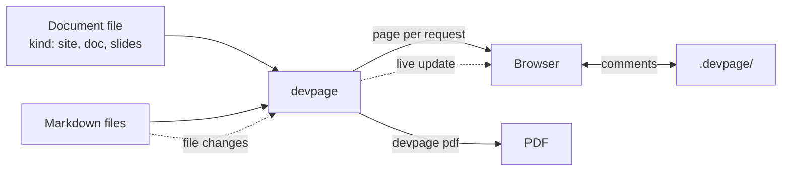

# devpage

devpage renders the documents a software project lives by — a site of system
docs, a design doc or PRD, a slide deck — from Markdown files in the
repository, live: point it at a document, open the address it prints, and
every page you have open updates the moment its file is saved — by you or by an
agent. These pages are devpage's own documentation, served by devpage.

## What devpage does

- **Three kinds of document.** A **site** of pages with a sidebar built from
  their Topics sections; a **doc** read top to bottom, split into chapter files,
  with an outline that follows you; a deck of **slides**, one file per slide, on
  a 16:9 stage.
- **Extended Markdown.** GitHub-flavoured Markdown with raw HTML allowed,
  highlighted code, and `mermaid` fences drawn as diagrams whose nodes link to
  other pages — in a light and a dark theme that follow the reader's system.
- **Widgets.** React components used as HTML tags in Markdown: callouts, tabs,
  file trees, source-beside-result examples, terminals and keycaps ship with
  devpage, and a project adds its own as `.tsx` files.
- **Live updates.** A file's change refreshes every open page in place,
  without a reload.
- **Comments.** Select text or hover a paragraph to start a thread. Threads
  are files in a `.devpage/` folder git ignores, so an agent can read them and
  resolve them by deleting the file.
- **Checked links.** Broken links show on the page while you write, and
  `devpage check` fails a test on them.
- **PDF.** `devpage pdf` prints a doc or a deck exactly as the browser shows it.
- **Local or deployed.** It runs on your machine, or for a team behind the
  auth proxy you already have.

What devpage may become beyond this is on the [vision](vision.md): ideas, not
commitments.

## How these docs are organized

Every subject has one home: a folder under `boxes/` whose README is its
entrance, with focused children for each mechanism and, when it has rules of its
own, a `constraints/` folder. The docs on `main` describe the system as it is; a design that
isn't built yet lives on a design branch until the code catches up. The words
each subject owns are in its glossary — the [viewer's](boxes/viewer/README.md#glossary)
for documents and pages, [engineering's](boxes/engineering/README.md#glossary)
for the development flow.

## Topics

### Start here

- [Vision](vision.md) — what devpage is for and where it is going. Ideas, not
  commitments.
- [Installing devpage](installing.md) — `cargo install devpage`, what PDF
  printing needs, and running it.
- [Getting started](getting-started.md) — the mental model, and a first
  site, doc and deck run end to end.

### The system

- [System catalog](boxes/README.md) — how devpage works, one subject per
  folder.
- [General constraints](constraints/README.md) — the rules every change is
  reviewed against.
