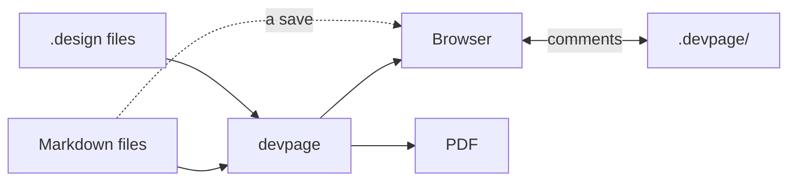

# devpage

devpage renders the documents a software project lives by — a site of system
docs, a design doc or PRD, a slide deck — from Markdown files in the
repository, and designs of its UI from `.design` files, live: point it at a document, open the address it prints, and
every page you have open updates the moment its file is saved — by you or by an
agent. These pages are devpage's own documentation, served by devpage.

## What devpage does

<KindCards />

<Cards>

- (file-code) [Extended Markdown](boxes/viewer/writing-a-document/markdown-that-works/README.md) — GitHub-flavoured Markdown with raw HTML allowed, highlighted code, and `mermaid` fences drawn as diagrams whose nodes link to other pages.
- (palette) [Light and dark](boxes/viewer/themes/README.md) — A light and a dark theme the reader can switch between.
- (puzzle) [Widgets](boxes/viewer/widgets/README.md) — React components used as HTML tags in Markdown: callouts, tabs, file trees, examples, terminals, keycaps, steps and cards ship with devpage; a project adds its own as `.tsx` files.
- (frame) [Designs](boxes/viewer/designs/README.md) — A UI an agent writes as code, a `.design` file in JSX syntax over Figma's node model: drawn on a canvas, clicked through as a prototype, embedded in any page, and fetched as a PNG so the agent can see its work.
- (refresh-cw) [Live updates](boxes/viewer/live-updates/README.md) — A file's change refreshes every open page in place, without a reload.
- (message-square) [Comments](boxes/viewer/comments/README.md) — Turn on comment mode, then select text or hover a paragraph; threads are files in a `.devpage/` folder git ignores, so an agent can read and resolve them.
- (link) [Checked links](boxes/viewer/checking-links/README.md) — Broken links show on the page while you write, and `devpage check` fails a test on them.
- (printer) [PDF](boxes/viewer/pdf/README.md) — `devpage pdf` prints a doc or a deck exactly as the browser shows it.
- (video) [Video](boxes/viewer/making-a-video/README.md) — `devpage video` records a deck to mp4, each slide's notes read aloud by GPT-Live.
- (server) [Local or deployed](boxes/viewer/deploying/README.md) — On your machine, or for a team behind the auth proxy you already have.

</Cards>

What devpage may become beyond this is on the [vision](vision.md): ideas, not
commitments. How these docs are laid out is on the
[system catalog](boxes/README.md#how-to-read-the-catalog).

## Contributors

- [Andrei Puni](https://github.com/andrei512) — author.
- [Radu Marias](https://github.com/radumarias) — clickable Mermaid diagrams:
  nodes that act as links, highlighted on hover.

## Topics

### Start here

- [Vision](vision.md) — what devpage is for and where it is going. Ideas, not
  commitments.
- [Installing devpage](installing.md) — `cargo install devpage`, what PDF
  printing needs, and running it.
- [Getting started](getting-started.md) — the mental model, and a first
  site, doc and deck run end to end.

### The system

- [System catalog](boxes/README.md) — how devpage works, one subject per
  folder.
- [General constraints](constraints/README.md) — the rules every change is
  reviewed against.
