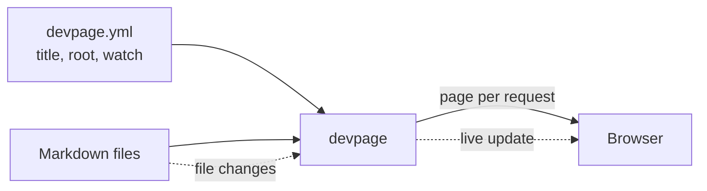

# devpage

devpage serves a folder of Markdown files from a repository as a live
document in the browser: you point it at a small `devpage.yml`, open the address it
prints, and every page you have open updates the moment its file is saved — by
you or by an agent. These pages are devpage's own documentation, served by
devpage.

## What devpage does today

- **One page frame for every document.** Each Markdown file is rendered as
  GitHub-flavoured Markdown, with raw HTML allowed, inside the same frame: a
  sidebar and the page, in a light and a dark theme that follow the reader's
  system setting.
- **Diagrams and highlighted code.** A `mermaid` fence is drawn as a diagram
  whose nodes can link to other pages; a fence that names a known language is
  syntax-highlighted.
- **Navigation from Topics.** The sidebar is the tree the pages form by
  listing their children in a `## Topics` section — nothing to configure
  separately.
- **Live updates.** A watched file's change refreshes every open page in
  place, without a reload.

That is the whole of it. devpage is a local program you build from source; it
renders one kind of page. Layouts per kind of document — design docs, PRDs,
slide decks — and the rest of the [vision](vision.md) are ideas, not built.

## How these docs are organized

Every subject has one home: a folder under `boxes/` whose README is its
entrance, with focused children for each mechanism and, when it has rules of its
own, a `constraints/` folder. The docs on `main` describe the system as it is; a design that
isn't built yet lives on a design branch until the code catches up. The words
each subject owns are in its glossary — the [viewer's](boxes/viewer/README.md#glossary)
for documents and pages, [engineering's](boxes/engineering/README.md#glossary)
for the development flow.

## Topics

### Start here

- [Vision](vision.md) — what devpage is for and where it is going. Ideas, not
  commitments, with what is built today set apart.
- [Installing devpage](installing.md) — the Rust toolchain, building,
  putting `devpage` on your `PATH`, and running it.
- [Getting started](getting-started.md) — the mental model, and a first
  document run end to end.

### The system

- [System catalog](boxes/README.md) — how devpage works, one subject per
  folder.
- [General constraints](constraints/README.md) — the rules every change is
  reviewed against.
