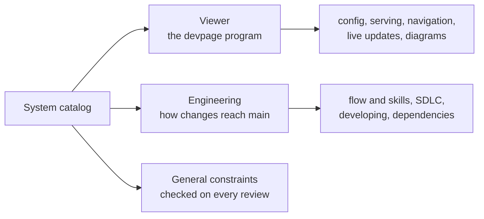

# The system catalog

Every part of devpage is explained here once, in the folder of the subject that
owns it. Start from the [vision](../vision.md) for where this is going; come
here for how the system works.

A box appears when its area is designed; the boxes are listed under
[Topics](#topics) below. Today there are two: the viewer, which is the program,
and engineering, which is how the program is changed.

## How to read the catalog

Folders are the hierarchy. Each subject folder has a README that is its
landing page: what the subject is and why it exists, a picture of its parts,
and a Topics section that leads down layer by layer — essentials that teach the
mental model, concept and task articles organized around what a reader wants to
do, mechanism pages that explain one part fully, and reference. Each child is a
subdirectory with its own README. Nesting describes conceptual
containment; a part that merely uses another does not contain it, so follow
links to reach the owner.

Beside the READMEs, a subject can hold:

- `constraints/` — one file per rule: the rule, why it holds and how it is
  checked. The subject's README lists them one line each.

- a glossary — the words the subject owns, as a section of its landing page.

## Constraints

Rules that belong to no single subject are the
[general constraints](../constraints/README.md), checked on every review. Every
other constraint lives with the subject it governs and applies to that
subject's descendants.

## Topics

- [Viewer](viewer/README.md) — the `devpage` program: serves a document and
  keeps open pages live.
- [Engineering](engineering/README.md) — how changes reach main and how the
  system documents itself.
