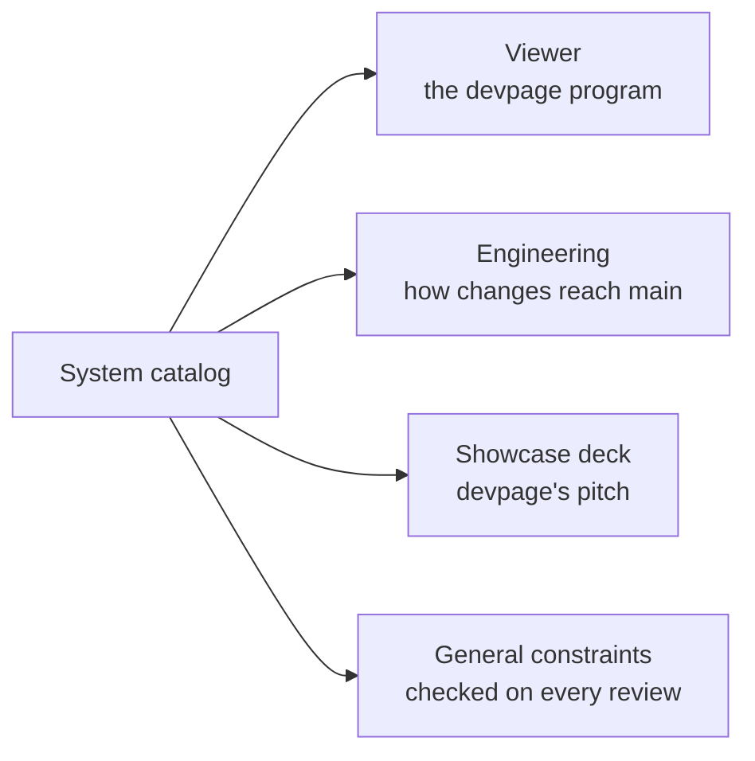

# The system catalog

Every part of devpage is explained here once, in the folder of the subject that
owns it. Start from the [vision](../vision.md) for where this is going; come
here for how the system works.

The boxes are listed under [Topics](#topics) below: the viewer, which is the
program; engineering, which is how the program is changed; and the showcase
deck, devpage presenting itself.

## How to read the catalog

Every subject has one home: a folder under `boxes/` whose README is its
entrance. Folders are the hierarchy, and nesting means containment — a part
that merely uses another does not contain it, so follow links to reach the
owner. One box looks like this:

<FileTree>

- viewer/
  - README.md — the entrance: what the subject is, a picture of its parts, and its Topics
  - glossary/README.md — the words it owns, one anchor per term
  - constraints/
    - the-served-folder-is-the-boundary.md — one rule per file: the rule, why, how it is checked
  - writing-a-document/README.md — a concept or task article
  - serving-pages/README.md — a mechanism page

</FileTree>

A README's Topics section leads down layer by layer — essentials that teach the
mental model, concept and task articles organized around what a reader wants to
do, mechanism pages that explain one part fully, and reference. A broad box
summarizes its parts and links to focused child designs; a focused box can
explain its behavior fully. Code belonging to a child remains bound by its own
and its ancestors' constraints. Each subject's words are in its glossary — the
[viewer's](viewer/glossary/README.md) for documents and pages,
[engineering's](engineering/README.md#glossary) for the development flow.

The docs on `main` describe the system as it is; a design that isn't built yet
lives on a design branch until the code catches up. A box appears when its area
is designed. Exact contracts stay beside their definitions in code; box docs
explain them and link to them. A change updates the explanations, contracts,
examples and incoming links it affects; a design decision lives in its owning
focused design, linked from the box entrance, and the reason for changing it
belongs in the commit message, not an ADR.

## Constraints

Rules that belong to no single subject are the
[general constraints](../constraints/README.md), checked on every review. Every
other constraint lives with the subject it governs, one file per rule listed
one line each in that subject's Topics, and applies to its descendants. Each
constraint file opens with the same note: it is a rule for automated AI code
review, which reads it on every change it governs and checks the diff
against it.

## Topics

- [Viewer](viewer/README.md) — the `devpage` program: serves a document and
  keeps open pages live.
- [Engineering](engineering/README.md) — how changes reach main and how the
  system documents itself.
- [The showcase deck](showcase/README.md) — devpage's own presentation: what
  each slide proves, and the rules that keep it current.
