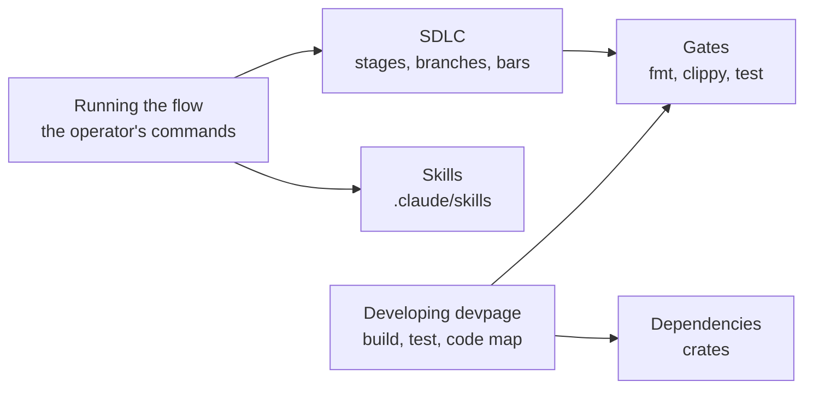

# Engineering

How devpage is understood, changed and checked: the development flow every
change goes through and the skills that run it, how to build and test devpage
itself, and what it is built from. Runtime behavior belongs to the part that
implements it — the [viewer](../viewer/README.md) — reached through the
[system catalog](../README.md).

Changes reach `main` through a flow of stages — design, prototype, plan, build,
review — each run by a skill the operator starts. The box docs on `main`
describe the system as it is; a design not yet built waits on its own branch.
Underneath sit the everyday mechanics of working on the code: a Rust build,
90 tests plus 20 that drive Chrome, and three gates, run by hand.

## Glossary

The words this box owns. Everything else in the docs uses them with these
meanings.

| Term | Meaning |
| --- | --- |
| **box** | A component or containing subsystem of devpage, documented in its own folder under `docs/boxes/` with a README as its entrance and, when it has rules, a `constraints/` folder. |
| **operator** | The person directing the work. Starts every stage, settles design questions, does the final review and merges into `main`. |
| **fork** | An agent that starts as a copy of the current session, carrying its conversation. The design session forks to prototype; `/build` forks one per lane. |
| **coordinator** | The agent running `/build`: dispatches lanes, has them reviewed, merges them into the design branch, carries design questions to the operator. Never writes code. |
| **lane** | A related chain of tickets given to one fork, worked in its own worktree on its own branch off the design branch. Parallelism comes from running several. |
| **ticket** | One step of a plan: a file in `docs/plan/` with `id`, `blocked-by` and `boxes` front-matter, saying what to build and its acceptance criteria. |
| **design branch** | `design/<name>`: the branch holding one design update — docs that describe a system not yet built — and, as the build proceeds, its code. Merges into `main` through the one pull request of the change. |
| **gate** | One of the three checks that must be green before any pull request opens: `cargo fmt --check`, `cargo clippy --all-targets -- -D warnings`, `cargo test`. |
| **task bar** | The review bar for a ticket going into a design branch (and for a direct pull request): acceptance criteria pass, the touched boxes' constraints hold, gates green, the system still works. |
| **drift bar** | The review bar for a design branch going into `main`: the code does what the docs claim, every expand–migrate–contract finished. |
| **expand–migrate–contract** | Changing a contract that already has callers in three moves: add the new one beside the old, move callers across, delete the old. The system works at every step. |

## Constraints

System-wide [constraints](../../constraints/README.md) apply here as
elsewhere. The SDLC's own rules are listed on the [SDLC](sdlc/README.md#topics)
page.

## Topics

### Essentials

- [Running the flow with skills](running-the-flow/README.md) — what the
  operator types for each stage, which skills agents start themselves, where
  each stage's output lands, and full flow versus hack versus direct PR.

### Concepts and tasks

- [Developing devpage](developing-devpage/README.md) — build, test and the
  gates; running the docs while you edit; what needs a rebuild; the code map.

### Mechanisms

- [SDLC](sdlc/README.md) — how a change reaches main, and how the box docs that
  describe the system are organized and kept true.

### Reference

- [Skills reference](skills-reference/README.md) — the twelve skills, who
  starts each, what goes in and comes out, and the upstream ones.
- [Dependencies](dependencies/README.md) — every crate devpage depends on and
  what it does here.
