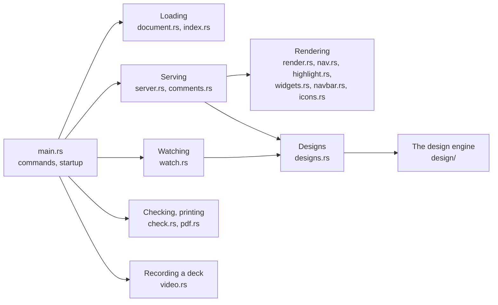

# Code map

Which module of devpage does what, and how `main` wires them together when
devpage starts. It is a mechanism page under
[Developing devpage](../developing-devpage/README.md), for someone finding
their way into the source.

devpage is one binary — `main.rs` and its modules — with its built-in assets
and the system widgets, and the [design engine](../../viewer/design-engine/README.md)
in three workspace crates beside it: `design/` (`devpage-design`),
`design/wasm/` (`devpage-design-wasm`) and `design/module/`
(`devpage-design-module`, which vendors the module).
Each part of the diagram opens the page that explains it.

| Module | Does |
| --- | --- |
| `src/main.rs` | The command line (clap): serving, `check`, `pdf` and `video`; wires the parts together and picks the address. |
| `src/document.rs` | `Document`: loads a document file of any kind, or a Markdown file as a one-chapter doc; the served folder and path safety; a site's `watch` patterns. `Entry`: the entry document, re-read when its file changes, keeping the last valid one while the file is invalid. |
| `src/index.rs` | The served folder's index of document files and of what `.gitignore` files exclude; finds a page's nearest site. |
| `src/watch.rs` | Watches the served folder, keeps the index current, sends `change` or `comments /<page>` on the change channel, and hands every changed path to the design store. |
| `src/designs.rs` | The design store — every design asked for, resolved in memory with the files it read, resolved again only when one of them changes; the `Designs` gRPC service and its watch stream; the PNG route; the canvas page; design problems for `devpage check`. |
| `src/server.rs` | The routes — the gRPC-Web watch route among them — request logging, the event stream, the comment requests and identity, and the built-in assets. |
| `src/render.rs` | A page, a doc or a deck inside its frame; an image of a `.design` file turned into its canvas; print mode; the problems bar; an invalid document file's page. |
| `src/nav.rs` | Reads Topics sections and builds a site's sidebar tree. |
| `src/highlight.rs` | Highlights fenced code for comrak, and marks Mermaid blocks. |
| `src/comments.rs` | The comment store: one YAML file per thread under `.devpage/comments/`, and the local author. |
| `src/check.rs` | Link checking, for the preview and `devpage check`, including external addresses. |
| `src/widgets.rs` | Widgets: the system and project widget sets and their problems; widget tags in Markdown turned into placeholders, and a slide's `<Notes>` taken out and read; TSX compiled by oxc, with helper imports versioned and compiled modules remembered. |
| `src/navbar.rs` | A site's navbar — its links, dropdowns and icons, which link holds the page shown, and its problems — and the light/dark switch with the head script that sets the theme before the page paints. |
| `src/icons.rs` | Icons by name, drawn as inline SVG: the vendored Lucide set and GitHub's mark. |
| `src/pdf.rs` | `devpage pdf`: serves the document internally and has chrome-headless-shell print it once every embedded design has painted, downloading the shell the first time; also downloads Chrome for Testing for `devpage video`. |
| `src/video.rs` | `devpage video`: checks the deck's notes, serves it internally, opens it in Chrome for Testing with the recorder from `assets/video.js`, and plays each slide's voice into the recording, pressing → between slides. `video/live.rs`: the narrator — the `DEVPAGE_` provider settings and the GPT-Live session. `video/silence.rs`: the silence rules, pure. |
| `src/slide_png.rs` | A slide as an image: serves the deck internally and has chrome-headless-shell screenshot slide `n` on a 1920 × 1080 screen once the page is ready, devpage's controls hidden. |
| `design/src/` | The engine: `parse` (text → syntax tree), `resolve` (→ scene), `render` (layout, display list, the CPU backend, PNG), `wire` (scenes and patches as messages), `proto` (the generated messages, and with the `server` feature the `Designs` service). |
| `design/wasm/src/` | The module: `lib.rs`, one `Design` per canvas — apply, lay out, paint on the CPU, hit-test; `gpu.rs`, the GPU backend on WebGPU. |
| `design/module/src/` | The module's builder: `main.rs` builds and vendors it, `lib.rs` computes and checks the fingerprint. |

What each crate does is in [Dependencies](../dependencies/README.md).

## How main wires it together

`main` in `src/main.rs` parses the command line. `devpage check` loads the
document, checks it and exits with `0` or `1`; `devpage pdf` loads it and
prints it; `devpage video` reads the narrator's settings, loads it and records
it, stopping on Ctrl-C, `SIGTERM` or `SIGHUP`. Serving starts in this order; a failure at any step stops devpage
with an error before anything is served.

<Steps>

1. Load the document
   From the path argument, or `.`, inside the served folder — the current
   folder or `--root` ([document files](../../viewer/configuration-reference/README.md#document-files)).
   It becomes the `Entry`, shared by the watcher and the server, which re-reads
   it whenever its file changes.

2. Build the index and create the design store
   The index of the served folder's document files and `.gitignore` files
   ([the index](../../viewer/document-index/README.md#the-index)); the watcher
   and the server share it. Then the design store, empty: it resolves a design
   the first time one is asked for
   ([in the server](../../viewer/design-engine/README.md#in-the-server)), and
   the watcher and the server share it too.

3. Create the change channel
   A broadcast channel of 16 messages carrying `change` and `comments /<page>`
   ([the channel and the stream](../../viewer/live-updates/README.md#the-channel-and-the-stream)).
   The link checker gets it too, and sends `change` when a background check of
   an external address finds it broken.

4. Start the watcher
   On the served folder, with the design store to hand changed paths to
   ([the watcher](../../viewer/live-updates/README.md#the-watcher)).
   `main` keeps it for the whole run; dropping it would stop watching.

5. Bind the address
   Exactly `--port`, or the first free port from 3030 up, on `--host` —
   `127.0.0.1` by default ([the address](../../viewer/serving-pages/README.md#the-address)).
   The identity is local — `git config user.name` — on a loopback address, and
   the `--user-header` header otherwise.

6. Print the address and serve
   `<title> → http://<host>:<port>` — `localhost` for a loopback address — then
   serve until devpage is stopped (`server::router_with_index`,
   [routes](../../viewer/serving-pages/README.md#routes)).

</Steps>
