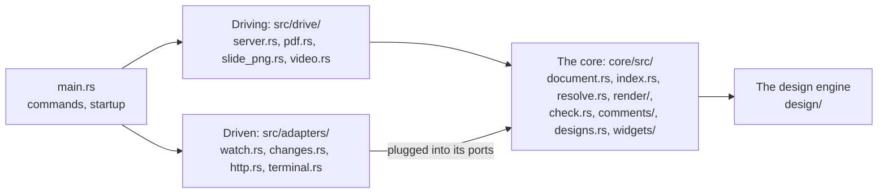

# Code map

Which module of devpage does what, and how `main` wires them together when
devpage starts. It is a mechanism page under
[Developing devpage](../developing-devpage/README.md), for someone finding
their way into the source.

devpage is arranged by role, in two crates. **The core**, `core/`
(`devpage-core`), is what a document is, how its pages render, what is wrong
with them, the comments on them and how designs resolve — with its built-in
assets and the system widgets. It depends on no I/O runtime: no tokio, axum,
notify, tonic, tokio-stream, reqwest or chromiumoxide, so the compiler refuses
a core that reaches for one. What it needs from outside it asks for through a
**port**: `Ask` and `Background` for external links, `Publish` for changes,
`Store` for comments, `Report` for problems. **The binary**, `src/`
(`devpage`), plugs **adapters** into those ports — `src/adapters/`: the change
bus, the network, the terminal, the file watcher — and drives the core from
`src/drive/`: the HTTP server and Chrome. The [design engine](../../viewer/design-engine/README.md)
is three more workspace crates beside them: `design/` (`devpage-design`),
`design/wasm/` (`devpage-design-wasm`) and `design/module/`
(`devpage-design-module`, which vendors the module).
Each part of the diagram opens the page that explains it.

| Module | Does |
| --- | --- |
| `src/main.rs` | The command line (clap): serving, `check`, `pdf`, `video`, `server` and the server commands; wires the parts together and picks the address. |
| `src/drive/client/` | The commands that talk to a devpage server: `mod.rs` parses and runs `context`, `publish`, `list`, `versions`, `comments`, `download` and `delete`, each in text or `--json`; `contexts.rs` keeps the contexts in `~/.devpage/config.yml`, runs a context's token command, and remembers which document each published file is per context; `api.rs` makes the server's API requests; `bundle.rs` zips exactly the files the check follows. |
| `core/src/document.rs` | `Document`: loads a document file of any kind, or a Markdown file as a one-chapter doc, every part resolved through the served folder; a site's `watch` patterns. `Entry`: the entry document, re-read when its file changes, keeping the last valid one while the file is invalid. |
| `core/src/index.rs` | The served folder's index of document files and of what `.gitignore` files exclude; finds a page's nearest site; holds the search index when built with one, and the module cache of the folder's widgets. |
| `core/src/search/` | The search index: the sections of everything the served document publishes, in tantivy, in memory, kept current as paths change; a query's pages, best first, each with its best sections and their snippets. `mod.rs` holds `Search` — `build`, `changed`, `search` — and the answer's types; `gather.rs` reads what is published into sections; `index.rs` is the schema and the indexing; `query.rs` turns a query into words and tantivy queries; `rank.rs` ranks sections and makes snippets. |
| `src/adapters/watch.rs` | Watches the served folder, keeps the index and its search index current, publishes a refresh or a page's comments on the change bus for the documents at `/` — a thread file only when the server's comment store didn't just write it — and has the design store and the index — with the widgets' memory of the files they read — forget every changed path, as its own listener rather than through the bus. |
| `core/src/lib.rs` | The core crate's modules, and what it may not depend on. |
| `core/src/changes.rs` | Typed changes (`Refresh`, `Comments` of a page) scoped to the documents under one mount prefix, or to every document, and the `Publish` port a producer publishes them through. |
| `src/adapters/changes.rs` | The change bus, on tokio: what any producer publishes reaches each subscriber — a page's event stream, the slide-PNG cache — that hears its scope. |
| `src/adapters/watch/set.rs` | The watch set: the served folder's deep and shallow folders, planned from the index's rules and every site's `watch` list, walking only what is in sight. |
| `src/adapters/watch/macos.rs` | The macOS watcher: an FSEvents stream per deep folder, kqueue on the shallow folders and the files directly in them. |
| `src/adapters/watch/inotify.rs` | The Linux watcher: `notify`'s inotify watcher, non-recursive on every folder in sight. |
| `src/adapters/watch/recursive.rs` | The watcher everywhere else: `notify`'s recommended watcher, recursive on the whole served folder. |
| `core/src/designs.rs` | The design store — every design asked for, resolved in memory with the files it read, resolved again only when one of them changes, and the changes it tells its listeners (`on_change`); a design's PNG and its validator, which block; design problems for `devpage check`. No transport and no runtime: the watch stream, the canvas page and painting off the async threads are the server's. |
| `src/drive/server.rs` | The HTTP adapter: one router built from one `Options` value — the routes, the gRPC-Web watch route and the search among them — request logging, the event stream, the comment requests and identity, the canvas page and drawing the PNGs the resolver names on blocking threads, and the built-in assets, each sent compressed as the browser accepts. |
| `core/src/resolve.rs` | The resolver: what a path in the served folder answers with — a page, a redirect, a file, a design's or a slide's PNG, or why there is none — decided from the documents alone; every address it answers with is under the served folder's mount. |
| `src/drive/server/watch_stream.rs` | The `Designs` gRPC service: the watch stream that sends each design a page shows — its scene, then what changed, or its problems — as the design store tells it of changes. |
| `src/drive/server/design_tests.rs`, `canvas_tests.rs`, `comments_browser.rs` | The tests that need the server: design PNGs and check over HTTP, the canvas in Chrome, the page script's comments in Chrome. |
| `src/drive/server_mode/` | `devpage server`. `config.rs`: every `DEVPAGE_*` variable, checked before listening, and the cache's limit from the volume's size. `api.rs`: publishing — the zip checked, kept in the bucket, recorded — listing, reading and deleting documents and versions; authors from the user header. `cache.rs`: versions unpacked on the PVC, each with its routers by mount, seeded from disk on start, made once however many misses arrive, never evicted while answering, and what goes chosen by the core's eviction policy. `versions.rs`: a request handed to a version's own router — the latest mounted at `/d/<id>`, a version at `/d/<id>/v/<n>` — whose preview asks no external address, the latest's on the document's own change bus, which a publish announces on. `pages.rs`: the front page, a page's versions for its version menu and banner, and a version's download — a PDF printed by Chrome or a design's PNG — rendered once and kept in the cache beside the version, counted with it. |
| `src/adapters/sqlite.rs` | The store: documents and their versions in one SQLite file — each version's document file, kind, title, author, size and sha-256 — numbers given once, deletes that make the version before the latest. |
| `src/adapters/bucket.rs` | The bucket: every version's zip, kept as uploaded, in S3, Azure Blob or a folder named by one URL, with credentials from object_store's own reading of the environment. |
| `core/src/cache.rs` | The cache's entries and the eviction policy port — which entries to delete when the cache is past its limit — with `Lru`, the least recently read first until it is at 90%. Pure. |
| `src/drive/server_mode_pages_browser.rs` | A published document's pages in Chrome: a page at the link swapping in each new version, an old version's banner and the version menu, and the download button's PDF, printed once. |
| `src/drive/server_mode_browser.rs` | A published document in Chrome: every request its pages make — widgets, search, the design watch stream, the events — stays under its mount, for the latest version and for a version at its own address. |
| `src/drive/server/canvas.rs` | The canvas page: one design alone in the window, drawn by the design script. |
| `core/build.rs` | The asset manifest — every built-in asset under its content address, compressed as brotli and gzip — and devpage's build id. |
| `core/src/addresses.rs` | `address`, the one function that makes every address a page loads from devpage — built-in assets, and under the served folder's mount system widgets, project widgets and their helpers — and the manifest `core/build.rs` made. |
| `src/drive/validators.rs` | The middleware that gives every response but the streams an ETag and answers `304`; `Accept-Encoding` negotiation. |
| `core/src/render/` | A page, a doc or a deck inside its frame; an image of a `.design` file turned into its canvas; print mode; the problems bar, from the problems it is given — rendering checks nothing itself; an invalid document file's page. `markdown.rs` is Markdown to HTML; `frame.rs` the frame of each kind; `sidebar.rs` a site's sidebar. |
| `core/src/markup.rs` | A page's Markdown read as text, before rendering: its front matter, its title, its `<Notes>`, and the scanner that finds widget tags outside code. A leaf: it uses nothing else in devpage. Its tests read notes from text alone. |
| `core/src/served.rs` | `ServedFolder`: the served folder and the boundary around it — resolving a path, link or URL inside it with symbolic links followed, refusing what lands outside, a file's address under the folder's **mount** and its name without it. Made once where serving starts and passed — `Served` takes one or, at the edges, a bare path served at `/` — so the mount reaches everything loaded from it. Every check that a path lies inside the served folder goes through it. A leaf. |
| `core/src/problem.rs` | `Problem`: one broken thing and where it was found, as checking, the navbar, widgets and comments report it. A leaf. |
| `core/src/nav.rs` | Reads Topics sections and builds a site's sidebar tree. |
| `core/src/highlight.rs` | Highlights fenced code for comrak, and marks Mermaid blocks. |
| `core/src/diagrams.rs` | The diagram engine: pele in QuickJS on a thread of its own, with the `URL` pele needs; each `mermaid` block of rendered HTML replaced by its SVG or its error block; the cache of drawings by source; the time and memory limits. |
| `core/src/comments/mod.rs` | Comments: the comment store port (`Store`: list, create, reply, resolve), `Comments` — the store the server writes through, which announces each write on the change bus — and the local author. |
| `core/src/comments/yaml.rs` | The comment store as files: one YAML file per thread under `.devpage/comments/`, the problems of a thread file that doesn't parse, and the bytes it last wrote, so the watcher skips the server's own writes. |
| `core/src/comments/memory.rs` | A comment store in memory, for tests. |
| `core/src/check.rs` | Link checking, for `devpage check` and for the preview (`Preview`, which the server holds and asks for each page's problems), including diagrams that don't parse. External addresses it hands to `core/src/external.rs`. `files` lists every file the check follows from a document — what `devpage publish` zips. The preview reports each problem the first time it finds it through its `Report` port: `src/adapters/terminal.rs` in devpage, a recorder in tests. |
| `src/adapters/terminal.rs` | The terminal as the preview's reporter: each problem printed on standard error once. |
| `core/src/external.rs` | Whether external addresses answer: asked once (twice if out of reach) for `devpage check`, in the background for the preview, which announces a refresh for every document on the change bus. How an address is asked is its `Ask` port, and where the preview's background asking runs its `Background` port: `src/adapters/http.rs` in devpage, a scripted table and the test's runtime in tests. |
| `src/adapters/http.rs` | The external-link checker devpage uses: `Http`, which asks an address over the network, and `Tokio`, which runs the preview's background asking on devpage's runtime; `offline`, the checker server mode's pages use, which asks none. Its tests run `devpage check` and the preview against a local web server. |
| `core/src/widgets/mod.rs` | The widget set a document has: the system and project widgets, each at its address, and their problems; a page's load set, preloaded from its head. |
| `core/src/widgets/tags.rs` | Widget tags in Markdown turned into placeholders (found by `core/src/markup.rs`'s scanner), and a slide's `<Notes>` taken out — text in, text out. |
| `core/src/widgets/compile.rs` | TSX compiled by oxc: the JSX runtime, the shims for widgets rendered by name, each helper import rewritten to the helper's own address. |
| `core/src/widgets/modules.rs` | The module cache, owned by the index: each module's files read once per change and its compiles remembered; a module's snapshot and version, from its source and every module it imports inside the served folder. |
| `core/src/navbar.rs` | A site's navbar — its links, dropdowns and icons, which link holds the page shown, and its problems — and the light/dark switch with the head script that sets the theme before the page paints. |
| `core/src/icons.rs` | Icons by name, drawn as inline SVG: the vendored Lucide set and GitHub's mark. |
| `src/drive/pdf.rs` | `devpage pdf`: serves the document internally and has chrome-headless-shell print it once every embedded design has painted or settled on its problems, downloading the shell the first time; also downloads Chrome for Testing for `devpage video`. |
| `src/drive/video.rs` | `devpage video`: checks the deck's notes, serves it internally, opens it in Chrome for Testing with the recorder from `assets/video.js` — the binary's one asset, and plays each slide's voice into the recording, pressing → between slides. `video/live.rs`: the narrator — the `DEVPAGE_` provider settings and the GPT-Live session. `video/silence.rs`: the silence rules, pure. |
| `src/drive/slide_png.rs` | A slide as an image: one chrome-headless-shell per server, started on the first shot and closed once idle, screenshots slide `n` in a tab of its own on a 1920 × 1080 screen once the page is ready, devpage's controls hidden; what it drew is kept until a watched file changes. |
| `design/src/` | The engine: `parse` (text → syntax tree), `resolve` (→ scene), `fonts` (font files, checked), `render` (layout, display list, the CPU backend, PNG), `wire` (scenes and patches as messages), `proto` (the generated messages, and with the `server` feature the `Designs` service). |
| `design/wasm/src/` | The module: `lib.rs`, one `Design` per canvas — apply, lay out, paint on the CPU, hit-test; `gpu.rs`, the GPU backend on WebGPU. |
| `design/module/src/` | The module's builder: `main.rs` builds and vendors it, `lib.rs` computes and checks the fingerprint. |

What each crate does is in [Dependencies](../dependencies/README.md).

## How main wires it together

`main` in `src/main.rs` parses the command line and, whatever the command,
starts the [diagram engine](../../viewer/diagrams/README.md#the-diagram-engine)'s
thread, which loads pele in the background while devpage gets on with the
rest, so the first page with a diagram doesn't wait for it. `devpage check` loads the
document, checks it and exits with `0` or `1`; `devpage pdf` loads it and
prints it; `devpage video` reads the narrator's settings, loads it and records
it, stopping on Ctrl-C, `SIGTERM` or `SIGHUP`. Serving starts in this order; a failure at any step stops devpage
with an error before anything is served.

<Steps>

1. Load the document
   From the path argument, or `.`, inside the served folder — the current
   folder or `--root` ([document files](../../viewer/configuration-reference/README.md#document-files)).
   It becomes the `Entry`, shared by the watcher and the server, which re-reads
   it whenever its file changes.

2. Build the index and create the design store
   The index of the served folder's document files and `.gitignore` files
   ([the index](../../viewer/document-index/README.md#the-index)), with the
   search index of their sections ([search](../../viewer/search/README.md));
   the watcher and the server share it. Then the design store, empty: it resolves a design
   the first time one is asked for
   ([in the server](../../viewer/design-engine/README.md#in-the-server)), and
   the watcher and the server share it too.

3. Create the change bus
   The bus carrying typed changes — a refresh, or a page's comments — each
   scoped to the documents it concerns
   ([the bus and the stream](../../viewer/live-updates/README.md#the-bus-and-the-stream)).
   The link checker gets it too, through its `Publish` port, and publishes a
   refresh for every document when a background check of an external address
   changes what pages show; the server's comment writes publish each page's
   comments on it as they land.

4. Gather the server's parts
   Every part above, in one `server::Options`, with the identity — local,
   `git config user.name`, on a loopback address, and the `--user-header`
   header otherwise; none with `--no-comments`, and the server has comments
   off — and the served folder's thread files, which are both the server's
   comment store and what the watcher follows.

5. Start the watcher
   `Options::watch`, on the watch set of the served folder, with the same
   index, design store, bus and thread files as the server, so a thread the
   server wrote is announced once
   ([the watcher](../../viewer/live-updates/README.md#the-watcher)).
   `main` keeps it for the whole run; dropping it would stop watching.

6. Bind the address
   Exactly `--port`, or the first free port from 3030 up, on `--host` —
   `127.0.0.1` by default ([the address](../../viewer/serving-pages/README.md#the-address)).

7. Print the address and serve
   `<title> → http://<host>:<port>` — `localhost` for a loopback address — then
   serve until devpage is stopped (`server::router(options)`,
   [routes](../../viewer/serving-pages/README.md#routes)).

</Steps>
