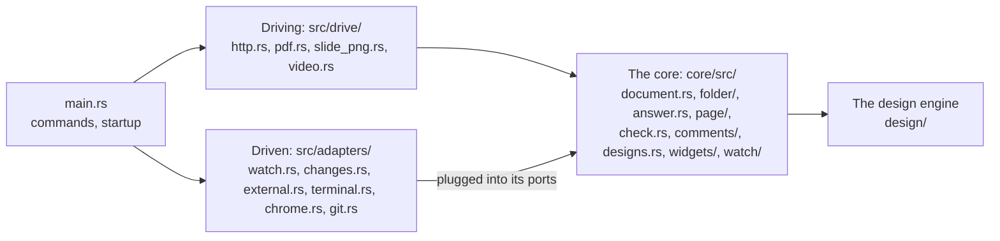

# Code map

Which module of devpage does what, and how `main` wires them together when
devpage starts. It is a mechanism page under
[Developing devpage](../developing-devpage/README.md), for someone finding
their way into the source.

devpage is arranged by role, in two crates. **The core**, `core/`
(`devpage-core`), is what a document is, how its pages render, what is wrong
with them, the comments on them and how designs resolve — with its built-in
assets and the system widgets. It depends on no I/O runtime: no tokio, axum,
notify, tonic, tokio-stream, reqwest or chromiumoxide, so the compiler refuses
a core that reaches for one. What it needs from outside it asks for through a
**port**: `Ask` and `Background` for external links, `Publish` for changes,
`Store` for comments, `Report` for problems. **The binary**, `src/`
(`devpage`), plugs **adapters** into those ports — `src/adapters/`: the change
bus, the network, the terminal, git, the file watcher, and the Chrome devpage
drives — and drives the core from `src/drive/`: the HTTP server, and the
commands that print, shoot and record through Chrome. The [design engine](../../viewer/design-engine/README.md)
is three more workspace crates beside them: `design/` (`devpage-design`),
`design/wasm/` (`devpage-design-wasm`) and `design/module/`
(`devpage-design-module`, which vendors the module).
Each part of the diagram opens the page that explains it.

| Module | Does |
| --- | --- |
| `src/main.rs` | The command line (clap): serving, `check`, `pdf`, `video`, `server` and the server commands; wires the parts together and picks the address. It aliases nothing at the crate root: every module names the core's modules as `devpage_core::…` and the binary's as `crate::adapters::…` and `crate::drive::…`. |
| `src/drive/api_types.rs` | The server API's JSON — `Published`, `Listed`, `Described`, `Version`, `Thread`, `NewThread`, `Started`, `Reply` — and `Refusal`, the status and text of a refused request: written by server mode and read by the client as the same types. The store's rows are not the API's JSON. |
| `src/drive/client/` | The commands that talk to a devpage server: `mod.rs` parses and runs `context`, `publish`, `list`, `versions`, `comments`, `download` and `delete`, each in text or `--json`; `contexts.rs` keeps the contexts in `~/.devpage/config.yml`, runs a context's token command, and remembers which document each published file is per context; `api.rs` makes the server's API requests and reads a refused one as its typed refusal; the zip it publishes is `adapters::bundle`'s. |
| `core/src/document.rs` | `Document`: loads a document file of any kind, or a Markdown file as a one-chapter doc, every part resolved through the served folder; a site's `watch` patterns; `downloads_as`, the one rule for what a kind downloads as — a doc or slides a PDF, a design a PNG — for the server's download and `devpage download`; `download_name`, the one rule for the file a document is saved as — by `devpage pdf`, `devpage video` and a download. |
| `core/src/folder/` | `Folder`: the served folder opened on its entry document. `index.rs`, its document index — every document file by kind, and what `.gitignore` files exclude; the entry document, re-read when its file changes, keeping the last valid one while the file is invalid; `owner`, a page's nearest site loaded as its file says now, and `widgets_owner`, the document naming a widgets folder. `sight.rs`: what a changed path means — whether it can matter at all (`matters`), whether it refreshes open pages by its site's `watch` list, and the folders to watch (`watched`, the watch set, walking only what is in sight); `changed` follows a burst of paths and answers the changes and whether the watch set may differ. It keeps no document but the entry. `served.rs`: `ServedFolder`, the boundary around it — resolving a path, link or URL inside it with symbolic links followed, refusing what lands outside, `named`, the file a path names or would name once it is there, a file's address under the folder's **mount** and its name without it — and for a path outside, neither: it is never named. Made once where serving starts — from `--root` on the command line, from a version's folder in server mode — and passed as `&ServedFolder` to everything loaded from it, so the mount reaches all of it. Every check that a path lies inside the served folder goes through it. |
| `core/src/search/` | The search index: the sections of everything the served document publishes, in tantivy, in memory, kept current a page at a time as paths change; a query's pages, best first, each with its best sections and their snippets. `mod.rs` holds `Search` — `build`, `changed`, `search` — and the answer's types; `gather.rs` finds what is published — through a `Pass`, which loads each document once and reads its widgets once — and keeps it as `Published`, with each Markdown file's footprint — what of it decides what is published — so a burst finds it again only when it can change it; and it reads what is published into sections, from each page's content phase — its `Rendered`, the widgets of the document that shows it expanded — each at its heading's id as the page renders it; `index.rs` is the schema and the indexing, a page at a time — what is published, when found again, compared with what the index holds, only what differs read again, and otherwise only the pages a burst reaches, then merged to one segment so it answers as one built fresh; `query.rs` turns a query into words and tantivy queries; `rank.rs` ranks sections and makes snippets. |
| `src/adapters/watch.rs` | The watcher's OS half: watches the folders the served folder says to watch, drops each path it says can't matter as it arrives (`sift`), gathers the rest into 50 ms bursts, canonicalized, and hands each to the core's `Listeners`, re-planning the watch when they say the watch set may differ or the platform needs it. It decides nothing a burst means. |
| `core/src/watch/` | The watcher's core half, local mode's one ordered response to saved files: `Listeners::changed` hears a burst of paths — the comments' threads another hand changed (`Comments::heard`), then the served folder (`Folder::changed`), then the design store and the module cache forget every path in the served folder outside `.devpage/`, and the slide PNGs (the `SlidePngs` port, given with `with_slide_pngs`) hear the same paths, then the page comments and the folder's refresh are published on the change bus, then the search index reads the paths again — and says whether the watch set may differ. Server mode builds none. |
| `core/src/lib.rs` | The core crate's facade, and what it may not depend on: its public modules — `addresses`, `answer`, `cache`, `changes`, `check`, `comments`, `designs`, `diagrams`, `document`, `external`, `folder`, `page`, `problem`, `search`, `watch` and `widgets` — and, for the core alone, `highlight`, `html`, `icons`, `markup` and `nav`. |
| `core/src/changes.rs` | Typed changes (`Refresh`, `Comments` of a page) and the `Publish` port a producer publishes them through, `publish(change)`: a bus serves one set of documents, so a change names no audience. |
| `src/adapters/changes.rs` | The change bus, on tokio: what any producer publishes reaches every subscriber — a page's event stream. Server mode keeps one per published document. |
| `src/adapters/chrome.rs` | One Chrome session — a Chrome with a profile folder of its own and the router its tabs load from, served on loopback — in one of two profiles: **shot** (chrome-headless-shell with its GPU on, honouring `DEVPAGE_CHROME_SANDBOX`) or **recording** (Chrome for Testing capturing its own tab). `open(path, Open)` waits until the page is ready, sending `X-Devpage-Shot` only when the tab is shot; a tab evaluates, waits, screenshots, prints to bytes, presses keys, sizes its window and closes. Downloads both browsers at the pinned `CHROME_VERSION`. `chrome::testing` is what the Chrome tests drive it with: one Chrome for the whole run, launched in the shot profile on a runtime of its own and killed as the run exits, a `Browser` of its own for each test — a browser context, with its own storage, cache and connections — a test's router served on loopback, and the waits on a page — `eval`, `until`, `until_is`, `next_frames`, `loaded`, `open` — with `answering`, which keeps every request a router answers, and `until_answered`, which waits on it. |
| `src/adapters/git.rs` | Git, asked for the user's name: the local comment author. |
| `src/adapters/watch/macos.rs` | The macOS watcher: an FSEvents stream per deep folder, kqueue on the shallow folders and the files directly in them. |
| `src/adapters/watch/inotify.rs` | The Linux watcher: `notify`'s inotify watcher, non-recursive on every folder in sight. |
| `src/adapters/watch/recursive.rs` | The watcher everywhere else: `notify`'s recommended watcher, recursive on the whole served folder. |
| `core/src/designs.rs` | The design store — every design asked for, kept resolved in memory with the files it read — through `ids::Remembering` — and resolved again only as far as a change to one of them reaches, held as the engine's `design`, the patches that made of each design's scene — encoded once from the edits resolving made, read by every watch stream (`next`) — and the changes it tells its listeners (`on_change`); a design's PNG and its validator, which block; a design's problems and what it is made of (`made_of`) — the files it read, one it asked for that isn't there named as it would be, and the folders it listed, so adding a file, or a font to its font folder, reaches what depends on the design — for `devpage check`, a page's problems, a slide's PNG and a publish's zip, which takes only the files there. One `Store` — one renderer, one 64 MB tile cache — holds the `Designs` of any number of folders, each under its mount, which its validators name; a folder no one holds leaves it with its tiles. No transport and no runtime: the watch stream and painting off the async threads are the server's. |
| `src/drive/http.rs` | The HTTP layer both modes serve through: one router built from one `App` — made by `App::local` for `devpage`, `App::printing` for what Chrome prints and records, `App::published` for a version in server mode, and `App::testing` for the tests, each taking only what varies, comments as `Commenting` (the threads and who writes them) or none — the routes, the gRPC-Web watch route and the search among them — request logging (`logged`), the event stream, the comment requests and the author each names through the comments' `Identity`, each answer turned into a response with its headers — a module `immutable` at its current address — and the PNGs it names drawn on blocking threads, and the built-in assets, each sent compressed as the browser accepts. |
| `core/src/answer.rs` | `Answers`: what `/`, a path in the served folder and a widget's module address answer with — a page (a design's canvas page among them), a redirect, a file, a design's or a slide's PNG, a widget's module and whether it is immutable, a module that throws why it can't be had, or why there is none — decided from the documents alone; every address it answers with is under the served folder's mount. |
| `src/drive/http/watch_stream.rs` | The `Designs` gRPC service: the watch stream that sends each design a page shows — its scene, then what changed, or its problems — as the design store tells it of changes. |
| `src/drive/http/design_tests.rs` | The design tests that need the server: design PNGs and check over HTTP. |
| `src/drive/server_mode/` | `devpage server`. `mod.rs`: `router(config)`, the one assembly, shared by `main` and the tests. `published.rs`: the published documents — `publish` in one order (checked, the document's lock, its number, the threads' carry worked out, the zip in the bucket, the version and its carry recorded in one transaction or not at all, its open pages told), `delete` of a document or a version in one order (lock, store, bucket, cache, open pages), lookup of a version by `Mount` (`Latest` at `/d/<id>`, `Pinned(n)` at `/d/<id>/v/<n>`, one `path()` for both), and the one maker of what a document needs — its change bus, dropped with it — and of what a version needs: its comments (the document's threads in the store, the version's folder, the document's bus), its router (whose preview asks no external address; the latest's on the document's bus and taking comments), its designs from the one design store every version shares, keyed by its pinned mount, and its download, a PDF printed by Chrome or a design's PNG, rendered once and kept in the cache. Locks are kept only while held. `routes/`: HTTP translation only, every error through `api_types::Refusal` — `api.rs` publishing, listing, reading and deleting, with authors from the server's one `comments::Identity` (the user header or `anonymous`); `comments.rs` the comments API, written through the latest version's comments; `versions.rs` a request handed to a version's own router under its mount; `pages.rs` the front page, from `assets/server-front.html`, `/favicon.ico` (`assets/logo.svg`, a copy of `docs/logo.svg`, and `favicon.ico`, it drawn at 64 pixels), a page's versions for its version menu and banner, and a version's download. `cache.rs`: versions unpacked on the PVC, each with its routers by mount, seeded from disk on start, made once however many misses arrive, never evicted while answering, and what goes chosen by the core's eviction policy. `config.rs`: every `DEVPAGE_*` variable, checked before listening, and the cache's limit from the volume's size. |
| `src/adapters/sqlite.rs` | The store: documents, their versions and their comment threads in one SQLite file — each version's document file, kind, title, author, size and sha-256 — numbers given once, a version recorded together with its threads' carry onto it in one transaction, deletes that make the version before the latest; threads and their messages, deleted with their document, and `DocumentThreads`, one document's threads as a comment store, by thread id. |
| `src/adapters/bucket.rs` | The bucket: every version's zip, kept as uploaded, in S3, Azure Blob or a folder named by one URL — `Bucket::open` is the one place `DEVPAGE_BUCKET_URL` is parsed — with credentials from object_store's own reading of the environment. |
| `src/adapters/bundle.rs` | A publish's zip: `pack` zips exactly the files the check follows from a document, for the client; `unpack` unpacks one, refusing an entry outside it or a symbolic link, for the server's check and its cache. |
| `core/src/cache.rs` | The cache's entries and the eviction policy port — which entries to delete when the cache is past its limit — with `Lru`, the least recently read first until it is at 90%. Pure. |
| `core/build.rs` | The asset manifest — every built-in asset under its content address, compressed as brotli and gzip — and devpage's build id. |
| `core/src/addresses.rs` | `address`, the one function that makes every address a page loads from devpage — built-in assets, and under the served folder's mount system widgets, project widgets and their helpers, each at the version the widgets give it — and the manifest `core/build.rs` made. It knows nothing of widgets. |
| `src/drive/validators.rs` | The middleware that gives every response but the streams an ETag and answers `304`; `Accept-Encoding` negotiation. |
| `core/src/page/` | A page, in two phases. **Content** (`content.rs`): one file's Markdown, its widgets' tags expanded, as `Rendered` — its HTML and every link it holds, by file and line, none of the frame's; the preview and `devpage check` judge it, and `ids` answers which ids a link into another page — a Markdown file, as the document `shown_in` shows it, or a doc with its chapters' prefixes — can land on, from that page's content phase, without building its frame; `Rendered::ids` and `Rendered::heading_ids` are the one source of a content's ids, for the check and search. **Frame** (`frame.rs`): `Rendered` put inside its document's frame — a site's page, a doc, a deck — with the problems found listed above it, from one navigation tree per page; print mode; an invalid document file's page. The page checks nothing itself. `markdown.rs` is Markdown to HTML, an image of a `.design` file turned into its canvas, and `heading_ids`, the ids its headings render with, read from the HTML; `navbar.rs` a site's navbar — its links, dropdowns and icons, which link holds the page shown, its problems and where it leads, for the check — and the light/dark switch with the head script that sets the theme before the page paints; `sidebar.rs` a site's sidebar; `canvas.rs` the canvas page, one design alone in the window, drawn by the design script. It re-exports the one `escape`, for the binary's own HTML. |
| `core/src/markup.rs` | A page's Markdown read as text, before rendering: its front matter, its title, its `<Notes>`, and the scanner that finds widget tags outside code. A leaf: it uses nothing else in devpage. Its tests read notes from text alone. |
| `core/src/problem.rs` | `Problem`: one broken thing and where it was found, as checking, the navbar, widgets and comments report it. A leaf. |
| `core/src/nav.rs` | Reads Topics sections and builds a site's sidebar tree, reading each page once a tree; `tree_and_topics` hands back the Topics it read too. |
| `core/src/highlight.rs` | Highlights fenced code for comrak, and marks Mermaid blocks. |
| `core/src/diagrams.rs` | The diagram engine: pele in QuickJS on a thread of its own, with the `URL` pele needs; each `mermaid` block of rendered HTML replaced by its SVG or its error block; the cache of drawings by source; the time and memory limits. |
| `core/src/comments/mod.rs` | Comments: `Comments`, the only way a thread is written — the page key, a new thread's page a file in the served or version folder, reply and resolve by thread id, carry onto a new version on the page's content render with widgets expanded, one announcement per write on the change bus, and `heard` for the watcher — `Identity`, who writes, and the comment store port (`Store`: list, create, reply, resolve, attached, heard — by thread id). A carry is worked out as a `Carry`, written by nothing here: the publish records it with its version, then `carried` announces it. |
| `core/src/comments/yaml.rs` | The comment store as files: one YAML file per thread under `.devpage/comments/<page>/`, found by its id through the served folder; the problems of a thread file that doesn't parse; and the bytes it last wrote, so what it heard is never the server's own write. |
| `core/src/comments/memory.rs` | A comment store in memory, for tests. |
| `core/src/comments/anchor.rs` | A thread carried onto a new version of its page: the page's text as the page script reads it, and where the thread's quote is in it now — with its context, with new context, or gone. Pure. |
| `core/src/check.rs` | Link checking, for `devpage check` and for the preview (`Preview`, which the server holds and asks for each page's problems), including diagrams that don't parse. Both judge a page by its content phase's `Rendered` — for the preview, the very one its page then shows — and a link into another page by `page::ids`; neither renders a page itself. External addresses it hands to `core/src/external.rs`. Both start from a folder opened on the document, whose owners decide the site each page is checked as. Both take the served folder's design store, which answers a design's problems and its files. `files` lists every file the check follows from a document — what `devpage publish` zips; `drawn_from` every file a deck's slides are drawn from — what a slide's PNG is forgotten by. The preview reports each problem the first time it finds it through its `Report` port: `src/adapters/terminal.rs` in devpage, a recorder in tests. |
| `src/adapters/terminal.rs` | The terminal as the preview's reporter: each problem printed on standard error once. |
| `core/src/external.rs` | Whether external addresses answer: asked once (twice if out of reach) for `devpage check`, in the background for the preview, which announces a refresh for every document on the change bus. How an address is asked is its `Ask` port, and where the preview's background asking runs its `Background` port: `src/adapters/external.rs` in devpage, a scripted table and the test's runtime in tests. |
| `src/adapters/external.rs` | The external-link checker devpage uses, the adapter half of `core/src/external.rs`: `checker`, which puts together `Http`, asking an address over the network, and `Tokio`, running the preview's background asking on devpage's runtime; `offline`, the checker server mode's pages use, which asks none and runs nothing (`Nowhere`). Its tests run `devpage check` and the preview against a local web server. |
| `core/src/widgets/mod.rs` | The widget set a document has: the system and project widgets, each at its address, and their problems; a system widget's version; a page's load set, preloaded from its head. |
| `core/src/widgets/request.rs` | A request for a widget's module: the file its address names — the one place an import's extensions are tried — compiled with the names of the document whose widgets folder holds it, whether it was asked for at its current version, or why it or a helper it reaches doesn't compile. |
| `core/src/widgets/tags.rs` | Widget tags in Markdown turned into placeholders (found by `core/src/markup.rs`'s scanner), and a slide's `<Notes>` taken out — text in, text out. |
| `core/src/widgets/compile.rs` | TSX compiled by oxc: the JSX runtime, the shims for widgets rendered by name, each helper import rewritten to the helper's own address. |
| `core/src/widgets/modules.rs` | The module cache, one per served folder: each module's files read once per change and its compiles remembered; a module's snapshot, version and address, from its source and every module it imports inside the served folder. |
| `core/src/html.rs` | HTML as devpage reads and writes it: the one `escape` and its inverse, a tag's attributes, every value one attribute takes in a page, and `Link::classify` — what a link's address names: an address on the web, one with another scheme, or a file with its fragment. The renderer, the navbar, the sidebar's Topics and the link check all read links through it. Crate-private: `page` re-exports `escape` for the binary's own HTML. A leaf. |
| `core/src/icons.rs` | Icons by name, drawn as inline SVG: the vendored Lucide set and GitHub's mark. |
| `src/drive/pdf.rs` | `devpage pdf`: the document's print call, and its print-mode page opened in a shot session, as paper, and printed to bytes once every embedded design has painted or settled on its problems. |
| `src/drive/video.rs` | `devpage video`: checks the deck's notes, serves it in a recording session, runs the recorder from `assets/video.js` in its tab, and plays each slide's voice into the recording, pressing → between slides. `video/narrator.rs`: the narrator — the `DEVPAGE_` provider settings and the GPT-Live session. `video/silence.rs`: the silence rules, pure. |
| `src/drive/slide_png.rs` | A slide as an image: one shot session per server, started on the first shot and closed once idle, screenshots slide `n` in a tab of its own on a 1920 × 1080 screen once the page is ready, devpage's controls hidden, from routes with comments and problems off; what it drew is kept, with the files its deck is drawn from (`check::drawn_from`), until the watcher says one of them changed — a shot being drawn meanwhile isn't kept — so another deck's files, a comment write and a broken link fixed forget nothing. |
| `src/drive/browser_tests/` | Every test suite that drives Chrome, one `#[cfg(test)]` module per suite, each on `chrome::testing`: `page_script` (widgets, live updates, decks, the navbar, the sidebar and its search, swaps), `canvas` (the canvas on the GPU and the CPU against the server's PNG, interactions, embedding, printing), `comments` (the page script's comments), `pdf` (what a doc and a deck print to), `slide_png` (a slide's PNG), `video` (a deck recorded, with a stand-in voice and with GPT-Live), and on a published document `server_mode` (every request stays under its mount), `server_mode_pages` (versions, the banner, the menu, the download button) and `server_mode_comments` (its threads across the page, the API and a publish). |
| `design/src/` | The engine, a core with adapters ([How the engine is built](../../viewer/design-engine/README.md#how-the-engine-is-built)). The core, which links no rasterizer: `parse` (text → syntax tree), `ids` (element ids matched across saves; `Remembering`, files read with each design file's last parse kept), `tree` (node ids, order keys, children), `scene` (what a resolved design is — nodes, colours, image files, the id index, the `Files` port; `edit`, the edits from one scene to the next by id, with the files they bring, applied all or nothing), `resolve` (→ scene; `again`, a design kept resolved and a change resolved again only as far as it reaches, into edits), `fonts` (font files, checked), `render` (the renderer and its text; `layout` — with `run`, a run's children each laid out on their own: `fill`, its `"fill"` children's share from a flex tree of its own; `free`, a frame with no layout's children at their own places — `painter`, `drawing`, `update` — a kept drawing and its damage), `display` (the drawing commands, property trees, chunks, the list's index, a run's children as spaces placed by the prefix sums of their sizes, or by their own places in an R-tree, the one paint entry point and its port `Target`, hit testing), `prefix_sums` (a sequence with every prefix's summary in log time), `tiles` (tiles, levels, a view's tiles, the cache and damage), `design` (a design as held while shown — its scene and its drawing in each theme asked for, brought along by each edit, the damage to its tiles, what to paint for a tile or a strip, a view's tiles, a click — and the one rule for a scene that can't be drawn), `shadow`, `atlas`, `compare`, `wire` (scenes and edits as messages, and back; `patch`, edits as the patch the store logs and the watch stream sends), `proto` (the generated messages, and with the `server` feature the `Designs` service). The adapters: `cpu` (the `vello_cpu` paint backend, a tile's pixels) and `png` (the PNG written band by band). |
| `design/wasm/src/` | The module: `lib.rs`, one `Design` per canvas, bindings over the engine's `design` and the canvas's `tiles::Plan` — apply a stream message to it, its damage handed to the plan inside the module; a frame's work (`frame`) and a tile's arrival (`arrived`, `missed`) for the CPU's compositor; the tiles' `level`; a tile on the CPU for the worker, hit-test; `vello_backend.rs`, the `vello` paint backend; `compositor/`, the compositor on WebGPU carrying out the plan — `mod.rs` a frame, `paint.rs` a tile into its texture, `pass.rs` the composite pass. |
| `core/assets/design.js` and its modules | The design script: `design.js` loads the engine and starts the page's canvases; `design-stream.js` the watch stream; `design-canvas.js` a canvas — view, pointer, interactions, overlays, an embed's backdrop; `design-tiles.js` the compositor on the CPU, carrying out the plan with the worker's paintings; `design-worker.js` the worker that paints them. |
| `design/module/src/` | The module's builder: `main.rs` builds and vendors it, `lib.rs` computes and checks the fingerprint. |

What each crate does is in [Dependencies](../dependencies/README.md).

## How main wires it together

`main` in `src/main.rs` parses the command line and, whatever the command,
starts the [diagram engine](../../viewer/diagrams/README.md#the-diagram-engine)'s
thread, which loads pele in the background while devpage gets on with the
rest, so the first page with a diagram doesn't wait for it. `devpage check` loads the
document, checks it and exits with `0` or `1`; `devpage pdf` loads it and
prints it; `devpage video` reads the narrator's settings, loads it and records
it, stopping on Ctrl-C, `SIGTERM` or `SIGHUP`. Serving starts in this order; a failure at any step stops devpage
with an error before anything is served.

<Steps>

1. Load the document
   From the path argument, or `.`, inside the served folder — the current
   folder or `--root` ([document files](../../viewer/configuration-reference/README.md#document-files)).
   It becomes the entry document of the folder the app opens on it
   (`Folder::new`, below), shared by the watcher and the server; the folder
   re-reads it whenever its file changes.

2. Create the process-wide parts
   The bus carrying typed changes — a refresh, or a page's comments — to
   every open page of the served folder
   ([the bus and the stream](../../viewer/live-updates/README.md#the-bus-and-the-stream));
   the link checker, on the network and reporting to the terminal, which
   gets the bus through its `Publish` port and publishes a refresh when a
   background check of an external address changes what pages show; and
   the identity — local, `git config user.name` from `adapters::git`, on a
   loopback address, and the `--user-header` header otherwise; none with
   `--no-comments`, and the server has comments off. With an identity come
   the served folder's comments: its thread files behind `Comments`, which
   the server writes through — publishing each page's comments on the bus as
   they land — and the watcher hears hand edits through.

3. Make the app
   `http::App::local` takes them and builds the rest. Opening the folder on
   the document indexes its document files and `.gitignore` files
   ([the index](../../viewer/document-index/README.md#the-index)); beside it,
   the search index of their sections ([search](../../viewer/search/README.md)),
   an empty module cache, and the design store, empty: it resolves a design
   the first time one is asked for
   ([in the server](../../viewer/design-engine/README.md#in-the-server)).
   The watcher and the server share all four.

4. Start the watcher
   `App::watch`, on the watch set of the served folder: the watcher hands
   its bursts to the core's `Listeners`, built with the same folder, design
   store, module cache, comments, bus and search index as the server, so a
   thread the
   server wrote is announced once
   ([the watcher](../../viewer/live-updates/README.md#the-watcher)).
   `main` keeps it for the whole run; dropping it would stop watching.

5. Bind the address
   Exactly `--port`, or the first free port from 3030 up, on `--host` —
   `127.0.0.1` by default ([the address](../../viewer/serving-pages/README.md#the-address)).

6. Print the address and serve
   `<title> → http://<host>:<port>` — `localhost` for a loopback address — then
   serve until devpage is stopped (`http::logged(http::router(app))`,
   [routes](../../viewer/serving-pages/README.md#routes)).

</Steps>
