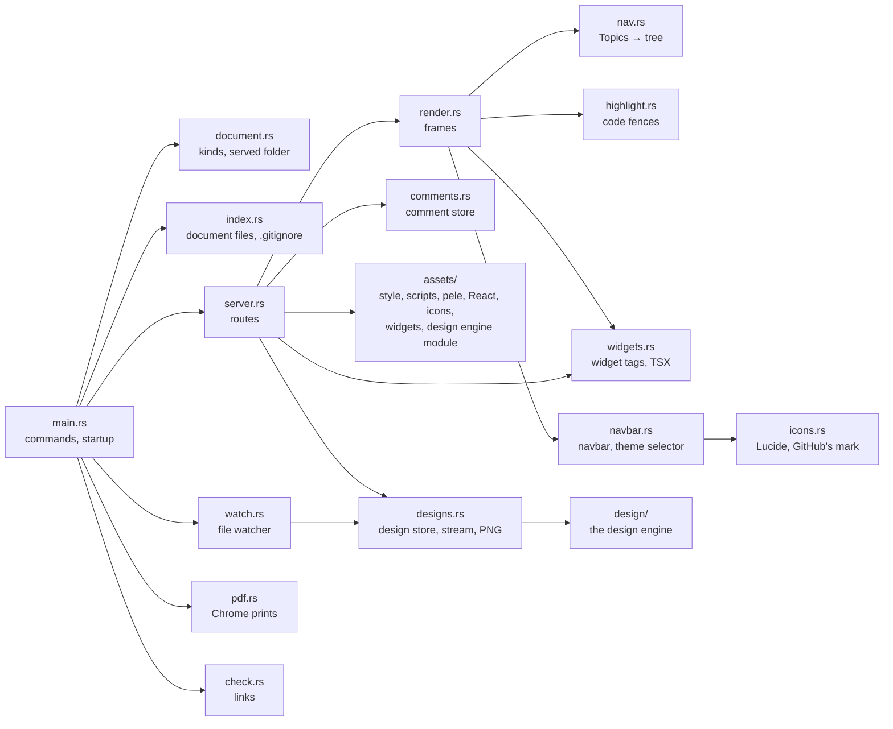

# Developing devpage

How to work on devpage itself: build it, run its tests and the three gates,
run the documentation while you edit it, and know what needs a rebuild. It
also maps the source — which module does what, and how `main` wires them — and
says what the test suite covers and what it doesn't. It is a task article
under [Engineering](../README.md); how a change travels from idea to `main` is
the [SDLC](../sdlc/README.md).

You need the toolchain from [Installing devpage](../../../installing.md#what-you-need).
Every command runs from the repository root.

## Build and run

```sh
cargo build                 # debug build, target/debug/devpage
cargo run -- docs           # build if needed, then serve these docs
```

Building devpage builds no WebAssembly: the
[design engine](../../viewer/design-engine/README.md)'s module for the browser
is [vendored](#the-vendored-design-engine) in `assets/vendor/`, and the binary
embeds it.

Run it from the repository root: the folder devpage starts from is the
[served folder](../../viewer/writing-a-document/README.md#the-served-folder),
so the whole repository is served and the docs' links to `../LICENSE`
work. `cargo run -- <args>` passes everything after `--` to
devpage, so `cargo run -- check docs` and `cargo run -- pdf docs/talks/devpage`
work the way an installed `devpage` would. It prints the address —
`http://localhost:3030`, or the next free port up if another devpage already
holds 3030.

### The vendored design engine

`assets/vendor/design-engine.wasm` and `assets/vendor/design-engine.js` are
the engine built for the browser and its bindings, committed like the pele
bundle. Rebuild them after changing anything they are built from:

```sh
cargo run -p devpage-design-module
```

It builds `devpage-design-wasm` for `wasm32-unknown-unknown` in the
size-optimised `wasm` profile, into `target/design-module/`, runs wasm-bindgen
on it as a library, and writes the two files and
`assets/vendor/design-engine.fingerprint`
([Dependencies](../dependencies/README.md#devpage-design-module-the-modules-builder)).
The target is the one `rust-toolchain.toml` names, so rustup adds it in a
checkout; nothing else needs it. The fingerprint is a SHA-256 of everything
the module is built from: every file in `design/src/`, `design/fonts/`,
`design/proto/`, `design/wasm/src/` and `design/module/src/`, the three crates'
`Cargo.toml` and `design/build.rs`, the `wasm` profile, and the locked version
of every package in the module's and wasm-bindgen's dependency trees. The
toolchain is recorded beside it but not hashed, so the same sources give the
same fingerprint on every machine. `cargo test` fails while the recorded
fingerprint differs from the sources', and says to run the command.

## The edit–save–refresh loop

What you edit decides what you have to do to see it:

| You change | What it takes |
| --- | --- |
| A Markdown page under `docs/` | Save. Pages are read on every request and the open page [updates itself](../../viewer/live-updates/README.md). |
| A page's Topics list | Save. The sidebar is rebuilt on every request, on every open page. |
| `docs/devpage.yml`, or any document file | Save. Document files are read on every request and the index of them is kept current by the watcher. |
| Rust code in `src/` | Stop devpage (Ctrl-C) and `cargo run` again, then reload the browser tab. A page reconnects to its event stream by itself, but doesn't fetch itself again on reconnecting. |
| `assets/style.css`, `assets/devpage.js`, `assets/design.js`, `assets/vendor/pele.js` | Rebuild and restart — they are compiled into the binary with `include_str!` — then do a full reload of the tab. Live updates and in-place links swap only the page content and its navigation, never the stylesheet or the scripts. |
| A `.design` file, or an image a design uses | Save. The design store resolves again the designs made from that file and the open canvases redraw in place ([Designs](../../viewer/designs/README.md)). |
| The engine in `design/src/`, the module in `design/wasm/src/`, or `design/proto/design.proto` | Run `cargo run -p devpage-design-module` to rebuild the [vendored module](#the-vendored-design-engine), then rebuild and restart devpage, and do a full reload of the tab — the binary embeds the module. After changing what the engine draws, run `DEVPAGE_UPDATE_REFERENCES=1 cargo test -p devpage-design` to rewrite the reference PNGs in `design/testdata/`, and look at them before committing. |

## Tests

```sh
cargo test                  # 171 tests in the four crates; needs no network and no Chrome
cargo test -- --ignored     # the 46 tests that drive chrome-headless-shell
```

`cargo test` runs every crate in the workspace: 109 in `devpage`, 56 in the
engine `devpage-design`, 4 in `devpage-design-wasm`, whose tests run
natively, and 2 in `devpage-design-module`. Tests are written as `#[cfg(test)]` modules beside the code they
test — the canvas's Chrome tests in `src/designs/canvas_tests.rs`, a child
module of `designs`; the
`tests/` folder holds only fixtures — `tests/fixtures/sync-design`, a doc of
three chapters that the doc and PDF tests load. Route tests start the real router on a free port on
`127.0.0.1` and talk to it with `reqwest`; external-link tests point the
checker at a local web server, so the suite needs no network. The 46 tests
marked `#[ignore]` drive chrome-headless-shell through chromiumoxide — the
copy [`devpage pdf` downloads](../../viewer/pdf/README.md#the-chrome-it-drives)
into devpage's cache folder, fetched by the first test that needs it — never
a Chrome installed on the machine, so a run puts nothing in the macOS Dock.
They run in parallel. Run them with `--ignored` after changing the page
script, the design script, the module, the stylesheet, a widget, print mode
or `devpage pdf`. The canvas tests start it with `--enable-unsafe-webgpu` and
`--enable-gpu`: the shell keeps its GPU process off without the second, and
then a screenshot holds black where a WebGPU canvas is; with it, WebGPU gets
the machine's real adapter and the screenshot is the canvas as a reader sees
it.

**The watcher's tests need file-system events.** Nine tests save a file and
wait for devpage to hear of it through `notify`:

- six `watch` tests — `a_saved_page_refreshes_open_pages`,
  `a_comment_thread_always_reaches_its_page`,
  `the_watch_list_follows_the_entry_file`,
  `a_sites_watch_list_narrows_only_its_own_folder`,
  `the_entrys_watch_list_does_not_quiet_another_folder` and
  `widget_files_refresh_whatever_watch_says` (the seventh,
  `ignored_files_and_files_outside_watch_do_not_refresh`, expects no event and
  passes either way);
- `server::the_entry_document_follows_its_file_without_a_restart`;
- two Chrome tests in `comments::browser` —
  `selected_text_becomes_a_thread_in_the_margin_and_in_the_store` and
  `a_live_update_with_the_comments_shown_swaps_the_page_in_place`.

Where the platform delivers no events to the test process —
`notify` itself receives nothing, as can happen in some sandboxed or
restricted sessions on macOS — those tests fail while everything else passes.
That says nothing about the change under test; run them where file events
work before calling the suite green.

| Module | Tests | Ignored | What they pin |
| --- | --- | --- | --- |
| `check` | 15 | | A site's navbar reported once and its links followed; a missing logo reported once; widget problems — an unknown widget tag, a project widget with a system widget's name, a widget or a helper that doesn't compile, a widgets folder's problems reported once however many pages; missing files and headings and links climbing out of the served folder; a slide number the deck doesn't have; a heading in a doc checked against the ids the doc renders; Topics checked against the page's own site, and a page in no site checked as a doc; a broken linked document named by its address, not an absolute path; each external address asked once and every link to it reported; an unreachable address asked again before `devpage check` reports it; the preview's background check refreshing open pages; an unreachable address shown only after three failures in a row and cleared when it answers; the fixture doc, the devpage talk and devpage's own docs free of broken internal links. |
| `comments` | 4 | 6 | A thread's whole life leaving `git status` clean; a thread file that doesn't parse named and left alone; the local author without a `.git` folder; timestamps. In Chrome: commenting off until comment mode is on, a comment made, the switch remembered after a reload; selected text becoming a thread in the margin and the store, then detaching; a paragraph comment on a nested list anchoring again after a reload; the comment icon and a wide table staying inside 390 px and 820 px windows; **C** on a deck; a live update with the comments shown swapping the page in place rather than reloading it. |
| `designs` | 15 | 25 | The store announcing only the designs made from a changed file, and resolving a design again when a missing import appears; a drawing too big to paint a problem in the store and in what `devpage check` reads; a real file named like a design's PNG served as it is; a link to a design's PNG checked as the design; no design file — a pasted zero-width space in a colour, deep nesting, a huge number, a truncated file — stopping the store, which still sees saves afterwards; nothing outside the served folder read; a PNG, or `422` and the problems, and `404` for a design outside the served folder or missing; a design as the entry document; the design service answering only `Watch`; the canvas page titled without `.design`; the watch stream over gRPC-Web sending the scene, a patch of only what changed, nothing for a no-op, problems, and a deleted design coming back when written again; one stream over several designs sending each scene once, patches naming their design, going on after one is deleted, and bringing it back when it is written again; `devpage check` naming a broken embedded design's `file:line:col`. In Chrome: an embed inside a widget on a page in a subfolder finding its design beside the page; the canvas on the GPU and on the CPU each matching the PNG by the engine's comparison, over the whole drawing and a margin of plain page around it; a click navigating, back returning, an overlay opening and closing; an interaction inside an instance from another folder opening its own target; the wheel zooming about the pointer and panning; an undone typo clearing the problems; a deleted design, on its canvas page and embedded, coming back when written again — after a page refetch too — without reopening its stream meanwhile; a canvas saying so when the engine doesn't load; an embedded design drawing at its own size and surviving a page edit; an embedded design centred at its own size and only ever scaled down, to the page's width or the window's height; the stage's link opening the design it shows on its canvas page; a small design not enlarged on its canvas page; a doc printing its embedded design; eight embedded designs painting through one stream while the page still loads; a doc with eight embeds printing as fast as one with one; leaving the last design in place closing the stream; an embed with problems surviving a page refetch; the canvas page's light/dark switch repainting what a design leaves transparent and remembered across a reload; an embedded design painting again when the page switches theme; a design inside a project widget on a slide not yet shown drawing once shown, inside the slide, and printing promptly; an embed inside a widget keeping the design it navigated to, and its way back, across a page refetch; the canvas page's switch leaving the problems bar whole in light and dark; a design on a slide scaled down to a 1280 × 720 or 1600 × 900 window painted whole on the GPU and on the CPU, each corner its own color, and a click landing where the reader sees it. |
| `document` | 8 | | Each kind parsed; a navbar read in order with its icons and dropdowns, `sidebar` and `theme-selector`, and its bad shapes refused; bad kinds, fields and missing files rejected; a Markdown file as a one-chapter doc; the served folder as boundary and address root; a document outside it refused; a site's `watch` list; only YAML with a devpage `kind` is a document file. |
| `icons` | 1 | | Lucide icons and GitHub's mark drawn; unknown names known as such. |
| `index` | 4 | | Document files found outside what `.gitignore` excludes; the nearest site above a page; nested `.gitignore` files and `.git` folders out of sight; changes keeping it current. |
| `main` | 1 | | Taking the next port when the first is busy. |
| `navbar` | 6 | | Links, dropdowns, icons and icon-only links rendered in order; the link holding the page shown highlighted, a dropdown holding it too; missing files and unknown icons as problems; no navbar rendering nothing, the comment-mode switch in the corner, and the theme selector off with `theme-selector: false` while the switch stays. A logo before the title and as the tab's icon, for a doc and a deck too; a missing logo as a problem and the page shown without it. |
| `nav` | 3 | | Links and `###` groups read from the Topics section only; the tree stopping at a cycle; a Topics entry outside the site or to a missing file is a problem. |
| `pdf` | 2 | 15 | The default file name made safe; a site refused. In Chrome: the logo loaded at 22px before the navbar's title, centred on it, and the tab's icon; the navbar's dropdown by click and keyboard, its highlight following an in-place link; the theme selector following the system until clicked, then switching every token and remembering the theme across a reload; the navbar folding into a menu on a narrow screen; the fixture doc on A4 with its header and footer; the devpage talk one 16:9 page per slide; a deck's keys; a doc's outline above the text on a narrow screen; every system widget rendering, long lines scrolling, task lists without bullets and an inline widget keeping its paragraph; widgets in a doc and a deck, a page loading only the widgets it uses; widgets mounting again after a live update and an edited widget or helper reaching open pages; a comment anchored inside a widget; a printed doc showing each widget's first render, terminal lines wrapping on paper; a broken helper's message and an unknown tag's error shown in place, and a project `Callout.tsx` leaving the system `Callout` rendering. |
| `render` | 15 | | An image of a design becoming its canvas, and a raw `` found whole with or without its closing slash, its attributes read however they are quoted, spaced or capitalised; headings never taking an id the frame uses; every frame carrying the logo as its tab's icon, before the sidebar's and the outline's title; Raw HTML kept and Mermaid fences marked; highlighting without a language label; unknown languages left plain; tables and heading ids; a doc's chapters with its outline; a deck's slides; links kept for chapters and slides from other folders; a one-file doc's title; a page's title. |
| `server` | 12 | | Widgets served compiled, for the document they belong to, with versioned helper imports; a page naming its widgets and carrying their placeholders, code left alone; a site's page printing as a doc of one chapter; `/` and the site's pages following the entry file's changes without a restart, through an invalid state and back; comment threads over HTTP; deployed writes needing the header and stamped with it, over HTTP and in the identity rule alone; a thread on a page outside the served folder refused; serving a folder with no `.git` by what each file is; nothing outside the served folder served; a served folder reached through a symbolic link; each site's title linking to its own root page. |
| `watch` | 7 | | A saved page refreshing open pages; ignored files and files outside `watch` not refreshing; a comment thread always reaching its page; the `watch` list following the entry file; a site's `watch` narrowing only its own folder, whichever document devpage was started with; widget files refreshing whatever `watch` says. |
| `widgets` | 16 | | Widget tags expanded with Markdown content, expression, bare and self-closing props, code left alone — fenced, indented and inline code and HTML comments, but not indented list content; an unknown tag replaced by an error, not passed through; a `Tab` outside a `Tabs` reported at its page line; nested and inline widgets, an inline widget at the start of a line staying in its paragraph; `Example`'s highlighted source; TSX compiled with the automatic runtime, widget shims, `__devpageUses` and versioned relative imports; a compile error's line; compiles remembered until the source or version changes; a folder's version moving when a helper changes; lowercase files as helpers and a system widget's name as a problem. |

The engine's tests pin, in `devpage-design`:

| Module | Tests | What they pin |
| --- | --- | --- |
| `parse` | 8 | Imports, attributes and text with props; JSX's strings without escapes, bare attributes and names with `-`; nesting and numbers kept within their limits, arrays and objects counting as levels and numbers too small named so; JSX whitespace in text; every syntax error, and each problem, at its line and column. |
| `resolve` | 21 | Props and defaults; an import name unique and never a built-in element's; sizes and spacing never negative; `justify` naming all it takes; `x` and `y` in a frame with auto layout, a negative size, an attribute given twice and an import of something other than a design each a problem; `props` only on the root; `"fill"` only under auto layout; a colour with anything but hex digits in it a problem, not a panic; a tree nested too deep through instances; an instance taking its props and the attributes every element takes; values parsed into their types; opacity kept between 0 and 1; every problem reported at once and each at its place; a missing import a problem at its line, used or not; a design that uses itself; paths kept inside the served folder; an interaction relative to the file that wrote it, one to nowhere a problem, and one only ever to a design; a valid design having none. |
| `render` | 26 | Auto layout, hug, fill, a root that fills on its own hugging, a drawing laid out once, align and justify, and absolute placement; a hugging frame with no layout taking its children's extent, nested ones too; the drawing being the root plus what is painted outside it, cut by clipping, and a drawing too big being a problem; no input — hostile values for every attribute of every element, a file cut at every character — making the engine panic; text hugging and centered; fills, gradients along their angle, strokes inside the box, per-corner radius, clip and opacity as one group; vectors scaled into and hugging their view box; images covering their box, PNG and JPEG decoding; the example designs painting as their reference PNGs; the comparison forgiving anti-aliased edges only, and catching a missing divider or icon on the checkout design. |
| `wire` | 1 | A patch carrying only the nodes that changed. |

and in `devpage-design-wasm`, 4: a scene sized, painted and hit-tested; a
patch before any scene, or garbage, doing nothing; problems keeping the scene
until a patch clears them; a click landing only on what a clip shows; and in `devpage-design-module`, 2: the vendored
module built from the sources as they are, and the fingerprint changing with
an engine source, the `wasm` profile and a locked version in the module's
tree, but not with a package outside it.

Tests that need files write them into folders under the system temp
directory, named with the test process's id, and don't all remove them.

**What has no test:** syntax highlighting except through the `render` tests;
a canvas reopening its stream after
devpage restarts, closing streams in a hidden tab, and drag-to-pan and pinch
on the canvas;
chrome-headless-shell's first download (it needs an empty cache folder);
fullscreen on a deck (headless Chrome refuses it without a real user
gesture); and how the light and dark themes look, which is checked by eye.

## The gates

Green before any pull request opens (from `AGENTS.md`):

```sh
cargo fmt --check
cargo clippy --all-targets -- -D warnings
cargo test
```

Formatting must match `rustfmt`'s defaults, clippy's warnings — on tests too —
are errors, and the suite passes. There is no CI yet, so nothing runs these
for you: run them by hand before you push. See
[CI](../sdlc/README.md#ci).

## The code

devpage is one binary — `main.rs` and its modules — with its built-in assets
and the system widgets, and the [design engine](../../viewer/design-engine/README.md)
in three workspace crates beside it: `design/` (`devpage-design`),
`design/wasm/` (`devpage-design-wasm`) and `design/module/`
(`devpage-design-module`, which vendors the module).
Each part of the diagram opens the page that explains it.



| Module | Does |
| --- | --- |
| `src/main.rs` | The command line (clap): serving, `check` and `pdf`; wires the parts together and picks the address. |
| `src/document.rs` | `Document`: loads a document file of any kind, or a Markdown file as a one-chapter doc; the served folder and path safety; a site's `watch` patterns. `Entry`: the entry document, re-read when its file changes, keeping the last valid one while the file is invalid. |
| `src/index.rs` | The served folder's index of document files and of what `.gitignore` files exclude; finds a page's nearest site. |
| `src/watch.rs` | Watches the served folder, keeps the index current, sends `change` or `comments /<page>` on the change channel, and hands every changed path to the design store. |
| `src/designs.rs` | The design store — every design asked for, resolved in memory with the files it read, resolved again only when one of them changes; the `Designs` gRPC service and its watch stream; the PNG route; the canvas page; design problems for `devpage check`. |
| `src/server.rs` | The routes — the gRPC-Web watch route among them — request logging, the event stream, the comment requests and identity, and the built-in assets. |
| `src/render.rs` | A page, a doc or a deck inside its frame; an image of a `.design` file turned into its canvas; print mode; the problems bar; an invalid document file's page. |
| `src/nav.rs` | Reads Topics sections and builds a site's sidebar tree. |
| `src/highlight.rs` | Highlights fenced code for comrak, and marks Mermaid blocks. |
| `src/comments.rs` | The comment store: one YAML file per thread under `.devpage/comments/`, and the local author. |
| `src/check.rs` | Link checking, for the preview and `devpage check`, including external addresses. |
| `src/widgets.rs` | Widgets: the system and project widget sets and their problems; widget tags in Markdown turned into placeholders; TSX compiled by oxc, with helper imports versioned and compiled modules remembered. |
| `src/navbar.rs` | A site's navbar — its links, dropdowns and icons, which link holds the page shown, and its problems — and the light/dark switch with the head script that sets the theme before the page paints. |
| `src/icons.rs` | Icons by name, drawn as inline SVG: the vendored Lucide set and GitHub's mark. |
| `src/pdf.rs` | `devpage pdf`: serves the document internally and has chrome-headless-shell print it once every embedded design has painted, downloading the shell the first time. |
| `design/src/` | The engine: `parse` (text → syntax tree), `resolve` (→ scene), `render` (layout, display list, the CPU backend, PNG), `wire` (scenes and patches as messages), `proto` (the generated messages, and with the `server` feature the `Designs` service). |
| `design/wasm/src/` | The module: `lib.rs`, one `Design` per canvas — apply, lay out, paint on the CPU, hit-test; `gpu.rs`, the GPU backend on WebGPU. |
| `design/module/src/` | The module's builder: `main.rs` builds and vendors it, `lib.rs` computes and checks the fingerprint. |

What each crate does is in [Dependencies](../dependencies/README.md).

### How main wires it together

`main` in `src/main.rs` parses the command line. `devpage check` loads the
document, checks it and exits with `0` or `1`; `devpage pdf` loads it and
prints it. Serving starts in this order; a failure at any step stops devpage
with an error before anything is served.

```mermaid
flowchart LR
  load["1. Load the document<br/>Document::load"] --> index["2. Build the index, create the design store<br/>Index::build, Designs::new"]
  index --> channel["3. Create the change channel<br/>broadcast, 16 messages"]
  channel --> watcher["4. Start the watcher<br/>watch::start"]
  watcher --> bind["5. Bind the address<br/>--host, --port or 3030 up"]
  bind --> serve["6. Print the address, serve<br/>server::router_with_index"]
  click load href "../../viewer/configuration-reference/README.md#document-files" "Document files"
  click index href "../../viewer/serving-pages/README.md#which-document-a-file-belongs-to" "The index"
  click channel href "../../viewer/live-updates/README.md#the-channel-and-the-stream" "The channel and the stream"
  click watcher href "../../viewer/live-updates/README.md#the-watcher" "The watcher"
  click bind href "../../viewer/serving-pages/README.md#the-address" "The address"
  click serve href "../../viewer/serving-pages/README.md#routes" "Routes"
```



1. **Load the document** from the path argument, or `.`, inside the served
   folder — the current folder or `--root`. It becomes the `Entry`, shared by
   the watcher and the server, which re-reads it whenever its file changes.
2. **Build the index** of the served folder's document files and `.gitignore`
   files; the watcher and the server share it. Then **create the design
   store**, empty: it resolves a design the first time one is asked for, and
   the watcher and the server share it too.
3. **Create the broadcast channel** that carries `change` and
   `comments /<page>` messages, and hand it to the link checker, which sends
   `change` when a background check of an external address finds it broken.
4. **Start the watcher** on the served folder, with the design store to hand
   changed paths to. `main` keeps it for the whole
   run; dropping it would stop watching.
5. **Bind** exactly `--port`, or the first free port from 3030 up, on `--host`
   (`127.0.0.1` by default). The identity is local — `git config user.name` —
   on a loopback address, and the `--user-header` header otherwise.
6. **Print `<title> → http://<host>:<port>`** (`localhost` for a loopback
   address) and serve until devpage is stopped.

## Working on the docs

These docs are a devpage site: `docs/devpage.yml`, rooted at
`docs/README.md`. Keep `cargo run -- docs` open, from the repository root,
while you write, and run `cargo run -- check docs` before you push — `cargo
test` checks the same internal links.
How to write and organize pages is in the
[viewer's task articles](../../viewer/README.md#topics); the reading hierarchy
this repository follows is the documentation skill,
`.claude/skills/documentation/SKILL.md`. Check every diagram you add with the
Node command in [Diagrams and themes](../../viewer/diagrams-and-themes/README.md#writing-a-diagram).
