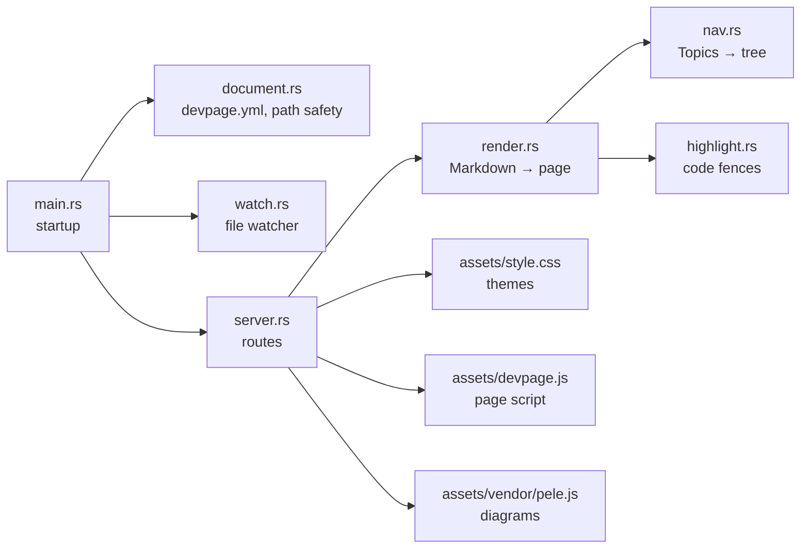
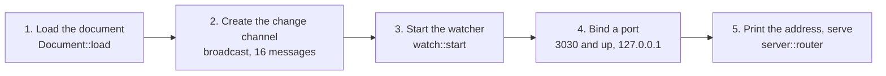

# Developing devpage

How to work on devpage itself: build it, run its tests and the three gates,
run the documentation while you edit it, and know what needs a rebuild. It
also maps the source — which module does what, and how `main` wires them — and
says what the test suite covers and what it doesn't. It is a task article
under [Engineering](../README.md); how a change travels from idea to `main` is
the [SDLC](../sdlc/README.md).

You need the toolchain from [Installing devpage](../../../installing.md#what-you-need).
Every command runs from the repository root.

## Build and run

```sh
cargo build                       # debug build, target/debug/devpage
cargo run -- docs/devpage.yml     # build if needed, then serve these docs
```

`cargo run -- <document.yml | folder>` passes everything after `--` to devpage,
so it serves any document the way an installed `devpage` would. It prints the
address — `http://localhost:3030`, or the next free port up if another devpage
already holds 3030.

## The edit–save–refresh loop

What you edit decides what you have to do to see it:

| You change | What it takes |
| --- | --- |
| A Markdown page under `docs/` | Save. Pages are read on every request and the open page [updates itself](../../viewer/live-updates/README.md). |
| A page's Topics list | Save. The sidebar is rebuilt on every request, on every open page. |
| `docs/devpage.yml` | Restart devpage. The file is read only at start. |
| Rust code in `src/` | Stop devpage (Ctrl-C) and `cargo run` again, then reload the browser tab. A page reconnects to its event stream by itself, but doesn't fetch itself again on reconnecting. |
| `assets/style.css`, `assets/devpage.js`, `assets/vendor/pele.js` | Rebuild and restart — they are compiled into the binary with `include_str!` — then do a full reload of the tab. Live updates and in-place links swap only the page content and the sidebar, never the stylesheet or the scripts. |

## Tests

```sh
cargo test
```

The suite is twelve unit tests, written as `#[cfg(test)] mod tests` beside the
code they test. There is no `tests/` folder and no integration test.

| Module | Tests | What they pin |
| --- | --- | --- |
| `document` | 4 | Parsing `devpage.yml` and the `watch` default; rejecting a missing root and an unknown field; loading a bare file name from the current folder; serving only files inside the document's folder. |
| `nav` | 2 | Reading links and `###` groups from the Topics section only; building the tree and stopping at a cycle. |
| `render` | 5 | Raw HTML kept and Mermaid fences marked; code highlighted without a language label; unknown languages left plain and escaped; tables and heading ids; the page title. |
| `main` | 1 | Taking the next port when the first is busy. |

The `document` and `nav` tests write small documents into a folder under the
system temp directory, named with the test process's id
(`devpage-doc-<pid>`, `devpage-nav-<pid>`), and don't remove it. One
`document` test changes the process's current folder for a moment. The `main`
test binds real ports on `127.0.0.1`, from 41000 up. The `render` tests work
on strings alone.

**What has no test:** the HTTP routes and handlers in `src/server.rs` (path
safety is tested only through `Document::file`), the watcher in
`src/watch.rs`, `src/highlight.rs` except through the `render` tests, and
everything in the browser — `assets/devpage.js`, the stylesheet and the
diagrams. Diagrams are checked by hand with the Node command in
[Diagrams and themes](../../viewer/diagrams-and-themes/README.md#writing-a-diagram).

## The gates

Green before any pull request opens (from `AGENTS.md`):

```sh
cargo fmt --check
cargo clippy --all-targets -- -D warnings
cargo test
```

Formatting must match `rustfmt`'s defaults, clippy's warnings — on tests too —
are errors, and the suite passes. There is no CI yet, so nothing runs these
for you: run them by hand before you push. See
[CI](../sdlc/README.md#ci).

## The code

devpage is one binary — `main.rs` and six modules — with three built-in assets. Each part
of the diagram opens the page that explains it.



| Module | Does |
| --- | --- |
| `src/main.rs` | Reads the argument, wires the parts together, picks the port. |
| `src/document.rs` | `Document`: loads and validates `devpage.yml`, matches `watch` patterns, maps a URL path to a file inside the document's folder. |
| `src/watch.rs` | Watches the document's folder and sends a message on each change to a watched file. |
| `src/server.rs` | The four routes, request logging, the event stream and the built-in assets. |
| `src/render.rs` | A Markdown file to a whole page: GFM rendering, title, sidebar HTML, the page frame. |
| `src/nav.rs` | Reads Topics sections and builds the sidebar tree. |
| `src/highlight.rs` | Highlights fenced code for comrak, and marks Mermaid blocks. |

What each crate does is in [Dependencies](../dependencies/README.md).

### How main wires it together

`main` in `src/main.rs` starts devpage in this order; a failure at any step
stops it with an error before anything is served.



1. **Load the document** from the first argument, or `.` when there is none.
   The `Document` is shared (`Arc`) by the watcher and the server.
2. **Create the broadcast channel** that carries "a watched file changed".
   The watcher holds a sender; each open event stream subscribes.
3. **Start the watcher** on the document's folder. `main` keeps it in a local
   variable for the whole run; dropping it would stop watching.
4. **Bind the first free port** from 3030 up, on the local machine only.
5. **Print `<title> → http://localhost:<port>`** and serve the router until
   devpage is stopped.

## Working on the docs

These docs are a devpage document: `docs/devpage.yml`, rooted at
`docs/README.md`. Keep `cargo run -- docs/devpage.yml` open while you write.
How to write and organize pages is in the
[viewer's task articles](../../viewer/README.md#topics); the reading hierarchy
this repository follows is the documentation skill,
`.claude/skills/documentation/SKILL.md`. Check every diagram you add with the
Node command in [Diagrams and themes](../../viewer/diagrams-and-themes/README.md#writing-a-diagram).
