# Running the flow with skills

How the operator drives a change through devpage's development flow in this
repository: the slash command that starts each stage, which skills only the
operator can start and which agents reach for themselves, where each stage's
output lands, and how to choose between the full flow, a hacking session and a
direct pull request. It is the essentials article under
[Engineering](../README.md); the [SDLC](../sdlc/README.md) is the full design
of the process, and the [skills reference](../skills-reference/README.md) lists
every skill exactly.

## The mental model

**Each stage is a skill, and the operator starts it.** A skill is a folder
under `.claude/skills/` whose `SKILL.md` tells an agent how to run one kind of
work. The operator types its name as a slash command — `/design`, `/plan` — and
the agent follows it. Between stages nothing moves on its own: a settled design
is not permission to spike it, and a conversation stays a conversation until
the operator asks for the artifact (`AGENTS.md`).

**Some skills only the operator can start.** `design`, `plan`, `build`, `hack`
and `improve-codebase-architecture` carry `disable-model-invocation: true` in
their frontmatter: an agent can't start them on its own initiative, only the
operator's slash command does. The rest — `prototype`, `implement-ticket`,
`review`, `retro` and the supporting `align`, `documentation` and
`codebase-design` — an agent may also reach for when its work calls for one:
the design session forks itself to run `prototype`, a lane runs
`implement-ticket`, every stage uses `align` to talk.

**The branches carry the state.** A design lives on `design/<name>` until the
code catches up; tickets are branches off it; which tickets are done is which
branches are merged. `main` only ever holds docs that are true.

```mermaid
flowchart LR
  design["/design<br/>box docs on design/name"] --> prototype["/prototype<br/>code + docs/plan/00-prototype.md"]
  prototype --> plan["/plan<br/>tickets in docs/plan/"]
  plan --> build["/build<br/>lanes merged, docs/plan deleted"]
  build --> review["/review<br/>drift bar on the PR to main"]
  review --> merge["operator merges"]
  merge --> retro["/retro<br/>report in chat"]
  click design href "../sdlc/README.md#design" "Design"
  click prototype href "../sdlc/README.md#prototype" "Prototype"
  click plan href "../sdlc/README.md#plan" "Plan"
  click build href "../sdlc/README.md#build" "Build"
  click review href "../sdlc/README.md#review" "Review"
  click merge href "../sdlc/README.md#branches" "Branches"
  click retro href "../sdlc/README.md#retro" "Retro"
```

## What the operator types

| Command | When | What happens | Where the output lands |
| --- | --- | --- | --- |
| `/design` | An idea that changes what the box docs say. | A conversation, using `align`, until a blast-radius pass turns up nothing new; then, when asked, the write. | The box docs under `docs/boxes/` (and `docs/constraints/` for a system-wide rule), on a branch `design/<name>` cut once the shape is clear. |
| `/prototype` | After the design is settled — the operator asks for the spike. | The design session forks itself; the fork builds one end-to-end path in thirty measured minutes, with tests. | Code on `prototype/<name>`, merged back into the design branch by the fork; its report at `docs/plan/00-prototype.md`. |
| `/plan` | After the prototype has merged. | A separate session turns the report into tickets; the operator approves a story, one line per step. | One file per ticket in `docs/plan/`, numbered in dependency order, each opening with front-matter (`id`, `blocked-by`, `boxes`). |
| `/build` | After the story is approved. | A coordinator hands lanes to forks, each in its own worktree running `implement-ticket`, and merges them with `--no-ff` as they pass their own review. | Ticket branches merged into the design branch; `docs/plan/` deleted; a pull request from the design branch to `main`, reviewed at the drift bar by a fresh agent. |
| `/review` | Any branch or pull request; the operator, a lane or the coordinator. | The change is checked against its target's bar — the task bar into a design branch, the drift bar into `main`. | Findings in the conversation; on the design-branch PR they come back as new tickets. |
| `/retro` | After the operator merges the design branch — normally run by the session that coordinated `/build`. | One line per stage, cost and catch, and a paragraph on what looked off. | Chat only; nothing is written. |
| `/hack` | A bug fix or a small change. | Align, then build together in the operator's checkout; docs, tests and gates once the operator says it's right. | A branch `hack/<name>` and a pull request to `main`. |

The operator does the final review and the merge into `main`, and after it
`/build`'s session deletes the design branch and its ticket branches.

### Plan files in the served docs

`docs/plan/` sits inside this documentation's folder, so while a design branch
holds it, devpage serves those files like any page — `/plan/00-prototype.md`
renders, and saving one refreshes open pages, since `watch` covers every
Markdown file. No Topics section lists them, so they never appear in the
sidebar; open them by address. They never reach `main`: `/build` deletes
`docs/plan/` before the pull request opens.

## Choosing a path

- **Full flow** — the change alters what the box docs say: a new mechanism, a
  new contract, a rule. Design → prototype → plan → build → review.
- **Hacking session** — a bug fix or a small change where iterating on running
  code beats writing docs first. Only the operator opens one (or accepts one
  offered); if it starts crossing boxes or bending a constraint, it goes back
  to `/design`. It ends at the same bar: docs true, tests, gates, a reviewed
  pull request.
- **Direct pull request** — the change alters no design: a typo, a dependency
  bump, a fix whose shape the docs already describe. Branch off `main`, open a
  pull request, reviewed at the task bar. No skill is required.

## An example, end to end

To make the order concrete, follow one imagined change — the sidebar
collapsing its groups. This is an illustration of the flow, not a planned
feature.

1. The operator types `/design` and talks it through. The agent works out the
   blast radius — the viewer's navigation pages, `assets/devpage.js`, the
   stylesheet — and, when asked, writes the change into
   `docs/boxes/viewer/` on `design/collapsible-groups`.
2. The operator asks for the spike. The fork cuts
   `prototype/collapsible-groups`, makes one group collapse end to end with a
   test, commits `docs/plan/00-prototype.md`, merges into the design branch and
   deletes its branch.
3. `/plan` in a new session reads that report and proposes a two-step story;
   the operator approves it, and `docs/plan/01-…md` and `02-…md` appear.
4. `/build` hands each ticket to a fork, merges both, deletes `docs/plan/`,
   opens the pull request to `main` and has a fresh agent `/review` it at the
   drift bar.
5. The operator reviews and merges; the coordinator deletes the branches and
   prints the `/retro`.

## Where next

- [SDLC](../sdlc/README.md) — the reasons behind each stage, the branch
  topology and the review bars.
- [Skills reference](../skills-reference/README.md) — all twelve skills: who
  starts each, what goes in and what comes out.
- [Developing devpage](../developing-devpage/README.md) — building, testing
  and the gates.
