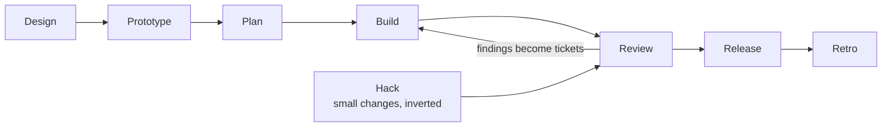
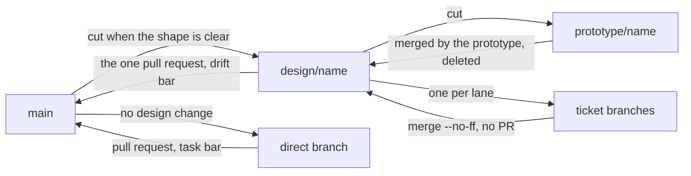

# SDLC

How work gets from an idea to running code: the stages every change to devpage
goes through and the skill that runs each, the branches that carry a design
until the code catches up, the two review bars, and how the box docs are
organized. It is the mechanism page of the [Engineering](../README.md) box;
[Running the flow with skills](../running-the-flow/README.md) is the short
version, from the operator's keyboard.

## Stages

### Design

A conversation that works out how the system should change. The
operator brings an idea, the two sides debate it, the agent works out the blast
radius, and the loop repeats until a pass turns up nothing unaccounted for. It
produces one thing: an update to the box docs. (`/design`)

### Prototype

A fork spikes the design before anyone plans it, on a branch off
the design branch. Its job is one end-to-end path through whatever the design
newly brings, in real code with tests: fewer ceremonies, not worse work. It has
**thirty minutes of measured time** — read off a clock, never estimated, because
an agent can measure and cannot estimate — and its instruction is to keep going,
so "bigger than I expected" is a reason to continue rather than to report.

If the budget runs out before an end-to-end path exists, the design update is too
big. That is evidence rather than an opinion, and the split goes back to the
design conversation rather than being the prototyper's call.

The branch it leaves behind is the implementation branch: work is hardened in
place, and it is thrown away only when the approach proved wrong. Its report is
the plan's first draft. (`/prototype`)

### Plan

A separate session that turns the prototype into tickets, which is
mostly deciding what it takes to productionise what already runs. Because the
work has been measured rather than imagined, plans come out proportional — two
or three tickets, not nine. The operator approves a story — one line per step —
not a list of tickets. (`/plan`)

### Build

A coordinator hands **lanes** to forks, each in its own worktree and
on its own branch off the design branch, and merges them one at a time as they
pass review. A lane is a related chain of tickets given to one fork, which
starts working rather than reading itself in. Parallelism comes from running
several lanes. The coordinator never writes code itself. (`/build`, with lanes
running `implement-ticket`)

A fork carries the conversation that produced the design only when `/build` runs
in the session that had it, which the stage split makes unusual — plan is a
separate session, so build is normally two stages downstream. Assume it doesn't:
the brief carries what was decided.

### Review

Every change is checked against the bar its target sets. A ticket
is reviewed by the fork that built it, at the task bar, and comes back once,
converged; the coordinator merges it. Fresh eyes come once, at the end: the
design branch's pull request to main is reviewed at the drift bar by an agent
that neither wrote nor coordinated the branch, its findings come back as new
tickets, and the operator does the final review and merge. A finding is
something reachable by accident — what only deliberate evasion could trigger is
a note, not a round. (`/review`)

### Release

The operator's call, from main. A release publishes the version in
`Cargo.toml` to [crates.io](https://crates.io/crates/devpage) with
`cargo publish`, from main's tip with the gates green, and tags that commit
`v<version>`. Publishing is permanent — a version can be yanked but never
replaced — so it happens only when the operator says so. The
[example image](../../viewer/deploying/README.md#the-image) installs the
released version, so it follows each release.

### Retro

After the operator merges the design branch into main, the session
that coordinated the build reports where the time went and what each stage
caught, in chat, changing nothing. It is not part of the ready-to-merge report.
The operator carries what repeats across runs and says when a rule changes.
(`/retro`)

### Who starts a stage

The operator starts a stage; agents reach for the skills that serve one. That
split is machine-readable: `design`, `plan`, `build` and `hack` carry
`disable-model-invocation: true` in their frontmatter — as does the upstream
`improve-codebase-architecture` skill, which the operator starts for an
architecture review — while `prototype`, `implement-ticket`, `review` and
`retro` — reached by a fork or the coordinating session — don't, and neither
do the supporting `align`, `documentation` and `codebase-design` skills. Each
skill is listed in the [skills reference](../skills-reference/README.md).

### Hack

A small change can run the flow inverted: `/hack` aligns on the change, builds
it with the operator watching, and writes the docs once the operator says it's
right. It ends at the same bar as any other branch.

## Branches

On `main`, the box docs describe the system as it actually is — see
[docs-are-true-on-main](constraints/docs-are-true-on-main.md). That is the
invariant everything else protects.

A design update describes a system that doesn't exist yet, so it can't live on
main. It goes on its own branch — one branch per design update — cut as soon as
the shape of the change is clear. Tickets are branches off *that* branch, merged
back into it once their review is clean.

### Design branches

Those merges need no pull request: the review happens between agents rather than
in comments, and only main is meant to be guarded. Exactly one pull request
exists per design update, the one into main. A design branch is named
`design/<name>`.

When every ticket has landed, the design branch opens a pull request to main.
That review asks one question: does the code now do what the docs claim? When it
merges, the docs are true again.

Everything lands as a **merge commit** — never squashed. Each ticket is a working
state worth keeping, and flattening a design branch into one commit takes
`bisect` and `blame` down with it. It also leaves the branch looking unmerged
forever, since its commits never become ancestors of main.

So the doc/reality gap is carried by the branch topology rather than by status
sections that nobody updates.

**A design branch is deleted, locally and on the remote, when it merges into
main — with its ticket branches.** The merge is not finished while those names
still exist. Ticket branches outlive their own merges on purpose: while the
design branch is in flight, which tickets are done is which branches are
merged, and the coordinator reads that rather than its own memory. Once the
design branch lands, that question is settled and the names answer nothing;
the merge commits keep the history. A prototype branch goes at its own merge,
or unmerged when the spike proved the approach wrong. Branches belonging to
tooling rather than to the flow — a workflow's lanes, a worktree's ref — die
with the run that made them.

### Prototype branches

The prototype gets a branch of its own, `prototype/<name>`, cut from the design
branch — and it is short-lived. The prototype merges it back into the
design branch itself when the spike is done and deletes it — it is the only agent
alive at that point, and its report is unreadable from anywhere else. Lanes then
branch off the design branch as they always have, so nothing downstream changes.

A spike that proved the approach wrong is deleted **without merging**, which is
the only reason this is a separate branch rather than the design branch itself.

The prototype runs the gates itself before it merges.

### Changes that alter no design

A change that alters no design — a typo, a dependency bump, a fix whose shape the
docs already describe — skips all of this: branch off main, open a pull request
back to main, reviewed at the task bar. The long way is for changes that alter
what the box docs say.

When building turns up something the design didn't anticipate and it has more
than one sensible answer, the operator settles it and the amendment lands on the
design branch already in flight. It belongs to the same change set, and that
branch is already describing a system that doesn't exist yet.

## CI

There is no CI yet. The repository has no CI configuration — no `.github/`
folder, no workflow of any kind — so nothing runs on a push or a pull request.
The gates in `AGENTS.md` (`cargo fmt --check`, `cargo clippy --all-targets --
-D warnings`, `cargo test`) are run by hand, by whoever is about to merge or
open a pull request; [Developing devpage](../developing-devpage/README.md#the-gates)
shows them. What CI should run on, and when, is not designed yet.

## Review bars

**Task bar** — a ticket going into a design branch: acceptance criteria pass, the
constraints of the boxes it touches hold, gates green, the system still works.

**Drift bar** — a design branch going into main: the code does what the docs
claim, every expand–migrate–contract finished, no old path left beside its
replacement.

## Boxes and documentation

A box is a component or containing subsystem. Its documentation lives under
`docs/boxes/`, nested by subject containment. Its README is the entrance: a broad
box summarizes its parts and links to focused child designs; a focused box can
explain its behavior fully. Code belonging to a child remains bound by its own
and its ancestors' applicable constraints. A dependency link is not containment.

Each box's README lists its constraints in one line each, linked to one file per
rule: the precise rule, its reason and how to check it. System-wide rules belong
in `docs/constraints/`, read on every review.

A box appears when its area is designed. Exact contracts stay beside their
definitions in code; box docs explain them and link to them.

A change updates the explanations, contracts, examples and incoming links it
affects. A design decision lives in its owning focused design, linked from the
box entrance; it does not force a detailed tangent into the README. The reason
for changing the design belongs in the commit message, not an ADR.

## Constraints

The SDLC's two rules are listed under [Topics](#topics), one line each, and
reviewed on every change to the process or to box docs. System-wide rules are
the [general constraints](../../../constraints/README.md).

## Topics

### Constraints

- [On main, the box docs describe the system as it is](constraints/docs-are-true-on-main.md)
  — anything merged to main leaves the docs an accurate description of the
  code; a design not yet built waits on its design branch.
- [Decisions live in box docs, not in a decision log](constraints/decisions-live-in-box-docs.md)
  — a decision goes into the owning box's docs or constraints and its reason
  into the commit message; there is no ADR directory.
