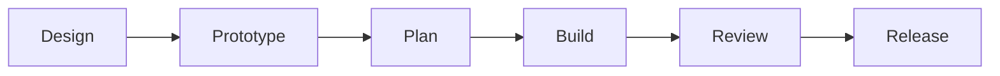

# SDLC

How work gets from an idea to running code: the stages every change to devpage
goes through and the skill that runs each, the branches that carry a design
until the code catches up, the two review bars, and how the box docs are
organized. It sits under the [Engineering](../README.md) box;
[Running the flow with skills](../running-the-flow/README.md) is the short
version, from the operator's keyboard.

Review findings go back to Build as new tickets; after the merge, the
[retro](./stages/README.md#retro) reports where the time went. A small change
can run the flow inverted, as a [hack](./stages/README.md#hack).

<Cards columns={3}>

- [Design](stages/README.md#design) — `/design`: a conversation, then the box docs on `design/<name>`.
- [Prototype](stages/README.md#prototype) — `/prototype`: thirty measured minutes, one end-to-end path.
- [Plan](stages/README.md#plan) — `/plan`: the prototype turned into a story of tickets.
- [Build](stages/README.md#build) — `/build`: lanes in their own worktrees, merged one at a time.
- [Review](stages/README.md#review) — `/review`: the task bar per ticket, the drift bar at the end.
- [Release](stages/README.md#release) — The operator's call: `cargo publish`, the design engine and the core first, and a tag.

</Cards>

## Boxes and documentation

How box docs are organized and kept true — one home per subject, constraints
one file per rule, docs on main describing the system as it is — is on the
[system catalog](../../README.md#how-to-read-the-catalog).

## Requirements

The SDLC's own rules, reviewed on every change to the process or to box docs,
and the ones every change is held to.

<Requirements />

## Topics

- [Stages](stages/README.md) — what each stage does and produces, from design
  to retro, and the hack.
- [Branches](branches/README.md) — design, prototype, ticket and direct
  branches: how they merge and when they are deleted.
- [Review bars and CI](review-bars/README.md) — the task bar and the drift
  bar, and what checks them today.
