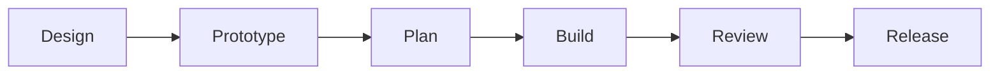

# SDLC

How work gets from an idea to running code: the stages every change to devpage
goes through and the skill that runs each, the branches that carry a design
until the code catches up, the two review bars, and how the box docs are
organized. It is a concept page of the [Engineering](../README.md) box;
[Running the flow with skills](../running-the-flow/README.md) is the short
version, from the operator's keyboard.

Review findings go back to Build as new tickets; after the merge, the
[retro](./stages/README.md#retro) reports where the time went. A small change
can run the flow inverted, as a [hack](./stages/README.md#hack).

<Cards columns={3}>

- [Design](stages/README.md#design) — `/design`: a conversation, then the box docs on `design/<name>`.
- [Prototype](stages/README.md#prototype) — `/prototype`: thirty measured minutes, one end-to-end path.
- [Plan](stages/README.md#plan) — `/plan`: the prototype turned into a story of tickets.
- [Build](stages/README.md#build) — `/build`: lanes in their own worktrees, merged one at a time.
- [Review](stages/README.md#review) — `/review`: the task bar per ticket, the drift bar at the end.
- [Release](stages/README.md#release) — The operator's call: `cargo publish` and a tag.

</Cards>

## Boxes and documentation

A box is a component or containing subsystem. Its documentation lives under
`docs/boxes/`, nested by subject containment. Its README is the entrance: a broad
box summarizes its parts and links to focused child designs; a focused box can
explain its behavior fully. Code belonging to a child remains bound by its own
and its ancestors' applicable constraints. A dependency link is not containment.

Each box's README lists its constraints in one line each, linked to one file per
rule: the precise rule, its reason and how to check it. System-wide rules belong
in `docs/constraints/`, read on every review.

A box appears when its area is designed. Exact contracts stay beside their
definitions in code; box docs explain them and link to them.

A change updates the explanations, contracts, examples and incoming links it
affects. A design decision lives in its owning focused design, linked from the
box entrance; it does not force a detailed tangent into the README. The reason
for changing the design belongs in the commit message, not an ADR.

## Constraints

The SDLC's two rules are listed under [Topics](#topics), one line each, and
reviewed on every change to the process or to box docs. System-wide rules are
the [general constraints](../../../constraints/README.md).

## Topics

- [Stages](stages/README.md) — what each stage does and produces, from design
  to retro, and the hack.
- [Branches](branches/README.md) — design, prototype, ticket and direct
  branches: how they merge and when they are deleted.
- [Review bars and CI](review-bars/README.md) — the task bar and the drift
  bar, and what checks them today.

### Constraints

- [On main, the box docs describe the system as it is](constraints/docs-are-true-on-main.md)
  — anything merged to main leaves the docs an accurate description of the
  code; a design not yet built waits on its design branch.
- [Decisions live in box docs, not in a decision log](constraints/decisions-live-in-box-docs.md)
  — a decision goes into the owning box's docs or constraints and its reason
  into the commit message; there is no ADR directory.
