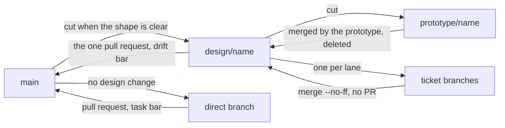

# Branches

Which branches carry a change from idea to `main` — design, prototype, ticket
and direct branches — how they merge, and when each is deleted. It is a
concept page under the [SDLC](../README.md).

On `main`, the box docs describe the system as it actually is — see
[docs-are-true-on-main](../constraints/docs-are-true-on-main.md). That is the
invariant everything else protects.

A design update describes a system that doesn't exist yet, so it can't live on
main. It goes on its own branch — one branch per design update — cut as soon as
the shape of the change is clear. Tickets are branches off *that* branch, merged
back into it once their review is clean.

## Design branches

Those merges need no pull request: the review happens between agents rather than
in comments, and only main is meant to be guarded. Exactly one pull request
exists per design update, the one into main. A design branch is named
`design/<name>`.

When every ticket has landed, the design branch opens a pull request to main.
That review asks one question: does the code now do what the docs claim? When it
merges, the docs are true again.

Everything lands as a **merge commit** — never squashed. Each ticket is a working
state worth keeping, and flattening a design branch into one commit takes
`bisect` and `blame` down with it. It also leaves the branch looking unmerged
forever, since its commits never become ancestors of main.

So the doc/reality gap is carried by the branch topology rather than by status
sections that nobody updates.

**A design branch is deleted, locally and on the remote, when it merges into
main — with its ticket branches.** The merge is not finished while those names
still exist. Ticket branches outlive their own merges on purpose: while the
design branch is in flight, which tickets are done is which branches are
merged, and the coordinator reads that rather than its own memory. Once the
design branch lands, that question is settled and the names answer nothing;
the merge commits keep the history. A prototype branch goes at its own merge,
or unmerged when the spike proved the approach wrong. Branches belonging to
tooling rather than to the flow — a workflow's lanes, a worktree's ref — die
with the run that made them.

## Prototype branches

The prototype gets a branch of its own, `prototype/<name>`, cut from the design
branch — and it is short-lived. The prototype merges it back into the
design branch itself when the spike is done and deletes it — it is the only agent
alive at that point, and its report is unreadable from anywhere else. Lanes then
branch off the design branch as they always have, so nothing downstream changes.

A spike that proved the approach wrong is deleted **without merging**, which is
the only reason this is a separate branch rather than the design branch itself.

The prototype runs the gates itself before it merges.

## Changes that alter no design

A change that alters no design — a typo, a dependency bump, a fix whose shape the
docs already describe — skips all of this: branch off main, open a pull request
back to main, reviewed at the task bar. The long way is for changes that alter
what the box docs say.

When building turns up something the design didn't anticipate and it has more
than one sensible answer, the operator settles it and the amendment lands on the
design branch already in flight. It belongs to the same change set, and that
branch is already describing a system that doesn't exist yet.
