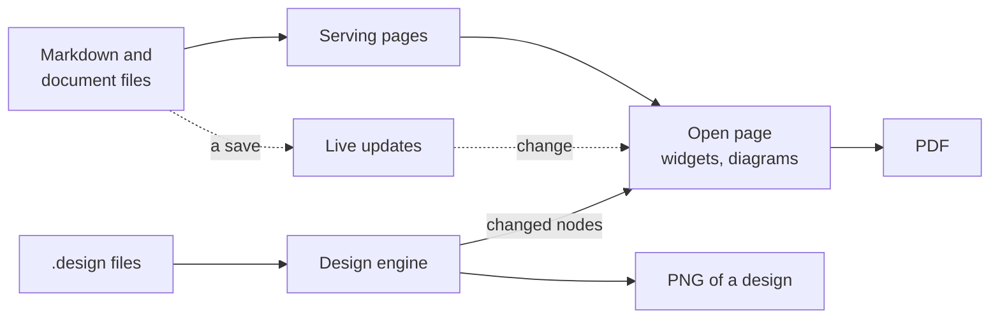

# Viewer

The viewer is the `devpage` program. It serves **documents** from a folder
in the browser — a **site** of pages, a **doc** read top to bottom, a deck
of **slides**, or a **design** drawn on a canvas and clicked through as a
prototype — keeps every open page current as the files change, lets readers
leave **comments** on any page of a site, a doc or a deck (a design is
discussed on the page that embeds it), checks every link, prints a doc or a
deck to PDF exactly as the browser shows it, and records a deck as a narrated
video. This page says what its parts are
and where each is explained; it belongs to the [system catalog](../README.md).

Point it at a document's YAML file, at a folder holding `devpage.yml`, or at a
single Markdown file, and it prints the address it serves on:

```sh
devpage docs/devpage.yml      # or: devpage docs
devpage design.md             # one Markdown file, served as a doc
devpage check docs            # every link, exit 1 if one is broken
devpage pdf talks/launch      # the deck as a PDF
devpage video talks/launch    # the deck as an mp4, its notes read aloud
devpage app/checkout.design   # one design, on a canvas
devpage png app/checkout.design            # the design as a PNG, no server
devpage png talks/launch --slide 3         # slide 3 as a PNG
```

Every page is rendered when it is requested, straight from the files on disk,
so what the browser shows is what the files hold, and an open page swaps in the
fresh one the moment a file changes.



## Its parts

Each card opens the page that explains it.

### Write

The kinds of document, and how a site is laid out.

<Cards>

- (pen-line) [Writing a document](write/writing-a-document/README.md) — The four kinds, the document file and the served folder.
- (layout-grid) [Making a site](write/making-a-site/README.md) — Root page, sidebar, navbar, logo, theme switch and 404 page.
- (list-tree) [Organizing navigation](write/organizing-navigation/README.md) — How Topics sections build a site's sidebar.
- (braces) [Code reference](write/code-reference/README.md) — A page for every module, type and function of the code, read with tree-sitter.
- (file-text) [Writing a doc](write/writing-a-doc/README.md) — Chapters, the outline, and the PDF's paper, header and footer.
- (presentation) [Making slides](write/making-slides/README.md) — One file per slide on a 16:9 stage.

</Cards>

### On the page

What a page holds beyond Markdown, and how it looks.

<Cards>

- (puzzle) [Widgets](on-the-page/widgets/README.md) — React components as tags in Markdown, devpage's and your own.
- (workflow) [Diagrams](on-the-page/diagrams/README.md) — Mermaid fences drawn as SVG, with nodes that are links.
- (frame) [Designs](on-the-page/designs/README.md) — A UI as a `.design` file: a canvas to click through, an embed in any page, a PNG for the agent.
- (palette) [Themes](on-the-page/themes/README.md) — The light and dark tokens behind the page, its code and its diagrams.

</Cards>

### Share

How a document reaches other people.

<Cards>

- (message-square) [Comments](share/comments/README.md) — Threads on text or a paragraph, kept as files git never sees.
- (printer) [Printing to PDF](share/pdf/README.md) — `devpage pdf` has Chrome print a doc or a deck as it shows.
- (video) [Making a video](share/making-a-video/README.md) — `devpage video` records a deck, each slide's notes read aloud by GPT-Live.
- (server) [Deploying devpage](share/deploying/README.md) — For a team, behind the auth proxy you already run.
- (cloud-upload) [Server mode](share/server/README.md) — `devpage server`: publish a document, keep every version, share one link.

</Cards>

### Check

What `devpage check` holds a document to.

<Cards>

- (link) [Checking links](check/checking-links/README.md) — Every link, image and diagram target, and every diagram, in the preview and in `devpage check`.
- (network) [Structuring a site](check/structuring-a-site/README.md) — Page types a site defines, and which may sit under which, checked.
- (list-checks) [Checking requirements](check/checking-requirements/README.md) — Constraints as pages, the tests that point at them, and their JUnit results.

</Cards>

### Beyond pages

Devpage extended, and talked to.

<Cards>

- (puzzle) [Extensions](extensions/README.md) — Local Rust packages adding watched knowledge, rendering and full document views.
- (mic) [The live session](live-session/README.md) — Talking over the pages: an orb, coding agents at work, and scratch pads on a canvas.

</Cards>

### Behind every page

What keeps an open page current and findable.

<Cards>

- (refresh-cw) [Live updates](write/writing-a-document/live-updates/README.md) — From a saved file to a swapped page.
- (search) [Search](write/making-a-site/search/README.md) — Every section of what the site publishes, ranked and grouped by page, in the sidebar as you type.

</Cards>

### Reference

The exact contracts and the words.

<Cards>

- (book-open) [Configuration reference](configuration-reference/README.md) — Every field, flag and error.
- (search-check) [Viewer glossary](glossary/README.md) — The words the viewer owns.

</Cards>

## Requirements

<Requirements />

## Topics

### Essentials

- [Getting started](../../getting-started.md) — the mental model and a first
  site, doc and deck, run end to end.

### The parts

- [Write](write/README.md) — the four kinds of document, a site, a doc and a
  deck, the sidebar a site's Topics build, and the code reference.
- [On the page](on-the-page/README.md) — what a page holds beyond Markdown:
  widgets, diagrams and designs, and the themes that color it.
- [Share](share/README.md) — comments, PDF, video, deploying for a team, and
  server mode.
- [Check](check/README.md) — what `devpage check` holds a document to: its
  links, its page types and its requirements.

### Beyond pages

- [Extensions](extensions/README.md) — Enabling a local Rust package without
  assembling another executable.
- [The live session](live-session/README.md) — a voice session over the
  pages: what it does and why, how to turn it on, the program `devpage setup`
  installs and its settings; under it, how Voice, Fast and the slow agents
  work, the scratch pad, the screens and the evals.

### Reference

- [Configuration reference](configuration-reference/README.md) — every field
  of each kind's document file, the command line and its flags, and the
  errors devpage stops with.
- [Viewer glossary](glossary/README.md) — the words the viewer owns, one
  anchor per term.
