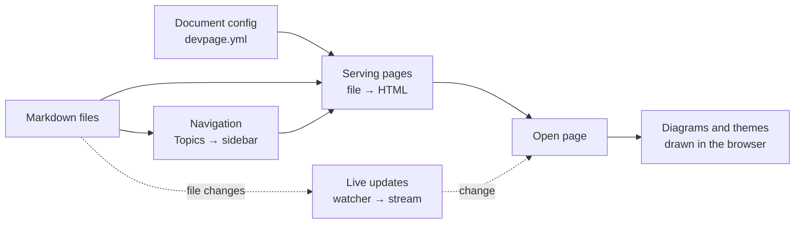

# Viewer

The viewer is the `devpage` program: it serves a **document** — Markdown files
described by a `devpage.yml` — in the browser, and keeps every open page current
as the files change. This page says what its parts are and where each is
explained; it belongs to the [system catalog](../README.md).

Point it at a document's YAML file, or at a folder holding `devpage.yml`, and
it prints the address it serves on:

```sh
devpage docs/devpage.yml      # or: devpage docs
```

Every page is rendered when it is requested, straight from the file on disk,
so what the browser shows is what the repository holds. The sidebar is not
configured separately: it is the tree the pages form by listing their children
in `## Topics` sections. While a page is open it listens for changes, and when
a watched file is saved it swaps in the fresh page without reloading. Mermaid
fences are drawn as diagrams in the page's light or dark theme.



Each part of the diagram opens its page.

- **Document config** — `devpage.yml` names the document, its root page and
  the files to watch, and fixes the folder that is served.
- **Serving pages** — a request for a Markdown file renders it as GitHub-flavoured
  Markdown, with fenced code highlighted, inside the page frame; any other
  file is served as it is.
- **Navigation** — the sidebar, rebuilt from the Topics sections on every
  request.
- **Live updates** — a file watcher and a stream that tells open pages to
  fetch themselves again.
- **Diagrams and themes** — Mermaid fences drawn as SVG in the browser, colored
  by the same tokens as the page.

## Glossary

The words this box owns; the rest of the docs use them with these meanings.

| Term | Meaning |
| --- | --- |
| **document** | What devpage serves: a `devpage.yml` and the files in its folder. The docs call the served whole the document, never a "site"; the sidebar's top link shows the **document title** (`title`). The code uses the same word: that link has the class `document-title`. |
| **document file** | The YAML file describing a document, usually `devpage.yml`. |
| **document folder** | The folder holding the document file. Relative paths resolve against it, and nothing outside it is served. |
| **page** | A Markdown (`.md`) file in the document folder, rendered into the page frame when requested. Any other file is served as it is. |
| **root page** | The page named by `root`: where `/` redirects, and the top of the sidebar tree. |
| **page frame** | The HTML every page is wrapped in: the sidebar, the rendered page, the stylesheet and the two scripts. There is one, shared by every page. |
| **Topics** | A page's `## Topics` section. The first link of each top-level list item names a child of the page in the sidebar. |
| **entry** | One page in the sidebar tree, labelled with its Topics link's text. |
| **group** | A run of entries under one `###` heading in a Topics section, shown under that heading in the sidebar. |
| **watch** | The `devpage.yml` field listing glob patterns; a change to a file matching one refreshes open pages. Also the file watcher that applies them. |
| **live update** | An open page fetching itself again and swapping in its content and sidebar, in place, after a watched file changed. |
| **built-in asset** | One of the three files compiled into the binary and served under `/__devpage/`: `style.css`, `devpage.js`, `pele.js`. |
| **theme** | A set of values for the color and font tokens. There are two, light and dark, chosen by the reader's system setting. |
| **token** | A CSS custom property in `assets/style.css` — `--accent`, `--syntax-string` — that the page, its code and its diagrams take their colors and fonts from. |

## Topics

### Essentials

- [Getting started](../../getting-started.md) — the mental model and a first
  document, run end to end.

### Concepts and tasks

- [Writing a document](writing-a-document/README.md) — the `devpage.yml`, where
  pages live, links between them, the Markdown that works, and documenting
  another repository.
- [Organizing navigation](organizing-navigation/README.md) — how Topics
  sections build the sidebar, and how to lay out a document's reading order.
- [Diagrams and themes](diagrams-and-themes/README.md) — writing Mermaid
  diagrams, what errors look like, and the light and dark color tokens that
  color the page, its code and its diagrams.

### Mechanisms

- [Serving pages](serving-pages/README.md) — from a request to a file to a
  page: path safety, the rendering pipeline, assets, ports and logging.
- [Live updates](live-updates/README.md) — from a saved file to a swapped page:
  the watcher, the event stream and the page script.
- [Navigation tree](navigation-tree/README.md) — how the sidebar tree is read
  from Topics sections, resolved, grouped and kept free of cycles.
- [The vendored pele bundle](vendored-pele/README.md) — the third-party
  diagram renderer built into devpage: its source, version, licences and how
  to upgrade it.

### Reference

- [Configuration reference](configuration-reference/README.md) — every
  `devpage.yml` field, its default and errors, and the command line.
