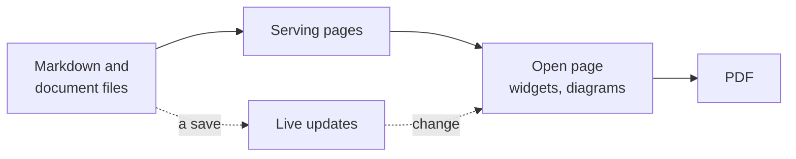

# Viewer

The viewer is the `devpage` program. It serves **documents** from a folder
in the browser — a **site** of pages, a **doc** read top to bottom, or a deck
of **slides** — keeps every open page current as the files change, lets readers
leave **comments** on any of them, checks every link, and prints a doc or a
deck to PDF exactly as the browser shows it. This page says what its parts are
and where each is explained; it belongs to the [system catalog](../README.md).

Point it at a document's YAML file, at a folder holding `devpage.yml`, or at a
single Markdown file, and it prints the address it serves on:

```sh
devpage docs/devpage.yml      # or: devpage docs
devpage design.md             # one Markdown file, served as a doc
devpage check docs            # every link, exit 1 if one is broken
devpage pdf talks/launch      # the deck as a PDF
```

Every page is rendered when it is requested, straight from the files on disk,
so what the browser shows is what the files hold, and an open page swaps in the
fresh one the moment a file changes.



## Its parts

Each card opens the page that explains it.

### Write

<Cards>

- (pen-line) [Writing a document](writing-a-document/README.md) — The three kinds, the document file and the served folder.
- (layout-grid) [Making a site](making-a-site/README.md) — Root page, sidebar, navbar, logo and theme switch.
- (file-text) [Writing a doc](writing-a-doc/README.md) — Chapters, the outline, and the PDF's paper, header and footer.
- (presentation) [Making slides](making-slides/README.md) — One file per slide on a 16:9 stage.
- (puzzle) [Widgets](widgets/README.md) — React components as tags in Markdown, devpage's and your own.
- (workflow) [Diagrams](diagrams/README.md) — Mermaid fences drawn as SVG, with nodes that are links.

</Cards>

### Read

<Cards>

- (list-tree) [Organizing navigation](organizing-navigation/README.md) — How Topics sections build a site's sidebar.
- (palette) [Themes](themes/README.md) — The light and dark tokens behind the page, its code and its diagrams.
- (refresh-cw) [Live updates](live-updates/README.md) — From a saved file to a swapped page.

</Cards>

### Share

<Cards>

- (message-square) [Comments](comments/README.md) — Threads on text or a paragraph, kept as files git never sees.
- (printer) [Printing to PDF](pdf/README.md) — `devpage pdf` has Chrome print a doc or a deck as it shows.
- (server) [Deploying devpage](deploying/README.md) — For a team, behind the auth proxy you already run.

</Cards>

### Check

<Cards>

- (link) [Checking links](checking-links/README.md) — Every link, image and diagram target, in the preview and in `devpage check`.
- (book-open) [Configuration reference](configuration-reference/README.md) — Every field, flag and error.
- (search-check) [Viewer glossary](glossary/README.md) — The words the viewer owns.

</Cards>

## Topics

### Essentials

- [Getting started](../../getting-started.md) — the mental model and a first
  site, doc and deck, run end to end.

### Concepts and tasks

- [Writing a document](writing-a-document/README.md) — the three kinds, the
  document file, the served folder, links between pages and documents, and the
  Markdown that works.
- [Making a site](making-a-site/README.md) — a site's document file, root page,
  sidebar, navbar, logo and theme switch.
- [Organizing navigation](organizing-navigation/README.md) — how a site's
  Topics sections build the sidebar, and how to lay out its reading order.
- [Writing a doc](writing-a-doc/README.md) — chapters, the outline, and the
  PDF's paper, header and footer.
- [Making slides](making-slides/README.md) — one file per slide, the stage,
  the keys, and printing a deck.
- [Comments](comments/README.md) — commenting on text or a paragraph,
  replying, resolving, and the files a thread is kept in.
- [Checking links](checking-links/README.md) — what is checked, problems in
  the preview, and `devpage check` in tests.
- [Printing to PDF](pdf/README.md) — `devpage pdf`, the Chrome it drives, and
  why the PDF matches the screen.
- [Deploying devpage](deploying/README.md) — the example image, the auth
  proxy that names readers, and trying it with Docker Compose.
- [Diagrams](diagrams/README.md) — Mermaid diagrams: writing them, making
  their nodes links, checking them, and what errors look like.
- [Themes](themes/README.md) — the light and dark tokens that color the page,
  its code and its diagrams, the theme switch, and per-page CSS.
- [Widgets](widgets/README.md) — React components as tags in Markdown: using
  them, the system widgets, and writing a project's own.

### Mechanisms

- [Serving pages](serving-pages/README.md) — from a request to a file to a
  page: the served folder, the document a page belongs to, rendering, assets,
  addresses and logging.
- [Live updates](live-updates/README.md) — from a saved file to a swapped page:
  the watcher, the event stream and the page script.
- [Navigation tree](navigation-tree/README.md) — how a sidebar tree is read
  from Topics sections, resolved, grouped and kept free of cycles.
- [The vendored pele bundle](vendored-pele/README.md) — the third-party
  diagram renderer built into devpage: its source, version, licences and how
  to upgrade it.
- [The vendored React bundle](vendored-react/README.md) — the React that
  widgets run with: its version, how it is built, its licence and how to
  upgrade it.
- [The vendored icons](vendored-icons/README.md) — the Lucide icons and
  GitHub's mark devpage draws in navbars and the theme selector: versions,
  licences and how to upgrade them.

### Reference

- [Configuration reference](configuration-reference/README.md) — every field
  of each kind's document file, the command line and its flags, and the
  errors devpage stops with.
- [Viewer glossary](glossary/README.md) — the words the viewer owns, one
  anchor per term.

### Constraints

- [The served folder is the boundary](constraints/the-served-folder-is-the-boundary.md)
  — what devpage may serve, read and link to.
- [devpage never writes a document](constraints/devpage-never-writes-a-document.md)
  — comments stay in `.devpage/`; a PDF goes only where it was asked for.
- [A PDF is the page the browser shows](constraints/a-pdf-is-the-page.md)
  — one renderer for screen and paper.
- [devpage authenticates no one](constraints/devpage-authenticates-no-one.md)
  — identity comes from the proxy in front of it.
- [One name, one widget](constraints/one-name-one-widget.md)
  — widgets compose by name, so no name is shadowed.
