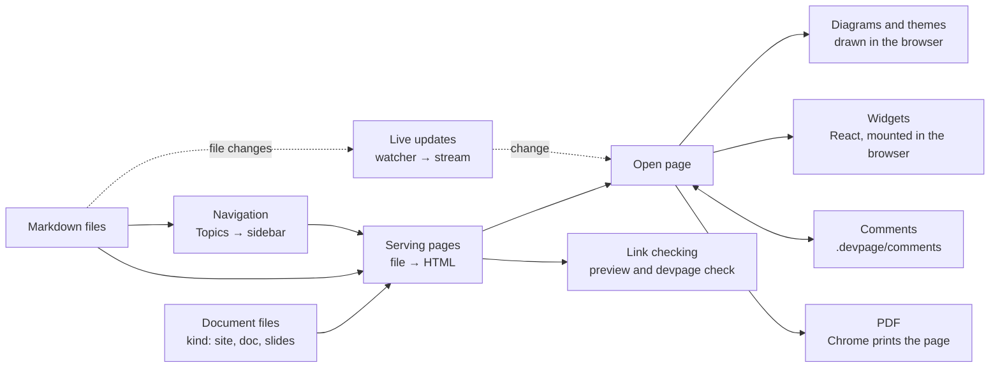

# Viewer

The viewer is the `devpage` program. It serves **documents** from a folder
in the browser — a **site** of pages, a **doc** read top to bottom, or a deck
of **slides** — keeps every open page current as the files change, lets readers
leave **comments** on any of them, checks every link, and prints a doc or a
deck to PDF exactly as the browser shows it. This page says what its parts are
and where each is explained; it belongs to the [system catalog](../README.md).

Point it at a document's YAML file, at a folder holding `devpage.yml`, or at a
single Markdown file, and it prints the address it serves on:

```sh
devpage docs/devpage.yml      # or: devpage docs
devpage design.md             # one Markdown file, served as a doc
devpage check docs            # every link, exit 1 if one is broken
devpage pdf talks/launch      # the deck as a PDF
```

Every page is rendered when it is requested, straight from the files on disk,
so what the browser shows is what the files hold. A site's sidebar is
the tree its pages form by listing their children in `## Topics` sections; a
doc's outline is its chapters' headings; a deck is its slides in the order its
YAML lists them. While a page is open it listens for changes and swaps in the
fresh page without reloading. Mermaid fences are drawn as diagrams in the
page's light or dark theme.



Each part of the diagram opens its page.

- **Document files** — a YAML file whose `kind` says what it describes: a
  site, a doc or slides. A lone Markdown file is a doc with defaults.
- **Serving pages** — a request names a file in the served folder; a Markdown
  file is rendered into the frame of the document it belongs to, and any other
  file is served as it is.
- **Navigation** — a site's sidebar, rebuilt from the Topics sections on every
  request.
- **Live updates** — a file watcher over the served folder and a stream that tells
  open pages to fetch themselves, or their comments, again.
- **Diagrams and themes** — Mermaid fences drawn as SVG in the browser, colored
  by the same tokens as the page.
- **Widgets** — React components written as HTML tags in Markdown: devpage's
  system widgets, and a project's own from its widgets folder.
- **Comments** — threads anchored to selected text or a paragraph, one file per
  thread in a `.devpage/` folder git never sees.
- **Link checking** — every link, image and diagram target, shown on the page
  while you write and failed by `devpage check` in tests.
- **PDF** — `devpage pdf` has Chrome print a doc or a deck, so the PDF is the
  page the browser shows.

## Glossary

The words this box owns; the rest of the docs use them with these meanings.

| Term | Meaning |
| --- | --- |
| **document** | What devpage serves and a reader opens: a site, a doc or slides. Every kind is a document; the code uses the same word (`Document`, `Kind`). |
| **kind** | Which of the three a document is, named by the `kind` field of its document file: `site`, `doc` or `slides`. |
| **site** | A document of many pages with a sidebar built from Topics sections. Configured by `root`. |
| **doc** | A document read top to bottom as one page — a design doc, a PRD — made of one or more chapters, with an outline beside it and PDF settings. The word for the kind is always *doc*, never "document". |
| **chapter** | One Markdown file of a doc, listed in its `chapters` field. |
| **slides** | A document that is a deck: one Markdown file per slide, in the order its `slides` field lists them, each laid out at 1920 × 1080. The kind is *slides*; one deck is a **deck**, one file a **slide**. |
| **document file** | The YAML file describing a document — any name, `devpage.yml` by default. |
| **entry document** | The document devpage was started with, where `/` leads. |
| **served folder** | The folder devpage serves: the one it was started from, or the one `--root` names. Addresses are paths in it, `.devpage/` sits at its top, and nothing outside it is served, read or linked to. |
| **page** | A Markdown (`.md`) file in the served folder, rendered into a frame when requested. Any other file is served as it is. |
| **root page** | The page a site's `root` names: where the site opens, and the top of its sidebar tree. |
| **page frame** | The HTML a page is wrapped in: the stylesheet, the scripts and the kind's own layout — a site's sidebar, a doc's outline, a deck's stage. |
| **outline** | A doc's navigation: its chapters' headings, beside the text, following the reader as they scroll. |
| **Topics** | A page's `## Topics` section. The first link of each top-level list item names a child of the page in a site's sidebar. |
| **entry** | One page in a sidebar tree, labelled with its Topics link's text. |
| **group** | A run of entries under one `###` heading in a Topics section, shown under that heading in the sidebar. |
| **live update** | An open page fetching itself again and swapping in its content and navigation, in place, after a watched file changed. |
| **comment mode** | The switch beside the theme toggle that turns commenting on: while it is on, selecting text or hovering a paragraph offers a comment. Off until the reader turns it on; the browser remembers it. |
| **comment** | A thread a reader starts, in comment mode, on selected text or on a paragraph: the first message and its replies, one level deep. Stored in the comment store; resolving deletes it. |
| **anchor** | What a comment is attached to: the quoted text, with a little of the text before and after it to tell repeats apart. |
| **detached comment** | A comment whose quoted text is no longer on its page. It stays readable, listed at the top of the page, until it is resolved. |
| **comment store** | `.devpage/comments/` at the top of the served folder: one YAML file per thread. Git never sees it — `.devpage/` ignores itself. |
| **author** | Who wrote a comment: `git config user.name` (or the system's user name) when devpage runs locally, the identity header's value when it is deployed. |
| **deployed** | devpage listening on an address other than the local machine's (`--host`), behind an auth proxy that names the reader in a header. |
| **problem** | A broken link, a missing chapter or slide, a Topics entry pointing nowhere or an invalid document file — shown on the page in the preview and reported by `devpage check`. |
| **print mode** | A page rendered for Chrome to print: no live updates, no comments, no navigation chrome. What `devpage pdf` captures. |
| **built-in asset** | One of the files compiled into the binary and served under `/__devpage/`. |
| **widget** | A React component used in Markdown as an HTML tag whose name starts with a capital letter — `<Callout>`. Its props come from the tag's attributes and its content, rendered as Markdown, is its `children`. |
| **system widget** | A widget devpage ships, in every document: `Callout`, `Tabs`, `Tab`, `Example`, `FileTree`, `Terminal`, `Keys` and `Diagram`, through which every Mermaid fence renders. |
| **project widget** | A widget a project writes: one `.tsx` file in the folder its document file's `widgets` field names, named by its file name. |
| **theme** | A set of values for the color and font tokens. There are two, light and dark: by default the reader's system setting picks one, and the theme selector — one button — switches between them. |
| **navbar** | A site's bar across the top: its title, then the links, dropdowns and icons its `navbar` field lists. |
| **token** | A CSS custom property in `assets/style.css` — `--accent`, `--syntax-string` — that the page, its code and its diagrams take their colors and fonts from. |

## Constraints

- [The served folder is the boundary](constraints/the-served-folder-is-the-boundary.md)
  — nothing outside it is served or read.
- [devpage never writes a document](constraints/devpage-never-writes-a-document.md)
  — the server writes only in `.devpage/`; `devpage pdf` writes only its PDF.
- [A PDF is the page the browser shows](constraints/a-pdf-is-the-page.md)
  — Chrome prints the same HTML; there is no second renderer.
- [devpage authenticates no one](constraints/devpage-authenticates-no-one.md)
  — deployed, it trusts one header and must sit behind a proxy that sets it.
- [One name, one widget](constraints/one-name-one-widget.md)
  — a project widget can't take a system widget's name; an unknown widget tag
  is a problem.

## Topics

### Essentials

- [Getting started](../../getting-started.md) — the mental model and a first
  site, doc and deck, run end to end.

### Concepts and tasks

- [Writing a document](writing-a-document/README.md) — the three kinds, the
  document file, the served folder, links between pages and documents, and the
  Markdown that works.
- [Organizing navigation](organizing-navigation/README.md) — how a site's
  Topics sections build the sidebar, and how to lay out its reading order.
- [Writing a doc](writing-a-doc/README.md) — chapters, the outline, and the
  PDF's paper, header and footer.
- [Making slides](making-slides/README.md) — one file per slide, the stage,
  the keys, and printing a deck.
- [Comments](comments/README.md) — commenting on text or a paragraph,
  replying, resolving, and the files a thread is kept in.
- [Checking links](checking-links/README.md) — what is checked, problems in
  the preview, and `devpage check` in tests.
- [Printing to PDF](pdf/README.md) — `devpage pdf`, the Chrome it drives, and
  why the PDF matches the screen.
- [Deploying devpage](deploying/README.md) — the example image, the auth
  proxy that names readers, and trying it with Docker Compose.
- [Diagrams and themes](diagrams-and-themes/README.md) — writing Mermaid
  diagrams, what errors look like, and the light and dark color tokens that
  color the page, its code and its diagrams.
- [Widgets](widgets/README.md) — the system widgets, writing a project's own
  in TSX, props and content, styling, and what a failing widget looks like.

### Mechanisms

- [Serving pages](serving-pages/README.md) — from a request to a file to a
  page: the served folder, the document a page belongs to, rendering, assets,
  addresses and logging.
- [Live updates](live-updates/README.md) — from a saved file to a swapped page:
  the watcher, the event stream and the page script.
- [Navigation tree](navigation-tree/README.md) — how a sidebar tree is read
  from Topics sections, resolved, grouped and kept free of cycles.
- [The vendored pele bundle](vendored-pele/README.md) — the third-party
  diagram renderer built into devpage: its source, version, licences and how
  to upgrade it.
- [The vendored React bundle](vendored-react/README.md) — the React that
  widgets run with: its version, how it is built, its licence and how to
  upgrade it.
- [The vendored icons](vendored-icons/README.md) — the Lucide icons and
  GitHub's mark devpage draws in navbars and the theme selector: versions,
  licences and how to upgrade them.

### Reference

- [Configuration reference](configuration-reference/README.md) — every field
  of each kind's document file, the command line and its flags, and the
  errors devpage stops with.

### Constraints

- [The served folder is the boundary](constraints/the-served-folder-is-the-boundary.md)
  — what devpage may serve, read and link to.
- [devpage never writes a document](constraints/devpage-never-writes-a-document.md)
  — comments stay in `.devpage/`; a PDF goes only where it was asked for.
- [A PDF is the page the browser shows](constraints/a-pdf-is-the-page.md)
  — one renderer for screen and paper.
- [devpage authenticates no one](constraints/devpage-authenticates-no-one.md)
  — identity comes from the proxy in front of it.
- [One name, one widget](constraints/one-name-one-widget.md)
  — widgets compose by name, so no name is shadowed.
