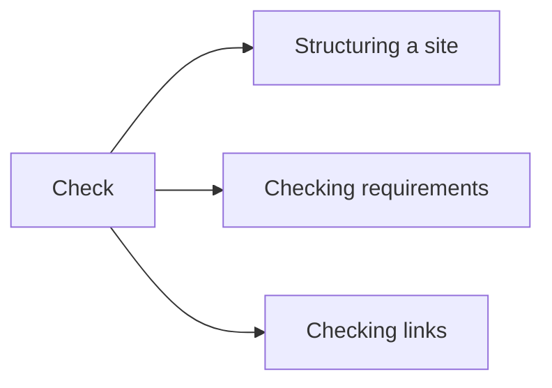

# Check

What `devpage check` holds a document to, in the preview and in a test: every
link and diagram, the page types a site defines and which may sit under which,
and requirements tied to the tests that prove them. It is a part of the
[viewer](../README.md).

## Topics

- [Structuring a site](structuring-a-site/README.md) — a site's own page types,
  the type each page names, and which types may sit under which.
- [Checking requirements](checking-requirements/README.md) — a system's
  requirements as pages, tests that point at its constraints, and what
  `devpage check` reports from their results.
- [Checking links](checking-links/README.md) — what is checked, problems in the
  preview, and `devpage check` in tests.
