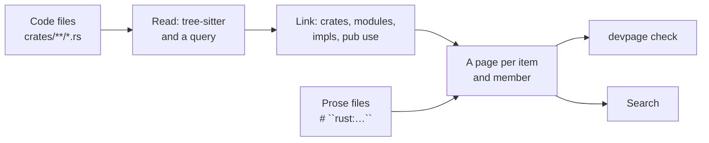

# Code reference

A site's [code reference](../glossary/README.md#code-reference) is a page for
every module, type and function of the code it names, in the style of DocC:
made from the code as it is now, live as you save, checked when prose links
to it, and never written to disk. This page is how to use it; how devpage
reads the code is in [Reading the code](reading-the-code/README.md). It
belongs to the [viewer](../README.md). devpage's own is
[the Rust reference](../../../reference/rust).



## Enabling it

A site enables the [system extension](../glossary/README.md#system-extension)
`code` in its document file, with one
[namespace](../glossary/README.md#namespace) per language and the files to
read:

```yaml
extensions:
  code:
    config:
      rust:
        files:
          - "../core/src/**/*.rs"
          - "../src/**/*.rs"
        private: true
```

`files` are glob patterns relative to the document file, inside the served
folder. `private: true` gives items no `pub` path reaches pages too; without
it the reference is the public API. Every field, and the errors a wrong one
stops devpage with, are in the
[configuration reference](../configuration-reference/README.md#code). Only a
site has a code reference.

## The pages

The pages are under `reference/<namespace>/` in the site's folder, shown in the
site's frame like its own pages, and laid out as Apple lays out a symbol page,
with no label the layout already says:

- The kind — Structure, Method of `Answers`, Module… — above the name, and the
  doc comment's first paragraph as the abstract.
- The declaration, as written without its body, on a card, with the file and
  line it is in under it.
- The rest of the doc comment, and any [prose](#adding-prose) that adds to it.
- What it holds, grouped by kind — a module's modules, structures,
  enumerations, traits, functions…; a type's fields, variants, associated
  functions and methods — each its declaration on one line with its name in
  bold, linked, and its abstract under it. A type's traits close the page.

Every [item](../glossary/README.md#item) has a page, and so does every
[member](../glossary/README.md#member): `reference/rust` lists the crates,
`reference/rust/devpage_core/answer` is a module, `…/answer/Answers` a
structure and `…/answer/Answers/path` its method. A Topics entry for
`reference/rust` opens the reference's tree in the sidebar: its crates, and
under each module its modules and types. A function's or a member's page keeps
its module or its type open there.

A doc comment reads as the page's Markdown: its headings go below the page's
own, an unlabelled code block is Rust with rustdoc's hidden `# ` lines left
out, and rustdoc's links to names show as the name. An item a `pub use` makes
public in another module has its page there; its address where it is declared
leads to the same page. An item marked `#[cfg(test)]` or `#[doc(hidden)]` has
none, nor does anything inside it.

A real file at one of these addresses wins, as anywhere in the served folder.
An address under `reference/` with nothing there answers the
[404 page](../making-a-site/README.md#a-page-for-missing-addresses), offering
the closest name: `nothing at …/my_lib/Stor — did you mean …/my_lib/Store?`.

## Linking to code

Link to a page like to any page of the site:

```markdown
[`Answers::path`](../reference/rust/devpage_core/answer/Answers/path)
```

[`devpage check`](../checking-links/README.md) and the preview check it: a
name the code no longer has is `broken link … — no such code; did you mean …?`,
with the closest page, and a `#fragment` the page doesn't have is
`broken link … — no section #…`. So a rename in the code fails the check of
every page that still links to the old name.

## Adding prose

A [prose file](../glossary/README.md#prose-file) is a Markdown file anywhere in
the site whose first non-blank line is a heading of an item's or a member's
[id](../glossary/README.md#id), `<namespace>:<path>`, between double backticks.
What follows it is added to that page, after the doc comment:

```markdown
# ``rust:devpage_core::answer::Answers``

Every route is decided here, so it is tested without a socket.
```

A prose file whose id names nothing — the item was renamed or removed — is a
problem: `devpage check` reports `<file>:<line>: ``<id>`` names no code` and
exits `1`, and the reference's pages list it. So is a second prose file for an
id: `` ``<id>`` is added to by <file> already ``, the first in path order being
the one added.

## Changing what is read

devpage reads each file with the language's built-in tree-sitter query,
[`rust.scm`](../../../../core/src/code/rust.scm). To read the code
differently — another kind of declaration, a macro your code declares items
with — copy it, change it, and point the namespace's `query` at your copy.
What a query can capture, and what devpage does with each capture, is in
[Reading one file](reading-the-code/README.md#reading-one-file). A query that
doesn't compile stops devpage at start, naming its line; one saved while devpage
runs is a problem on the reference's pages until it compiles, and the last
query that did keeps reading the code.

## What it doesn't see

It reads the code as written, not as compiled: no macro output, no `#[cfg]`
evaluation, no `#[path]` attributes, no inferred types, and no links a doc
comment writes to a Rust path. A file outside its crate's `src/` — a test, a
bench, `build.rs` — is no module.

## Publishing it

A code reference is meant to be read by running `devpage` in the repository,
where it reads the code as it is now. A site that enables it can still be
[published](../server/publishing/README.md): the publish carries each
namespace's files, the `Cargo.toml` naming their crate, its query file and its
prose files, and the server builds the version's reference from them as
`devpage` does locally. Only code inside the published folder can be carried,
as for any file a publish holds.

## Topics

### Mechanisms

- [Reading the code](reading-the-code/README.md) — how one file is read with a
  query, how the files are linked into items, and how the reference stays live
  and searched.

### Reference

- [The `code` extension's fields and errors](../configuration-reference/README.md#code)
  — every field of a namespace, and the errors devpage stops with.
- [`devpage_core::code`](../../../reference/rust/devpage_core/code) — the
  implementation, in devpage's own reference.
