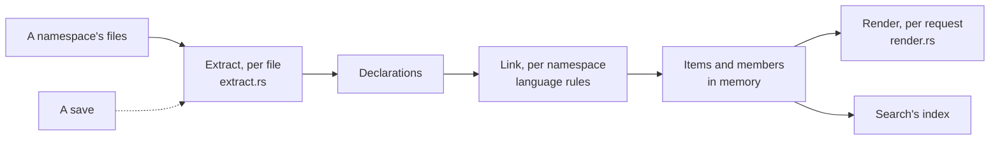

# Reading the code

How devpage turns a namespace's files into the pages of a
[code reference](../README.md): each file read on its own with a tree-sitter
query, every file's declarations linked into items, a page rendered when it is
asked for, and all of it kept current as files are saved. It is a mechanism
page, for someone about to change `core/src/code/`
([`devpage_core::code`](../../../../reference/rust/devpage_core/code)).

## Reading one file

Each file is parsed by its language's tree-sitter grammar, compiled into
devpage, and matched against the namespace's query. The query decides what a
declaration is; devpage reads these captures:

| Capture | What it marks |
| --- | --- |
| `@item.<kind>` | A declaration of that kind — `function`, `struct`, `field`… Known kinds include: `module`, `struct`, `enum`, `union`, `trait`, `type`, `function`, `constant`, `static`, `macro`, `field`, `variant`, `class`, `interface`; provider kinds also form groups. |
| `@name` | Its name, in the same match; string literals are decoded. |
| `@doc`, `@signature`, `@public` | Explicit documentation, source signature and public visibility for custom declaration patterns. |
| `@visibility` | Its visibility when written: `pub` is public, anything else (`pub(crate)`) restricted; none is private. |
| `@attach` | A block whose members belong to another declaration — an `impl` — with `@attach.to`, the type it names, and `@attach.trait`, the trait when it implements one. |
| `@reexport` | A statement making a name reachable where it is written — `pub use` — with `@reexport.path` and its `@visibility`. |

A declaration's parent is the nearest declaration or `@attach` block around it
in the file; one inside a function's body is local and has no page. Its
signature is its text up to its `body` field, or all of it; its doc comment is
the `///` or `/** */` comments just before it, attributes skipped, and a
file's own doc is its `//!` lines. `#[cfg(test)]` or `#[doc(hidden)]` just
before a declaration leaves it out. Where a file doesn't parse, the parts that
do are kept, but parse failures remain check problems. Python uses docstrings,
TypeScript JSDoc, and PyO3 attributes plus explicit registration.
Extracting knows nothing of any other file, so it runs on every
core at once.

Selected local Rust templates are expanded before linking and parsed through
the same reader. Their expanded source and original invocation lines are also
passed to native semantic providers, preserving fields and attributes for joins.

## Linking the files

What no one file can say, the Rust linker resolves across all of them:

- **The crate and the module** a file is: the nearest `Cargo.toml` above it
  names the crate — its `[lib] name`, or its `[package] name` with `-` as
  `_` — and the file's place under that crate's `src/` the module: `lib.rs` and
  `main.rs` are the crate, `a/mod.rs` and `a.rs` are `a`, `a/b.rs` is `a::b`.
  A file outside `src/` belongs to no module and has no page.
- **Members:** a field or variant belongs to the type around it; a function
  in an `impl` of a type — in any file of the crate — is that type's method,
  found in the same module first, then as the one type of that name in the
  crate. An `impl` of a trait adds the trait to the type's list, not its
  functions.
- **Reachability:** an item is public when it is `pub` and every module down
  to it is declared `pub`. Without `private`, only those have pages.
- **`pub use`:** an item a `pub use` in a public module reaches, which no
  `pub` path reaches otherwise, gets its page at the `pub use`'s path; its
  declared path becomes an alias of it. `crate::`, `self::`, `super::`,
  another crate's name and `{…}` lists resolve; a glob makes no alias.

Python and TypeScript use file modules below the configured `root`, plus an
optional `module` prefix. Named TypeScript reexports resolve source declarations.
PyO3 binding attributes and module registrations supply Python identities and
callable signatures; interpreter arguments never appear as user parameters.
Native providers contribute validated items directly to this same catalog.

A namespace is linked again, whole and in memory, whenever one of its files
changes: linking is a pass over every file's declarations, which stay as they
were extracted.

## Answering an address

An address under the site's `reference/` is answered after the served
folder's own files and before the 404 page: a real file there wins, a page of
the reference comes next, and the 404 page offers the closest name when there
is none. `reference/<namespace>` is the namespace's page; a path below it names
an item, an alias of one, or a member under its type. The page is rendered on
request from the items as they are now, as Markdown the site's frame shows
like its own pages ([Serving pages](../../serving-pages/README.md#the-url-is-the-file-path)).
Link checking asks the same index whether an address is a page and which
section ids it holds ([Checking links](../../checking-links/README.md#what-is-checked)).

## Staying current

When devpage loads the site, every file the namespace's `files` match is
read — `.gitignore`d and hidden files left out — and linked. A namespace's
folders are always watched, whatever the site's `watch` list says
([the watch set](../../live-updates/README.md#the-watch-set)). A saved file is
extracted again and its namespace linked again before open pages refresh; a
file new to the namespace walks its folders again, so an ignored one is still
left out. A saved prose file is read again. A saved query is compiled and
every file extracted with it; a query that doesn't compile is a problem until
it does, and the last one that did keeps reading.

[Search](../../search/README.md#what-is-searched) indexes every item's and
member's page as one section — its name, its doc comment and prose as text,
its declaration as code — and after a save indexes again only the pages whose
text changed.

Nothing is written to disk. Native capture compiles each configured language
query once per preparation and reuses it for every matching source file.
