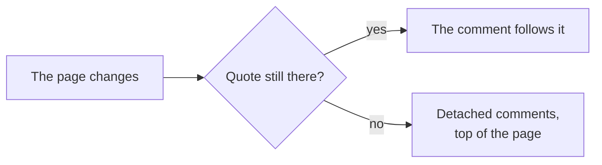

# Comments

How readers comment on a site, a doc or a deck — a design is discussed on the
page that embeds it — and where those comments live: threads anchored to selected text or a paragraph, kept one file
per thread in a `.devpage/` folder git never sees, and resolved by deleting
that file. It sits under the [viewer](../README.md);
the files threads are kept in are on [The comment store](the-comment-store/README.md).

Comments are working notes about the docs, not part of them. Locally, the loop
is: you comment while reading, tell your agent to check the comments, and it
changes the docs and deletes the threads it has dealt with. Deployed, a team
comments and replies in the browser.

## Who wrote it

A comment is stamped with its **author** and the time it was written.

- **Locally** the author is `git config user.name` as git sees it in the
  served folder, or the system's user name when git has none.
- **Deployed** the author is the value of the identity header the auth proxy
  sets — `X-Forwarded-Email` unless `--user-header` names another — trimmed. A
  comment without it, or with it blank, is refused ([devpage authenticates no one](../constraints/devpage-authenticates-no-one.md),
  [Deploying devpage](../deploying/README.md)).

## When the text changes

A comment is anchored to the **rendered text** it quotes — the page's text as
the reader sees it, every run of spaces and line breaks counted as one space —
with up to 32 characters before and after to tell repeats apart. When the page changes, the
comment follows its quote wherever it now is. When the quote is gone — the
sentence was rewritten — the comment is **detached**: it is listed at the top of
the page under *Detached comments*, still readable and resolvable, never lost
until someone resolves it.

## The comment store

Each thread is one YAML file under `.devpage/comments/`, which git never sees;
reading, replying or resolving from the files is on
[The comment store](the-comment-store/README.md).

## Topics

- [Commenting on a page](commenting/README.md) — comment mode, commenting on
  text or a paragraph, replying, resolving, and turning comments off.
- [The comment store](the-comment-store/README.md) — the thread files, their
  YAML, and the requests the page script makes.
- [How a comment is written](how-a-comment-is-written/README.md) — the one
  path every thread write takes to its file and to every open page.
