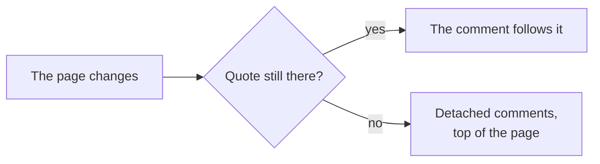

# Comments

How readers comment on any document — a site, a doc or a deck — and where those
comments live: threads anchored to selected text or a paragraph, kept one file
per thread in a `.devpage/` folder git never sees, and resolved by deleting
that file. It is a concept and task article under the [viewer](../README.md);
the files threads are kept in are on [The comment store](the-comment-store/README.md).

Comments are working notes about the docs, not part of them. Locally, the loop
is: you comment while reading, tell your agent to check the comments, and it
changes the docs and deletes the threads it has dealt with. Deployed, a team
comments and replies in the browser.

## Commenting

Commenting is opt-in, so reading a page never sprouts buttons. **Turn comment
mode on** with the speech-bubble button beside the theme toggle — at the right
end of the navbar, or in the top-right corner of a page without one. It shows
pressed while on, and the browser remembers it for the next visit. Threads
already written, their highlights and the margin show either way.

<Steps>

1. Turn comment mode on
   The speech-bubble button beside the theme toggle shows pressed while on.

2. Pick what the comment is on
   **Text**: select it, and a **Comment** button appears under the selection.
   **A paragraph**: hover over it, and a speech-bubble icon appears just to its
   right (inside its right edge when the window has no room beside it). The
   whole paragraph — or heading, list item, table, code block or diagram — is
   the anchor.

3. Write it
   A box opens at the top of the comments: write the comment and press
   **Comment** (or ⌘-Enter / Ctrl-Enter); **Cancel** or Escape drops it.

</Steps>

The comment's
text is highlighted, and on a wide window its thread sits in the margin level
with it. On a narrow window, and on slides, threads sit in a panel instead,
opened with the **Comments (n)** button in the corner — or <Keys>C</Keys> on a deck.
Clicking highlighted text opens its thread. Every open page showing that text
gets the comment at once.

Each comment is a **thread**: the first message, then replies, one level deep
as in Google Docs. Anyone can reply, in the box under the thread. **Resolve** deletes the thread — there is
no archive and no "resolved" state, because the store is not history. Anyone
can resolve any thread.

Comments are never printed: print mode leaves them out
([A PDF is the page the browser shows](../constraints/a-pdf-is-the-page.md)).

## Who wrote it

A comment is stamped with its **author** and the time it was written.

- **Locally** the author is `git config user.name` as git sees it in the
  served folder, or the system's user name when git has none.
- **Deployed** the author is the value of the identity header the auth proxy
  sets — `X-Forwarded-Email` unless `--user-header` names another. A comment
  without it is refused ([devpage authenticates no one](../constraints/devpage-authenticates-no-one.md),
  [Deploying devpage](../deploying/README.md)).

## When the text changes

A comment is anchored to the **rendered text** it quotes — the page's text as
the reader sees it, every run of spaces and line breaks counted as one space —
with up to 32 characters before and after to tell repeats apart. When the page changes, the
comment follows its quote wherever it now is. When the quote is gone — the
sentence was rewritten — the comment is **detached**: it is listed at the top of
the page under *Detached comments*, still readable and resolvable, never lost
until someone resolves it.

## The comment store

Each thread is one YAML file under `.devpage/comments/`, which git never sees;
reading, replying or resolving from the files is on
[The comment store](the-comment-store/README.md).

## Topics

- [The comment store](the-comment-store/README.md) — the thread files, their
  YAML, and the requests the page script makes.
