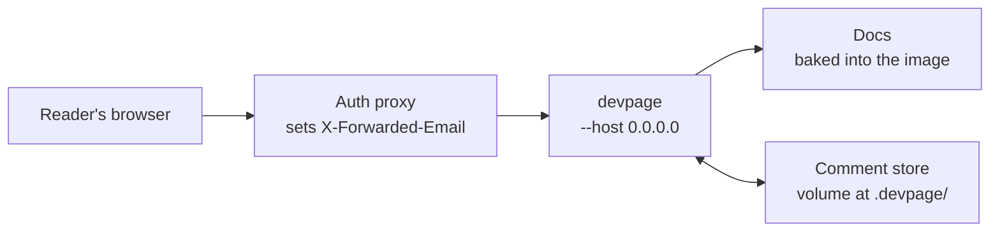

# Deploying devpage

How to run devpage for a team — on a Kubernetes cluster or any container host
— so they can read the docs and comment on them: the example image, the auth
proxy that names each reader, the volume that keeps comments, and trying the
whole thing on your machine with Docker Compose — and how to serve a public
site, which runs with comments off. It is a task article under the
[viewer](../README.md).

This is the **bundled** way to deploy: the documents are in the image, as in a
repository. To publish documents one at a time and keep their versions, see
[Server mode](../server/README.md).



## What deployed means

devpage listens on `127.0.0.1` unless `--host` gives another address. On any
address other than a loopback one it is **deployed**: it takes each comment's
author from the identity header instead of git, and refuses a comment that
lacks it. Everything else — live updates, comments, link problems — works as it
does locally.

```sh
devpage docs --host 0.0.0.0 --port 3030 --user-header X-Forwarded-Email
```

`--host` is the address to listen on, `--port` an exact port (failing if it is
taken) and `--user-header` the header that names the reader, read only when
deployed; their defaults are in the
[configuration reference](../configuration-reference/README.md#flags).

## A public site

Comments are for a team behind its auth proxy. Docs anyone on the internet can
read have no proxy to name the reader, so serve them with comments off:

```sh
devpage docs --host 0.0.0.0 --port 3030 --no-comments
```

The pages show no way to comment, every comment request answers `404`, and no
`.devpage/` volume is needed
([Turning comments off](../comments/README.md#turning-comments-off)). The
same image can serve both: add `--no-comments` to the command of the public
deployment only. `--no-comments` arrived in 0.2.1.

## The auth proxy

devpage has no login ([devpage authenticates no one](../constraints/devpage-authenticates-no-one.md)).
Put it behind the proxy your cluster already uses —
[oauth2-proxy](https://oauth2-proxy.github.io/oauth2-proxy/), or your ingress's
external authentication — and have it pass the signed-in user's email in
`X-Forwarded-Email`, or name its header with `--user-header`.

<Callout kind="danger" title="devpage must be reachable only through that proxy">
It believes the header, so anyone who can reach it directly can claim to be
anyone: expose the proxy, and keep devpage's own port inside the cluster.
</Callout>

## Caching and compression

devpage needs nothing from the proxy to be fast. Its own files are
[content-addressed](../serving-pages/README.md#caching): served once, kept by
the browser for good, never asked for again until a new devpage changes them.
The built-in assets are compressed when devpage is built, as brotli and gzip,
and sent in whichever the browser accepts, with `Vary: Accept-Encoding`. Pages,
images and widgets carry an ETag, and a browser that has the current one is
answered `304` with no body.

A proxy that compresses responses — Caddy's `encode`, say — leaves a response
that is already compressed as it is, and compresses the rest. A proxy may
weaken an ETag it compresses (`W/"…"`); devpage compares ETags the weak way,
so the browser still gets its `304`.

## The image

`deploy/bundled/Dockerfile` is an example image serving devpage's own docs. It installs
devpage from crates.io — the same `cargo install devpage` anyone runs — takes
the docs from that release, and starts devpage deployed:

```dockerfile
FROM rust:1.98.1-slim-bookworm AS build
ARG DEVPAGE_VERSION=0.2.4
# The docs and licence come from the published crate's own source, so they
# always match the binary.
RUN cargo install devpage --version "$DEVPAGE_VERSION" --locked \
 && cp -r "$CARGO_HOME"/registry/src/*/devpage-"$DEVPAGE_VERSION" /devpage-src

FROM debian:bookworm-slim
# ca-certificates: the link checker fetches https links.
RUN apt-get update \
 && apt-get install -y --no-install-recommends ca-certificates \
 && rm -rf /var/lib/apt/lists/*
COPY --from=build /usr/local/cargo/bin/devpage /usr/local/bin/devpage
COPY --from=build /devpage-src/docs /srv/docs
COPY --from=build /devpage-src/LICENSE /srv/LICENSE
COPY --from=build /devpage-src/CHANGELOG.md /srv/CHANGELOG.md
WORKDIR /srv
EXPOSE 3030
CMD ["devpage", "docs", "--host", "0.0.0.0", "--port", "3030"]
```

Build it with `docker build deploy/bundled`; it reads nothing from the build context.
`DEVPAGE_VERSION` picks the release (`--build-arg DEVPAGE_VERSION=…`). The
docs and the licence and changelog they link to come from that release's own source, which
`cargo install` has just downloaded, so the docs always describe the binary
beside them: a docs change reaches the image with the next release.

- **`ca-certificates`.** `devpage check` fetches every external link over
  HTTPS and needs the system's root certificates.
- **Same Debian.** The builder is Debian bookworm, like the runtime image, so
  the binary finds the C library it was linked against.
- **No Chrome.** The image has no browser, so it serves pages, designs and
  comments but not `devpage pdf` or a slide's PNG.

devpage runs from `/srv`, so the [served folder](../writing-a-document/README.md#the-served-folder)
is `/srv` and the comment store is `/srv/.devpage/comments`:

<FileTree>

- /srv/ — the served folder
  - docs/ — devpage's docs, baked in
  - LICENSE
  - CHANGELOG.md
  - .devpage/ — a volume, so comments survive a new image
    - comments/

</FileTree>

**Mount a volume at `/srv/.devpage`** so comments survive a new image, and
run **one replica**: the store is files, written by one process.

## Trying it with Docker Compose

`deploy/bundled/compose.yaml` runs the image behind a stand-in for the auth proxy — a
Caddy server that sets `X-Forwarded-Email: dev@example.com` on every request —
with the comment store on a named volume:

<Terminal>

```text
$ docker compose -f deploy/bundled/compose.yaml up --build
```

</Terminal>

Open `http://localhost:8090`. Comments you write are stamped
`dev@example.com`; stop and start the containers and they are still there.
devpage's own port is not published, as on a cluster: only the proxy is
reachable.

CI keeps this example working: `.github/workflows/deploy-example.yml` builds
the image and brings the compose file up on every pull request that touches
`deploy/bundled/`, every push to main and weekly, then expects the docs to load, a
design's PNG to come back as `image/png`, a comment to be accepted, and
`devpage check docs` to pass inside the image. The image installs the
released crate, so a change outside `deploy/bundled/` can't change what it tests.
The `install` job of `.github/workflows/gates.yml` installs devpage from the
checkout in a bare `rust:1.97-slim-bookworm` with nothing added, as
[Installing devpage](../../../installing.md) promises
([CI](../../engineering/sdlc/review-bars/README.md#ci)).
