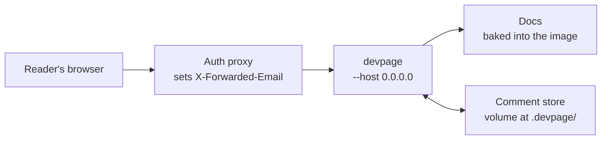

# Deploying devpage

How to run devpage for a team — on a Kubernetes cluster or any container host
— so they can read the docs and comment on them: the example image, the auth
proxy that names each reader, the volume that keeps comments, and trying the
whole thing on your machine with Docker Compose. It is a task article under the
[viewer](../README.md).



## What deployed means

devpage listens on `127.0.0.1` unless `--host` gives another address. On any
address other than a loopback one it is **deployed**: it takes each comment's
author from the identity header instead of git, and refuses a comment that
lacks it. Everything else — live updates, comments, link problems — works as it
does locally.

```sh
devpage docs --host 0.0.0.0 --port 3030 --user-header X-Forwarded-Email
```

| Flag | Default | Meaning |
| --- | --- | --- |
| `--host <address>` | `127.0.0.1` | The address to listen on. |
| `--port <port>` | the first free from 3030 up | Listen on exactly this port, or fail if it is taken. |
| `--user-header <name>` | `X-Forwarded-Email` | The request header that names the reader. Only read when deployed. |

## The auth proxy

devpage has no login ([devpage authenticates no one](../constraints/devpage-authenticates-no-one.md)).
Put it behind the proxy your cluster already uses —
[oauth2-proxy](https://oauth2-proxy.github.io/oauth2-proxy/), or your ingress's
external authentication — and have it pass the signed-in user's email in
`X-Forwarded-Email`, or name its header with `--user-header`.

**devpage must be reachable only through that proxy.** It believes the header,
so anyone who can reach it directly can claim to be anyone: expose the proxy,
and keep devpage's own port inside the cluster.

## The image

`deploy/Dockerfile` is an example image serving devpage's own docs. It installs
devpage from crates.io — the same `cargo install devpage` anyone runs — copies
the docs in, and starts devpage deployed:

```dockerfile
FROM rust:1.89-slim AS build
RUN cargo install devpage --version 0.1.0 --locked

FROM debian:bookworm-slim
COPY --from=build /usr/local/cargo/bin/devpage /usr/local/bin/devpage
COPY docs /srv/docs
WORKDIR /srv
EXPOSE 3030
CMD ["devpage", "docs", "--host", "0.0.0.0", "--port", "3030"]
```

Build it from the repository root: `docker build -f deploy/Dockerfile .`. The
docs are baked in, so a docs change is a new image, shipped like any other.
devpage runs from `/srv`, so the [served folder](../writing-a-document/README.md#the-served-folder)
is `/srv` and the comment store is `/srv/.devpage/comments`.
**Mount a volume at `/srv/.devpage`** so comments survive a new image, and
run **one replica**: the store is files, written by one process.

## Trying it with Docker Compose

`deploy/compose.yaml` runs the image behind a stand-in for the auth proxy — a
Caddy server that sets `X-Forwarded-Email: dev@example.com` on every request —
with the comment store on a named volume:

```sh
docker compose -f deploy/compose.yaml up --build
```

Open `http://localhost:8090`. Comments you write are stamped
`dev@example.com`; stop and start the containers and they are still there.
devpage's own port is not published, as on a cluster: only the proxy is
reachable.
