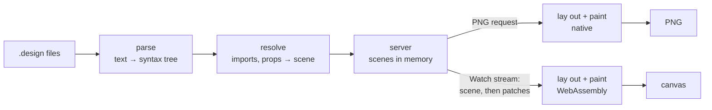

# Design engine

How a `.design` file becomes pixels: the engine parses it, resolves its
imports and props into one tree of nodes, lays the tree out, and paints it —
in the server for a PNG, and in the browser, compiled to WebAssembly, for the
canvas. A gRPC-Web stream carries each change to the browser as the nodes that
changed. It is a mechanism page under the [viewer](../README.md), for someone
about to change the engine, its stream or the canvas page; what a design can
say is in [Designs](../designs/README.md).



## One crate, two targets

The engine is the `devpage-design` crate in `design/`, a member of devpage's
Cargo workspace. It has no I/O: it is given file contents and asked for
results, so the same code runs in two places.

- **Native**, linked into `devpage`: the server parses and resolves designs,
  and paints PNGs.
- **WebAssembly**, as `design/wasm` — a `cdylib` built for
  `wasm32-unknown-unknown` with plain `extern "C"` exports and a hand-written
  loader in the page script, so building it needs no tool beyond `cargo`. The
  canvas page lays out and paints with it.

`devpage`'s build script builds the WebAssembly module and the binary carries
it as a [built-in asset](../serving-pages/README.md#built-in-assets), so an
installed `devpage` is still one file. `rust-toolchain.toml` names the
`wasm32-unknown-unknown` target, so `rustup` installs it on the first build.

## Parsing

The parser turns a file into a syntax tree: imports, then one element with its
attributes and children, each carrying its line and column. It reads the JSX
subset [Designs](../designs/README.md) defines — string and braced values,
array and object literals, `{prop}` references, text with references in it,
`//` comments — and nothing else. A file that doesn't parse gives one problem
at the first place it went wrong.

## Resolving

Resolving turns a design and the designs it imports into a **scene**: one tree
of **nodes**, each a frame, text, rectangle, ellipse, vector or image with
every attribute checked, typed and defaulted. An instance becomes the
imported design's tree with its props substituted; it stays one node — its
root — that knows which design it came from. Resolving reports every problem
it finds, not just the first: unknown elements, attributes and props, values
of the wrong type, missing or out-of-folder imports and images, and designs
that use themselves.

A node's **id** is the path of child positions from the root (`0.2.1`), which
is what [patches](#the-watch-stream) address.

## Layout

Auto layout is flexbox restricted to what Figma's auto layout does, so the
engine lays out with `taffy`, a Rust flexbox implementation: `layout="row"`
and `"column"` are a flex direction, `gap`, `padding`, `align` and `justify`
map onto their flex properties, `"hug"` is content size, `"fill"` is
`flex-grow: 1` along the direction and stretch across it, and a frame with
`layout="none"` places its children absolutely at their `x` and `y`.

Text is measured and shaped with `cosmic-text`, over the Inter faces the
engine embeds — regular, medium, semibold and bold — so the line breaks are
the same natively and in WebAssembly. No system font is ever consulted.

## Painting

The painter walks the laid-out scene and draws it with `tiny-skia`, a CPU
rasterizer, into an RGBA buffer: fills and gradients, strokes, rounded corners,
blurred shadows, clipping, vector paths, images and glyphs, each at the node's
opacity. A PNG is that buffer encoded; the canvas is that buffer put on the
screen. Painting on the CPU is what makes the two
[the same drawing](../constraints/a-design-has-one-renderer.md): there is no
GPU or browser between the scene and the pixels.

## In the server

The server keeps every design it has been asked for **resolved in memory**,
with the files each one was made from. When the [watcher](../live-updates/README.md#the-watcher)
reports a changed file, only the designs made from that file are parsed and
resolved again; nothing else is re-read. Painting happens when a PNG is asked
for, from the scene already in memory.

| Route | Answer |
| --- | --- |
| `GET /{path}.design` | the canvas page for the design |
| `GET /{path}.design.png` | the design painted at 1×, `image/png`; `422` and the problems as `text/plain` when it has any |
| `POST /devpage.design.v1.Designs/Watch` | the [watch stream](#the-watch-stream), as gRPC-Web |

## The watch stream

The browser and the server speak gRPC-Web, defined in `proto/design.proto` and
served by `tonic-web` on devpage's own address — no proxy. There is one
call:

```proto
service Designs {
  rpc Watch(WatchRequest) returns (stream Update);
}
```

`Watch` names a design by its address and streams **updates** for as long as
the page is open:

- the first update is the whole scene;
- after a save, the server resolves the design again, compares the new scene
  with the one it last sent, and sends a **patch**: the nodes whose subtree
  changed, each replaced by its id;
- when the design has problems, an update carries them instead, and the
  browser keeps the last scene it drew.

A save that changes nothing in a design's scene sends nothing.

## In the browser

The canvas page loads the WebAssembly module, opens the watch stream with
`fetch`, reads the gRPC-Web frames off the response body and hands each
message's bytes to the module, which decodes it and applies it to the scene it
holds. The module lays out and paints; the page puts the buffer on a
`<canvas>` sized to the screen's device pixels. It paints only when the scene
changes or the view does — a zoom, a pan, a resize — and only the part in
view.

Clicks are hit-tested by the module against the laid-out scene, and an
interaction runs in the page: a navigation pushes the new address onto the
browser's history and opens a stream for that design, an overlay opens a
second stream and paints its scene over a dimmed copy of the first.

A page that embeds designs does the same for each `<canvas>` it holds, one
stream per embedded design, closed while the tab is hidden like the
[event stream](../live-updates/README.md#why-one-stream-per-tab).

## Failure modes

| What happens | What the reader sees |
| --- | --- |
| A file has problems | The problems over the last valid drawing; the PNG route answers `422` with them. |
| A design is deleted | The stream ends with the problem `no such file`. |
| devpage stops | The canvas keeps its drawing; the page reopens the stream when devpage is back and gets the whole scene again. |
| The module fails to load | The canvas says so; the PNG route is unaffected. |
