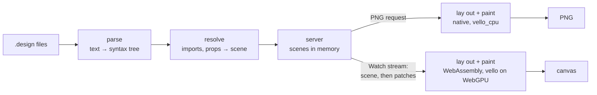

# Design engine

How a `.design` file becomes pixels: the engine parses it, resolves its
imports and props into one tree of nodes, lays the tree out, and paints it —
on the GPU in the browser, compiled to WebAssembly, for the canvas, and on the
CPU in the server for a PNG. A gRPC-Web stream carries each change to the browser as the nodes that
changed. It is a mechanism page under the [viewer](../README.md), for someone
about to change the engine, its stream or the canvas page; what a design can
say is in [Designs](../designs/README.md).



## One crate, two targets

The engine is the `devpage-design` crate in `design/`, a member of devpage's
Cargo workspace. It has no I/O: it is given file contents and asked for
results, so the same code runs in two places.

- **Native**, linked into `devpage`: the server parses and resolves designs,
  and paints PNGs on the CPU.
- **WebAssembly**, as `design/wasm` — a `cdylib` built for
  `wasm32-unknown-unknown`. The canvas page lays out and paints with it, on
  the GPU.

`devpage`'s build script builds the WebAssembly module and generates its
JavaScript bindings with `wasm-bindgen`, used as a library
(`wasm-bindgen-cli-support`), so building needs no tool beyond `cargo`. The
binary carries both as [built-in assets](../serving-pages/README.md#built-in-assets),
so an installed `devpage` is still one file. `rust-toolchain.toml` names the
`wasm32-unknown-unknown` target, so `rustup` installs it on the first build.

## Parsing

The parser turns a file into a syntax tree: imports, then one element with its
attributes and children, each carrying its line and column. It reads the JSX
subset [Designs](../designs/README.md) defines — string and braced values,
array and object literals, `{prop}` references, text with references in it,
`//` comments — and nothing else. A file that doesn't parse gives one problem
at the first place it went wrong.

## Resolving

Resolving turns a design and the designs it imports into a **scene**: one tree
of **nodes**, each a frame, text, rectangle, ellipse, vector or image with
every attribute checked, typed and defaulted. An instance becomes the
imported design's tree with its props substituted; it stays one node — its
root — that knows which design it came from. Resolving reports every problem
it finds, not just the first: unknown elements, attributes and props, values
of the wrong type, missing or out-of-folder imports and images, and designs
that use themselves.

A node's **id** is the path of child positions from the root (`0.2.1`), which
is what [patches](#the-watch-stream) address.

## Layout

Auto layout is flexbox restricted to what Figma's auto layout does, so the
engine lays out with `taffy`, a Rust flexbox implementation: `layout="row"`
and `"column"` are a flex direction, `gap`, `padding`, `align` and `justify`
map onto their flex properties, `"hug"` is content size, `"fill"` is
`flex-grow: 1` along the direction and stretch across it, and a frame with
`layout="none"` places its children absolutely at their `x` and `y`.

Text is measured, shaped and broken into lines with `parley`, over the Inter
faces the engine embeds — regular, medium, semibold and bold — so the line breaks are
the same natively and in WebAssembly. No system font is ever consulted.

## Painting

The painter walks the laid-out scene once and turns it into the engine's
**display list**: an ordered list of drawing commands in canvas pixels —
fills and gradients, strokes, rounded corners, blurred shadows, clip and
opacity layers, vector paths, images and parley's glyph runs. Everything a
drawing depends on is decided there. Two thin backends replay that one list,
each translating a command into its library's call and nothing more:

- **In the browser, on the GPU**: `vello` through `wgpu` on WebGPU, straight
  into the canvas. This is the path for speed — a pan or a zoom repaints the
  whole view on the GPU each frame.
- **In the server, on the CPU**: `vello_cpu`, into an RGBA buffer that is
  encoded as the PNG — a server, a CI runner or a container has no GPU to
  count on. A browser without WebGPU paints the canvas with `vello_cpu` too.

Both backends replay the
[same display list](../constraints/a-design-has-one-renderer.md); they differ
only where two rasterizers can — the last bit of anti-aliasing at an edge.
`vello_cpu` has its own API rather than replaying a `vello` scene, which is why
the shared form is the engine's list and not a vello type.

## In the server

The server keeps every design it has been asked for **resolved in memory** —
its scene or its problems — with every file resolving it asked for, missing
ones included, and the text of every file it read (`src/designs.rs`). When the
[watcher](../live-updates/README.md#the-watcher) reports a changed file, the
store forgets that file's text, and only the designs that asked for it are
parsed and resolved again; their other files come from memory, and no other
design is touched. A design whose scene or problems came out different is
announced to its watch streams. Creating a file a design was missing counts as
a change to it. Painting happens when a PNG is asked for, from the scene
already in memory. `devpage check` and a page's problems bar read designs
straight from disk instead, as they read pages.

| Route | Answer |
| --- | --- |
| `GET /{path}.design` | the canvas page for the design |
| `GET /{path}.design.png` | the design painted at 1×, `image/png`; `422` and the problems as `text/plain` when it has any |
| `POST /devpage.design.v1.Designs/Watch` | the [watch stream](#the-watch-stream), as gRPC-Web |

## The watch stream

The browser and the server speak gRPC-Web, defined in `proto/design.proto` and
served by `tonic-web` on devpage's own address — no proxy. There is one
call:

```proto
service Designs {
  rpc Watch(WatchRequest) returns (stream Update);
}
```

`Watch` names a design by its address — with or without the leading `/` —
and streams **updates** for as long as the page is open:

- the first update is the whole scene;
- after a save, the server resolves the design again, compares the new scene
  with the one it last sent, and sends a **patch**: the nodes whose subtree
  changed, each replaced by its id;
- when the design has problems, an update carries them instead, and the
  browser keeps the last scene it drew; once fixed, the next patch is against
  that last scene;
- when the design's own file is deleted, its `no such file` problem is the
  last update and the stream ends.

A save that changes nothing in a design's scene sends nothing, and the same
problems are not sent twice.

## In the browser

The canvas page loads the WebAssembly module (`assets/design.js` does the
page's part), opens the watch stream with `fetch`, reads the gRPC-Web frames
off the response body and hands each message's bytes to the module, which
decodes it and applies it to the scene that canvas holds — the module keeps
one per canvas. The module lays out and paints on the GPU into a `<canvas>`
sized to the screen's device pixels; one WebGPU device serves every canvas on
the page. It lays out again only when the scene changes, and paints only when
the scene or the view does — a zoom, a pan, a resize — at most once per
animation frame.

Without WebGPU the module paints with `vello_cpu` once per zoom level, and a
pan only moves that painting on the canvas. Print mode always paints on the
CPU, into a 2D canvas, which Chrome prints reliably.

Clicks are hit-tested by the module against the laid-out scene, and an
interaction runs in the page: a navigation pushes the new address onto the
browser's history and opens a stream for that design, an overlay opens a
second stream and paints its scene on a canvas of its own, centered over the
first behind a dimmed backdrop.

A page that embeds designs does the same for each `<canvas>` it holds, one
stream per embedded design, closed while the tab is hidden like the
[event stream](../live-updates/README.md#why-one-stream-per-tab). The page
script loads the design script only on a page that has a design. An embedded
design navigates inside its own canvas, with a back stack of its own, so the
page around it stays where it is; and when the page fetches itself again, each
embedded canvas still in it is kept, drawing and stream and all.

## Failure modes

| What happens | What the reader sees |
| --- | --- |
| A file has problems | The problems over the last valid drawing; the PNG route answers `422` with them. |
| A design is deleted | The stream ends with the problem `no such file`. |
| devpage stops | The canvas keeps its drawing; the page reopens the stream when devpage is back and gets the whole scene again. |
| The module fails to load | The canvas says so; the PNG route is unaffected. |
| The browser has no WebGPU | The module paints with `vello_cpu` and puts the buffer on the canvas. |
