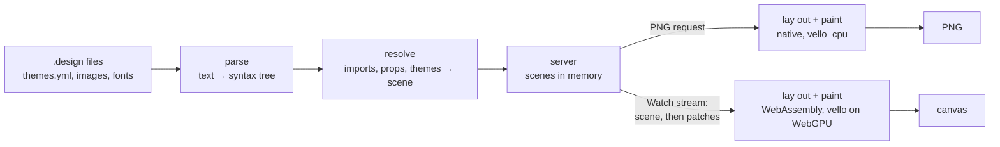
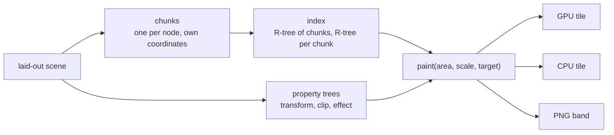

# Design engine

How a `.design` file becomes pixels: the engine parses it, resolves its
imports and props into one tree of nodes, lays the tree out, and paints it —
on the GPU in the browser, compiled to WebAssembly, for the canvas, and on the
CPU in the server for a PNG. A gRPC-Web stream carries each change to the browser as the nodes that
changed. It is a mechanism page under the [viewer](../README.md), for someone
about to change the engine, its stream or the canvas page; what a design can
say is in [Designs](../designs/README.md).



## One crate, two targets

The engine is the `devpage-design` crate in `design/`, a member of devpage's
Cargo workspace. It has no I/O: it is given file contents and asked for
results, so the same code runs in two places.

- **Native**, linked into `devpage`: the server parses and resolves designs,
  and paints PNGs on the CPU.
- **WebAssembly**, as `design/wasm` — a `cdylib` built for
  `wasm32-unknown-unknown`. The canvas page lays out and paints with it, on
  the GPU.

The WebAssembly module and its JavaScript bindings are **vendored**: built
once, committed under `core/assets/vendor/` like the
[pele bundle](../vendored-pele/README.md), and compiled into the binary as
[built-in assets](../serving-pages/README.md#built-in-assets), so an installed
`devpage` is still one file and building devpage needs neither the
`wasm32-unknown-unknown` target nor a nested build. One command, named on
[Developing devpage](../../engineering/developing-devpage/README.md), rebuilds
them — with `wasm-bindgen` used as a library — and records a fingerprint of
everything they are built from: the engine's and the module's sources, the
proto and the locked dependency versions. A test fails when that fingerprint
no longer matches the sources, naming the command, so the vendored module can
never silently lag the engine. Only someone changing the engine needs the
`wasm32-unknown-unknown` target, which `rust-toolchain.toml` names.

`devpage-design` is published to crates.io when devpage is released, first
and at the same version, so `cargo install devpage` builds the native engine
from the registry and takes the module from the vendored files — see
[Release](../../engineering/sdlc/stages/README.md#release).

## How the engine is built

The engine is a **core** with **adapters** plugged into it — the shape of
devpage's own [code map](../../engineering/code-map/README.md). The core
links no rasterizer: no `vello`, `vello_cpu`, `wgpu` or PNG encoder. Its
geometry and colours are `kurbo`'s and `peniko`'s, depended on directly, the
values both backends take, and a glyph is the engine's own. What varies
between the browser and the server is reached through one **port**,
`display::Target` — paint this area at this scale into this target — which
each [paint backend](../glossary/README.md#paint-backend) adapts. The
dependencies point inward: an adapter uses the core, never the reverse, and
a test (`the_core_names_no_adapter`, in `design/src/lib.rs`) fails when a
module of the core names an adapter or a rasterizer.

| Module | Role | Does |
| --- | --- | --- |
| `parse` | core | Text to a syntax tree. |
| `ids` | core | Element ids kept across saves: a new parse matched against the last. `Remembering`: files read with each design file's last parse kept, so the next is matched against it — what the store reads through. |
| `tree` | core | A scene's tree as a tree: a node's id, its order key among its siblings, and children under their keys. |
| `scene` | core | What a resolved design is: the scene, its nodes and their attributes, colours in both themes, image files, the scene's index from node id to place, and the `Files` port designs are read through. `edit`: how one scene becomes the next — an edit by id (a node changed, a subtree inserted, removed or moved), the edits between two scenes, edits with the files they bring, applied all or nothing, and what they did, for a drawing to follow. |
| `resolve`, `fonts` | core | A syntax tree and its imports, props, themes, images and font files to a scene; `again`, a design kept resolved and a change resolved again only as far as it reaches, into the edits that bring its scene across. |
| `render` | core | The renderer — its fonts and text shaping. `layout`: the scene as kept taffy trees — the drawing's own, and one per [run](#layout-boundaries-and-runs) — every frame with children is one — its children each laid out on their own: along a line, their sizes in prefix sums, one size for each child no ask can change and per ask the rest (`layout/run`); a run's `"fill"` children's share, from a flex tree of its own (`layout/run/fill`); a frame with no layout, its children at their own places and its hug counted (`layout/run/free`) — what can depend on the room it is given, counted bottom-up, and every node's box. `painter`: a node's own commands. `drawing`: a scene made into a kept drawing in a theme, its area and the images it paints. `update`: a drawing brought to the next scene by what changed, and the damage. |
| `display` | core | `draw`: the drawing commands and a node's box after layout. `trees`: the property trees. `chunk`: a node's commands under them, with their R-tree, and the builder that makes them. `list`: every chunk by paint order and the design's own space's R-tree. `run`: a run's children as spaces of their own — placed by the run's prefix sums and its one step between children, or, for a frame with no layout, at their own places and found by an R-tree of their boxes — and the run's one entry in the space it is in. `paint`: the one paint entry point and its port, `Target`. `hit`: hit testing through the index. |
| `prefix_sums` | core | A sequence in key order with every prefix's summary in log time: what a run keeps its children's sizes in. |
| `tiles` | core | Where a tile is, the pyramid's levels, the tiles a view needs and where each lands; `cache`: the tile cache and the damage that makes tiles stale; `plan`: the [frame plan](#the-frame-plan) both browser compositors carry out. The server uses the cache only. |
| `design` | core | A design as it is held while it is shown — its scene, the design's one copy, how many nodes use each file, and its drawing in each theme its holder asks for — each drawing brought along by every edit, the damage to its tiles kept until taken; its size, the interaction at a point, a view's tiles and an area to paint, rounded first; and [one rule for a scene that can't be drawn](#a-design-that-cant-be-drawn). The store and every canvas hold their designs as one. |
| `shadow`, `atlas`, `compare` | core | A shadow's samples and pieces; the GPU atlas's model; the rule two drawings are compared by. |
| `wire`, `proto` | core | Scenes and their edits as the watch stream's messages, and back: a scene whole; `patch`, edits as a patch, each file in it once. It does no I/O. |
| `cpu` | adapter | The `vello_cpu` paint backend, and a tile's straight-alpha pixels. |
| `png` | adapter | The PNG, written band by band — each band at most 16 MB of pixels — from whatever gives it tiles or strips; `png::fresh`, a scene drawn afresh and kept by nothing, as the PNG the tests compare a drawing against. |

In the module (`design/wasm/src/`), `lib.rs` is a canvas's `Design` — the
engine's `design` and the canvas's frame plan, bound for the page: a stream
message applied to it, its damage handed to the plan without leaving the
module, a frame's work and a tile's arrival for the CPU's compositor, a tile
on the CPU for the worker, hit testing; `vello_backend.rs` the `vello` paint
backend; `compositor/` the compositor on WebGPU — `mod.rs` a frame of the
plan carried out, `paint.rs` painting a tile into its texture, `pass.rs` the
composite pass. The page's part is the design script
and its modules ([in the browser](#in-the-browser)).

## Parsing

The parser turns a file into a syntax tree: imports, then one element with its
attributes and children, each carrying its line and column. It reads the JSX
subset [Elements and attributes](../designs/elements-and-attributes/README.md#attributes) defines — strings in double
or single quotes with no escapes, bare attributes as `true`, braced numbers,
booleans, props and `theme.<name>` colors, array and object literals, names
with `-` in them, text with references in it, `//` comments — and nothing
else. A file that doesn't
parse gives one problem at the first place it went wrong; so does one nested
more than 256 deep, or with a number past ±1,000,000, which keeps the parser's
recursion and every later step finite. Numbers written inside a string — a
gradient's angle and stops, a `viewBox`, a vector's `d` — are held to the same
limit while resolving, so none of them is infinite or not a number either.

### Element ids

Every element of a file has an **element id**, a number unique in that file
that stays the element's while the file is edited. The first parse of a file
numbers its elements in order. Every later parse is matched against the last
one, sibling list by sibling list, so an element keeps its id however the
lines around it change:

- siblings with a [`key`](../designs/elements-and-attributes/README.md#attributes)
  are matched by it;
- the others by a shortest edit script over the sibling list (Myers' diff),
  comparing each element whole — its name, its own attributes and everything
  in it, so a row inserted before a run of rows alike but for their text is
  that row, not a shift of them all — so an element inserted, removed or
  moved costs the elements it touched, not the list. Myers' diff costs the
  list's length times the edits, so past 256 edits in one list — a save that
  rewrote it — the list is matched by a histogram diff instead, which anchors
  on elements that occur once on each side and recurses between the anchors,
  near-linear however many edits there are; never by position —
  and then, among what is left, an unmatched element with an unmatched one of
  the same name in the same place, as an edit of it;
- a matched element's children are matched the same way; an element left
  unmatched is new and takes the file's next id.

Matching costs a pass over the file that changed — the one step of a save
that stays linear in what was saved — and nothing over any other file.

No input makes the engine panic: every value is checked before it is used, a
colour's digits as characters rather than bytes, and the resolver stops a tree
nested more than 256 deep through instances. The server also catches a panic
around every call into the engine and reports it as a problem with the design,
so even a bug in the engine can't take down the server or its file watcher.

## Resolving

Resolving turns a design and the designs it imports into a **scene**: one tree
of **nodes**, each a frame, text, rectangle, ellipse, vector or image with
every attribute checked, typed and defaulted. An instance becomes the
imported design's tree with its props substituted, rooted at one node — the
design's root, with the instance's own attributes applied to it. Resolving reports every problem
it finds, not just the first: unknown elements, attributes and props, values
of the wrong type, missing or out-of-folder imports, images and interaction
targets, images that don't decode, fonts that can't be used, designs that use
themselves, and the [themes](#themes)' problems.

An `Image`'s file is decoded whole while resolving — a PNG or JPEG that starts
right but is broken or cut short is a problem at its `src` — and goes with the
scene as an **image file**, known by its content: the SHA-256 of its bytes.
However many `Image`s show a file, under whatever names, the scene holds it
once, decoded once, so painting never decodes. The server keeps a file decoded
until the file changes, so a save of the design doesn't decode its images
again; the browser decodes a file once, when the first scene or patch
carrying it arrives, and keeps it while the scene shows it.

A file larger than 4,096 pixels a side is resampled once, as it is decoded, to
fit 4,096 with its aspect kept — each new pixel the area-weighted average of
the pixels under it, in premultiplied alpha — and both backends draw those
pixels; an `Image` still hugs the file's own size. Why 4,096 is
[the GPU's image atlas](#the-gpus-image-atlas).

### Font files

A `Text`'s font is Inter, which the engine embeds, or a **font file**, read
through `Files` like an image file and known the same way, by the SHA-256 of
its bytes (`design/src/fonts.rs`). A `Text`'s `font` is a name, which the
resolver looks up in the [themes](#themes)' merged `fonts` of the file that
wrote it; the path there names a file, which is that font, or a folder, which
is the `.ttf` and `.otf` files `Files` lists directly in it, italic and
oblique faces passed over. Each file is checked as it is read:
at most 4 MB (`fonts::MAX_FONT_BYTES`), one TrueType or OpenType font —
neither WOFF, WOFF2 nor a collection — that parley's font collection reads,
and in a folder, one family with one file per weight. The family's name, its
weights and its weight axis come from the font's own tables, through
`fontique`, the font collection parley lays text out with.

A text's weight then picks the face: in a variable font, the weight axis set
to it; among static files, the file of that weight. The text's node names the
face's file by its id, and the scene carries each font file its texts use
once, however many texts use it, under whatever names — a folder's other
weights aren't carried. Why at most 4 MB is on
[Fonts](../designs/README.md#fonts): every font file goes whole to each
browser that shows the design.

Every path a node carries — an image's file, a font file, an interaction's
target — is stored as an address in the served folder, worked out from the
file that wrote it. A value that reaches a design as a prop is read where it
was written — a path from that file, a font name in its fonts — the instance,
or the design whose default it is; so the resolver keeps, with each prop's
value, the file that wrote it. The canvas uses an interaction's target as it is, so it never
needs to know which file an instance came from.

A node's **id** is where it came from: the element ids from the design's
root through each instance down to the element that made it (`4/12/3`),
unique in the scene — an element id is unique in its file, and a file used
twice is used through two instances with ids of their own. It survives every
edit that doesn't remove the element: an insert before it, a sibling moved
past it, a line added above it. It is what [patches](#the-watch-stream)
address and what a drawing keeps a node's chunk, box and tiles under.

### Resolving again

The store keeps, with each scene, where each node came from: its element and
the props of the instance it was resolved in. When a file changes, only what
the change can reach is resolved again:

- a design file: the elements whose own attributes changed are resolved again
  in their instances' props, each the nodes it makes and nothing else; an
  element inserted is resolved as a new subtree where it now sits; one
  removed takes its nodes with it; an instance whose own attributes changed is
  resolved again with its subtree, since its props reach all of it; an import
  that names another file resolves its instances again;
- a `themes.yml`, a font file or folder, or an image: the nodes that read it —
  the store keeps, for each, the nodes that do. A theme color among a
  design's `props` defaults is read by the instance, since any node in it
  may read that prop: a change to the themes resolves the instance again
  with its subtree — for the design's own root, the design whole, as for
  any change to its own `props` defaults.

What was resolved again is the edits that bring the scene across — what the
watch stream sends as a patch: no scene is compared with another,
with two exceptions that change the whole design and are resolved whole and
compared: a change to the design's own `props` defaults, which every node
may read, and its root element replaced. A third is a safety net, not a
path: if resolving the parts again ever fails where resolving the whole
doesn't, the whole is taken and compared, and counted — the tests hold that
count at zero.
Resolving again costs what the change reached, beside reading the file that
was saved: the saved file is parsed, matched against its last parse and
walked beside it to find what changed — linear in that file, and nothing in
any other. Each update counts the elements it resolved again, and the tests
hold that count to what the edit reached, whatever the design's size. While a design has problems, what each save reached is kept, and
the save that makes it valid again resolves all of it against the last scene
sent; the problems themselves, every one, come from resolving the design
whole, which a design with problems pays on each save. The engine resolves
again in `design/src/resolve/again.rs` (`Resolution`): where each node came
from and the files the scene was made from, but no scene. A design has one
scene, its holder's — the `Holder` port in `scene`, which the store's held
`design` is — and resolving again reads it there and applies the edits it
makes to it there, once; it answers each change with the scene unchanged,
its problems — the scene left as it was — or the edits and what they did
(`Outcome::Changed`). The store keeps one per design, and encodes the edits
as the patch its streams send.

### Themes

Every color in a scene holds two values, its light and its dark one; a `#`
color holds the same value twice. A scene also says whether it is
**themed** — whether any `theme.` reference reached it — which is what puts
the switch on an embed's backdrop.

A file's `theme.` references are bound as the file is read, before its props
go anywhere: the resolver reads the `themes.yml` in the file's folder and in
each folder above it, up to the top of the served folder, through `Files`,
like any other file — every one of them, missing ones included, once per
folder per resolve — and keeps those whose `kind` is `themes`. It merges them
top down, name by name in each theme, a lower file's names over a higher
one's. Each reference becomes its two colors there and then, and a gradient
string with references becomes two gradient strings, one per theme — so a
value passed as a prop into a design in another folder carries its writer's
colors, as a path is worked out from its writer's file. The engine reads
`themes.yml` with `serde_yaml` and finds the line of a bad entry by its key,
since YAML values carry no place. A reference to a name that both themes
don't have after merging is a problem at the reference; a malformed
`themes.yml` is one at its own line, reported once per resolve however many
references read it.

A `themes.yml`'s `fonts` — names to paths from that file — merge the same
way, name by name, and set no default. They are read only when a `Text`
names a font, so a design with no `font` reads no `themes.yml` for one. A
name the merged fonts don't have is a problem at the `font`; a font that
can't be used is one at its entry in the `themes.yml`, once per resolve
however many texts use it.

## Layout

Auto layout is flexbox restricted to what Figma's auto layout does, so the
engine lays out with `taffy`, a Rust flexbox implementation: `layout="row"`
and `"column"` are a flex direction, `gap`, `padding`, `align` and `justify`
map onto their flex properties, `"hug"` is content size, `"fill"` is
`flex-grow: 1` along the direction and stretch across it, and a frame with
`layout="none"` places its children absolutely at their `x` and `y`. Every
frame is the containing block of the boxes placed absolutely in it, as in
Figma — taffy's `position: relative` on every frame: a child at `x` and `y`
is placed, sized and rounded against its own parent frame, never a farther
ancestor, so what a frame holds lays out the same wherever the frame is.

Flexbox gives such a frame no size of its own when it hugs, so the engine sizes
it as Figma does: as far as its children's furthest right and bottom edges,
measured before taffy rounds boxes to whole pixels, so a frame's size never
depends on where it sits. Its children are laid out against its box, which
grows to their extent, and again while it grows, to the fixed point. Along an
axis it doesn't hug, it is what it is given, or its padding. A frame with no
layout is never smaller than its padding along either axis, as every other
box is. `"fill"` needs auto layout to take space from,
so on a child of a no-layout frame it is a problem, found while resolving.

### Layout boundaries and runs

A layout is kept in pieces, so that an edit lays out only what it can change.

- A **layout boundary** is a node whose own content can't change its size: a
  fixed `width` and `height`. An edit inside one lays out the boundary's own
  subtree; its size can't move, so nothing outside it is laid out again.
- A **run** is an auto-layout frame — every one — whose children are set one
  after another. A child of a run is
  laid out on its own — across, in the room the frame gives it — and its
  place along the direction is the sum of the sizes and gaps before it, kept
  in a tree of prefix sums. A child whose size changes updates the sums in log
  time and moves no sibling: a sibling's place is read from the sums when it
  is painted, hit or rounded. `"space-between"` spreads the free room as one
  more gap after each child, and the sums count children, so a place is still
  a sum. `"fill"` children share the free room — the frame's length less the
  sums of the others, in log time — resolved as flexbox resolves it, against
  each one's least size, over the fill children only; a change of the free
  room lays out again the fill children whose size it changes, and no other
  sibling. The share is found by flexbox itself, in a tree of the run's
  own: a proxy for each fill child, measured by laying the child out in its
  container, beside one spacer as long as every other child and gap and as
  broad as the broadest — so a run with fill children that hugs is as long
  as flexbox makes such a container under the room it is given, each fill
  child counting its basis. A run that hugs takes its length from the sums
  and its breadth from the largest child, kept in a counted set; `justify`
  `"center"` or `"end"` is one offset for every child. The sums are exact —
  kept in 64-bit floats — where taffy adds its items' sizes one by one in
  32-bit ones; the two agree wherever taffy's own sums are exact, as they are
  for sizes in whole pixels and fractions of a power of two. A child whose
  breadth is within a thousandth of a pixel of its line's is the line's
  broadest and sits at its start, whatever the last bit of its size measured
  under another of the run's constraints.
- A frame with no layout is a **space**: each child laid out on its own at its
  `x` and `y`, which no sibling moves; a frame that hugs takes its size from
  the furthest right and bottom of its children, kept in counted sets; its
  children are indexed in the frame's own coordinates, so the frame moving
  moves one entry.
- What changes a child's room changes the child, and only then is the child
  laid out again: a run's new breadth reaches only the children that
  stretch across it, a new free room only the `"fill"` children it resizes,
  and a frame's own look — its fill, stroke, radius, shadow, opacity, clip —
  reaches no child at all. A node's room reaches its size only along an axis
  it doesn't fix: a fixed width, or height, takes nothing from the room
  along it, whatever is inside — so a card of a fixed width holding text
  that wraps is laid out once, wherever its frame grows. A new `align` moves
  every child across that doesn't fill its line: each is placed again, and
  nothing inside it, which sits in its own coordinates.

So an edit costs the nodes whose own box or look it changes, plus log time in
each run or space on their way to the root — however many siblings they
have. A place a run reads from its sums, or a box rounded when it is read,
is not a change.

Text is measured, shaped and broken into lines with `parley`, over the Inter
faces the engine embeds — regular, medium, semibold and bold — and the scene's
font files, so the line breaks are the same natively and in WebAssembly. No
system font is ever consulted. Before it lays a scene out, a renderer
registers the scene's font files with parley's font collection, each under a
family name of its own made from its id, so a text gets exactly the file its
node names — never another font of the same family name, Inter included. A
renderer keeps what it registered while the scenes it lays out use no other
font files, and otherwise starts its collection again from Inter and the new
scene's — so a server that has drawn a thousand fonts holds one scene's. A
glyph run carries the run's point on a variable font's axes, which both
backends draw at.

## Painting

The painter turns the laid-out scene, for one theme, into the engine's
**display list**: drawing commands — fills and gradients, strokes, rounded
corners, blurred shadows, vector paths, images and parley's glyph runs — and
the **property trees** they are drawn under. Everything a drawing depends on
is decided there, the theme's value of each color included: a drawing is made
for a theme, and the scene holds both. A design has no size limit: nothing
about a frame or an edit costs more because the design is bigger — a frame
costs what is visible, an edit what changed
([a frame costs what it shows](../constraints/a-frame-costs-what-it-shows.md)).



### Property trees

The display list doesn't nest its layers. As in Chrome's compositor, every
command refers to a node in each of three trees, and the trees hold what
nesting would:

- the **transform tree** — one node per scene node, its offset from its
  parent's, so a node's commands are in its own coordinates, its box's
  top-left at the origin;
- the **clip tree** — a clipping frame's shape, in its node's coordinates, and
  the drawing's own area at the root, so nothing shows outside the drawing;
- the **effect tree** — a layer drawn at an opacity (a node's `opacity`, a
  shadow's color's alpha), or added to what is under it, color and alpha
  alike, within a bound (a shadow's pieces) — each with the clip it is drawn
  inside.

A frame with children always has an effect and a clip of its own — at no
opacity and with no shape when it has neither, which paint as no layer — so
its opacity or its clip coming or going changes them in place, and what its
children are drawn under still names them.

A shadow's layers are made as property-tree nodes too, as its commands are
built (`design/src/display/chunk.rs`), so no command opens or closes anything.

A command's **property state** is its three nodes. To paint any subset of
the list, in paint order, the painter opens and closes exactly the layers
each command's state needs: it closes the effects and clips the next command
isn't under, then opens, from the common ancestor down, each effect — inside
its own clip — and then the command's clips inside that effect. So a tile, a
band or the whole drawing is painted by the same walk, and painting part of a
design gives the same pixels there as painting all of it.

### Chunks

The list is held in **chunks**, one per scene node: the node's own commands —
its shadow, fill, image, stroke and text — in its own coordinates, in the
order they paint. Chunks paint in tree order — a node before its children,
children in order. A drawing keeps that order with an **order key** per node:
a key between its neighbours', chosen when it is inserted, so a node inserted
before the first of 100,000 siblings takes a key of its own and renumbers
none. A node's position is its
transform node, so a node that moves keeps its chunk, and its children
theirs: only the offset changes.

### The display index

Painting part of a drawing asks what touches a rectangle, and the answer
comes from a two-level R-tree (`rstar`):

- the **top level** over the chunks, each by its bounds in the design's
  coordinates — what its commands cover, cut by its clipping frames — and, for
  a node with an interaction, its box there too. A new drawing bulk-loads it,
  packed; an update removes and inserts only the chunks that changed or
  moved;
- **per chunk**, an R-tree over its commands by their bounds in its own
  coordinates, which a move doesn't touch;
- **per run**, its children by their places along its direction: the top
  level holds the run once, and a query inside it finds the first child that
  reaches the rectangle by a binary search of the prefix sums — the
  rectangle widened by the furthest any child paints past its box, kept in a
  counted set — and walks the children until one starts past it. A child that
  changes size moves no entry: its siblings' places are the sums.

A query costs log time plus what it finds, and returns the commands in paint
order. At the scale being painted, a chunk smaller than one device pixel
both ways is skipped. Nothing that paints a frame, applies an edit or
answers a click walks every node.

The design's **drawing** — the root's box, widened by everything painted
outside it and cut by any clipping frame, rounded out to whole pixels — is
kept from the chunks' bounds as they are inserted and removed, so it, too,
costs nothing to know.

### One paint entry point

Everything that makes pixels calls one function: **paint** an area of the
design, in its coordinates, at a scale, into a target. The target is a thin
backend that translates each command into its library's call and nothing
more:

- **`vello` on the GPU**, through `wgpu` on WebGPU, in the browser;
- **`vello_cpu`**, into an RGBA buffer — in the server, a CI runner or a
  container, which has no GPU to count on, and in a browser without WebGPU.

Both backends replay the
[same display list](../constraints/a-design-has-one-renderer.md); they differ
only where two rasterizers can — the last bit of anti-aliasing at an edge.
`vello_cpu` has its own API rather than replaying a `vello` scene, which is
why the shared form is the engine's list and not a vello type. Where the two
libraries mean different things by the same call, the GPU backend's
translation evens it out: vello's GPU shader samples a gradient at each
pixel's corner, where vello_cpu — and both, for an image — take its center, so
each gradient goes to the GPU moved half a device pixel.

### Tiles

What paint makes is cached as **tiles**: squares of 256 device pixels, keyed
by theme, scale and position — column and row from the drawing's top-left at
that scale — so the tiles of every scale painted so far form a pyramid. A
cache is cost-capped — each tile costs what its holder says, bytes of pixels
or one — and drops the least recently used past its cap. A
theme has tiles of its own, so switching back to one is instant.

An update to the scene marks **damage**: for each chunk it touched, the
bounds it had and the bounds it has — and, when the drawing's area grows or
shrinks along its right or bottom edge, the strip it gained or lost. A child of a
[run](#layout-boundaries-and-runs) that changes size moves every child
after it, so its damage is one rectangle: from where it starts to where the
run ends, before and after. Only the
cached tiles that overlap the damage go stale; the rest are kept. An update
that moves the area's top-left moves every tile's place, so every tile goes
stale. The cache (`design/src/tiles/cache.rs`) holds whatever a tile is to its
user — pixels in the server, a texture on the GPU — and a stale tile stays in
it, marked so, until it is painted again.

### Incremental updates

A change to a file reaches a drawing as **edits** — in the browser, the
[patch](#the-watch-stream) the server sends the canvases: nodes changed,
inserted, removed and moved, each by its id. A drawing follows them by work
proportional to them:

1. a changed node is dirty; an inserted subtree is new, with order keys
   between its neighbours'; a removed one's chunks, boxes and property-tree
   nodes are freed; a moved one keeps them and takes a new order key;
2. layout runs again only where the edits can reach: inside the
   [boundary](#layout-boundaries-and-runs) around each dirty node, and past
   it only while a box's size changed — every frame with children is a run,
   along a line by the prefix sums, or free by its counted extent. The tree
   is laid out unrounded, and only
   the boxes visited are rounded to whole pixels, each edge where taffy's own
   pass would put it — measured, as that pass measures, from the box's parent,
   which is its containing block whether it is in the flow or placed
   absolutely;
3. a dirty node's chunk is made again; a node that only moved gets a new
   offset in the transform tree — a child of a run needs none, its place is
   the sums. A child of a run the sums moved by a fraction of a pixel rounds
   differently where it now falls, and so may everything in it; the update
   doesn't round it — the damage already covers it — and before an area is
   painted, hit or read (by the held [`design`](#how-the-engine-is-built),
   in the server and the canvas alike), the children of runs there that no longer round as their boxes
   were made are rounded anew, their boxes and any chunk whose box changed
   made again. So an edit costs what it changed, the rounding costs what is
   read, and what is read is a fresh drawing's, box for box;
4. each chunk made again or moved is removed from the index and inserted
   again;
5. the damage marks the tiles that overlap it stale.

The server and the browser apply the same edits to the same kind of drawing,
so both pay only for what changed. Both apply them to the scene they hold the
same way (`scene::apply`): every replacement checked first, so edits that
can't be applied change nothing, then only the replaced subtrees swapped in — what they
replaced is what the drawing is brought across by — and a file no node uses
any more dropped by a count of the nodes using each file, never a walk of
the scene.

### Hit testing

A click is answered by the same index: the chunks at the point, in paint
order, and among them the last — the topmost — whose node has an interaction,
whose box holds the point and whose clipping frames show it.

### Shadows

A shadow is its box's own shape — each corner's radius plus the spread — blurred
by a true Gaussian with a standard deviation σ of half the `blur`, reaching
three σ, past which it is under 0.15%. Vello's blurred rounded rectangle takes
one radius for all four corners, and the two backends share no blur filter,
so the painter computes the blur itself (`design/src/shadow.rs`): it samples
the shape's coverage every half σ — the shape flattened to lines within a
hundredth of a sample, as the rasterizer's own flattening would pull a curve
in, each sample the exact area it covers to the nearest 255th, as an 8-bit
rasterizer gives it, accumulated by the engine itself — and blurs the
samples. A Gaussian that wide has no detail finer than its
samples, so, drawn smoothly, they are the shadow at any zoom. A shadow with no
blur is the shape filled.

A shadow of up to 65,536 samples is one image of them. A larger one — a big
box, or a slight blur, down to a 16,384-pixel box blurred by 2 — is never
sampled more coarsely: it is drawn in pieces, each in a layer that adds it to
what is under it, inside one layer at the shadow color's opacity, so where two
pieces meet edge to edge they add up to the shadow with no seam at any zoom:

- solid where the blur can't reach the edge;
- along a straight edge, where it varies only across the edge, the edge's
  one-dimensional profile stretched along it — one piece for each unbroken
  run, since every join inside a pixel costs each piece there a rounding;
- a corner rounded by less than 16 σ, sampled in two dimensions, the cells of
  sampled corners that meet merged into as few pieces as they make;
- a rounder corner, the blurred edge of a disc as a radial gradient: across a
  disc of radius r, the straight edge's profile less φ(d)·σ/2r, within 0.1 of
  255 of the exact blur;
- an ellipse that isn't a circle, in wedges, each within a hundredth of σ of
  its circle of curvature and drawn as that circle's blurred edge, or sampled
  where the ellipse curves tighter than 16 σ; one too thin to be solid
  anywhere, in tiles that skip where the blur can't reach.

What holds from a 100-pixel box to a 16,000-pixel one, and the tests pin: two and a half σ out the shadow is at most 2 of 255 and
fades on from there, with no step where it ends; a straight edge rises from
10% to 90% over 2.563 σ, give or take 0.2 σ, its middle on the box's edge to a
quarter of a pixel; and a shadow in pieces is the same shadow as one image by
the engine's rule — no seam — at 1× and at scales that put each meeting edge
part way across a pixel. In any channel they differ by at most 4 of 255 where
σ spans a device pixel or more. A narrower blur's edge is steeper than a
pixel, and vello_cpu's 8-bit gradients and layers round a disc corner a few
hundredths of a pixel away from the sampled image: up to 6 of 255 where σ is
half a device pixel or more, 11 at a quarter or more, 18 below — a blur of 1
seen at a quarter of its size. Those bounds were measured over 3,000 random
outlines at 0.25×, 0.5×, 0.73×, 1×, 1.37× and 2×; the test holds the hard
cases and a dozen random outlines to them on every run. A 16,000-pixel box's shadow is 32 commands and builds in about
40 µs; an ellipse 16,000 by 8,000 blurred by 2, in about 0.3 ms.

### The GPU's image atlas

vello copies every image a frame paints — image files and a shadow's images
alike — into one atlas texture at most 8,192 pixels a side, and an image that
finds no room there is left out of the frame without a word. So the engine
decides it first. `Renderer::drawing` gives each image a drawing paints a blob
of its own, made in the order the drawing first paints it, and places them as
`vello_encoding`'s own image cache places them in a fresh atlas
(`design/src/atlas.rs`): the same `guillotiere` allocator, in that order, the
atlas starting at 1,024 a side and doubling, everything placed so far repacked
at each size. A test in the module runs vello's own resolver, as the module
ships it, on the scene the canvas renders — 4,000 random sets of images, and a
real drawing with files and shadows — and holds the two to the same fit, the
same first image left out and the same places, so a vello upgrade that packs
differently fails it. A drawing whose images don't all fit is the design's problem, at
the `src` — or the `shadow` — of the first that doesn't, in the store,
`devpage check` and the PNG route alike, so the canvas never draws one with a
hole. An image file takes its room once however many `Image`s show it, and is
at most 4,096 pixels a side, so four of the largest fill the atlas.

A canvas keeps its vello renderer — and with it the atlas — only while the
drawings it shows paint the very same blobs, in the same order. Any other
drawing gets a fresh renderer: another design after a navigation, on a canvas
page or in an embed, or a save that swaps a file or changes a shadow. A tile
paints only the images that touch it, so a fresh renderer is first given one
render that paints every image of the drawing, in the drawing's order, into a
single pixel: its atlas then holds exactly the drawing's images, placed as the
engine placed them in a fresh one, and every tile finds its images there.
vello takes a scene that binds no image, gradient or glyph run as needing no
atlas: it frees the atlas texture while its image cache still counts every
image as uploaded, so a tile painting none of the images still names one of
them, outside the tile, and the atlas stays as it is for the next. A
drawing made after the one its canvas last showed, painting
the same image files and the same shadow pixels in the same order, paints that
drawing's blobs: a save that changes only text or layout keeps the atlas and
uploads no image again.

### A design that can't be drawn

A scene can stop being drawable mid-session — a save that adds an image, or
an image file that grows, past what the atlas holds. The held design
(`design/src/design/`) has one rule for it, in the store and on the canvas
alike: it keeps showing its **last good drawing** in that theme — the drawing
of the last scene that could be drawn — and no damage reaches its tiles.
Every tile is painted from it, the tiles a pan or a zoom shows that were
never painted before included, and its size and clicks are its; a PNG
answers with the problem instead. The last good drawing is made afresh from
the scene before the edit, the moment the edit leaves the scene undrawable
— the edit undone, the scene drawn, the edit applied again — so a design
pays a scene's cost once per break. The drawing that follows the scene is
kept beside it, so each later change updates it at the change's cost. Why is
the design's problem, where a design's problems already show: the problems
bar over the canvas, the PNG route and `devpage check`. The change that makes
the scene drawable again lets the last good drawing go and makes every tile
of that theme stale, and what is painted then is a fresh drawing's. A whole
scene that can't be drawn — a stream sending all of it again — keeps showing
the drawing of the scene before, rounded whole as the new one arrives; one
that can't be drawn from the start has nothing to show, and is tried again
only once the scene changes.

## In the server

The server keeps every design it has been asked for **resolved in memory** —
its scene or its problems — with every file resolving it asked for, missing
ones included, and the text of every file it read (`core/src/designs.rs`). A
`themes.yml` a design's references read is one of its files like any other,
and so is one that was looked for and isn't there; so is a font file, and a
font folder's listing, which any file created, changed or deleted directly in
the folder makes the store forget. When the
[watcher](../live-updates/README.md#the-watcher) reports a changed file —
any file not under `.git` and not `.gitignore`d, unless a site's `watch`
names it — the
store forgets that file's text, and only the designs that asked for it are
parsed and resolved again; their other files come from memory, and no other
design is touched. A save can land while a design is being resolved, after
the file was read: the store numbers each read, and keeps a result only if
every file it was made from is still the read it saw — otherwise it resolves
the design again — so a stale scene is never kept. A design whose scene or problems came out different is
announced to its watch streams. Creating a file a design was missing counts as
a change to it — a `themes.yml` written into a folder between a design and one
above it, say. A page's problems bar asks the same store for the problems of
each design the page reaches, so the design a page embeds is resolved once,
for the page and its canvas alike. `devpage check`, and a publish on the
CLI's side, make a store of their own for the one run, and a server checks a
publish in its one store, under the scratch folder's own mount, which leaves
it when the check ends; each asks it the same: a
design's problems, and every file it is made of — what a publish zips —
which are the files resolving it read. The routes are on
[Serving pages](../serving-pages/README.md#routes).

The store holds each design's scene — its one copy — as the engine's
`design`, its **drawing** made in each theme the scene shows in — layout, chunks, property
trees and index — and a design [resolved again](#resolving-again)
updates them by the edits that resolving made, the very edits its watch
streams send as a patch: only the dirty part is laid out, only dirty
chunks are made, only their index entries move, and only the tiles over the
damage go stale. A changed component file touches only the designs made from
it. The store's tiles, at 1× in each theme, share one cache capped at 64 MB of
pixels, least recently used dropped first. A [server](../server/README.md)
holds every version it serves in one store, so that cap — and one renderer —
is the whole server's: each version's designs are kept under its own mount,
`/d/<id>/v/<n>`, whichever address shows it, its validators name that mount,
and a version no router holds any more leaves the store with its tiles. A drawing whose tiles don't all fit
— about 11,600 pixels tall at 1,440 wide, with nothing else cached — has its
PNG painted afresh each time it is asked for: the cap costs time, never
memory.

A PNG is assembled **band by band**, and a band is bounded in bytes: as many
rows as fit in 16 MB of pixels, at least one. While the drawing is at most
16,384 pixels wide that is a whole row of tiles, each taken from the cache or
painted if it is missing or stale; a wider drawing's bands are shorter, each
painted in pieces 256 pixels wide and never cached. Its rows go straight into
a streaming PNG encoder (the `png` crate), which holds two rows, as the
response's body. So a PNG of any size holds one band and two rows in memory —
for a drawing 1,000,000 pixels wide, 16 MB and 8 MB — and a
PNG asked for again after an edit paints only the tiles the edit made stale. No lock of the store's is held while a band is written, so a client that
stops reading holds up only its own PNG; a save that changes the design while
its PNG is being written ends that response there, short, rather than finish
it from the next scene.

## The watch stream

The browser and the server speak gRPC-Web, defined in
`design/proto/design.proto` — the engine crate generates the messages, and with
its `server` feature the service, so the proto ships with the engine — and
served by `tonic-web` on devpage's own address, with no proxy. There is one
call:

```proto
service Designs {
  rpc Watch(WatchRequest) returns (stream Update);
}
```

A page opens **one** watch stream, whatever it shows. `Watch` names every
design the page is showing — the canvas page's design and any overlay open on
it, or each design a page embeds — by its address, with or without the
leading `/`, and streams **updates**, each naming the design it is about, for
as long as the page is open. When the set changes — a navigation, an overlay
opening or closing, embeds arriving or leaving with a page swap — the page
closes the stream and opens one for the new set, which starts again with each
design's whole scene. One stream per page matters: a browser keeps at most six
connections open to one address over HTTP/1.1, which is what devpage speaks
unless it sits behind a proxy that offers more, and the page's
[event stream](../live-updates/README.md#the-bus-and-the-stream) already
holds one. For each design in the set:

- the first update is the whole scene — every color in both themes, and
  whether it is themed — with each image file it shows and each font file
  its texts use, once;
- after a save, the server [resolves again](#resolving-again) what the save
  reached and sends a **patch**: the nodes changed (their own attributes),
  inserted (a subtree, after a sibling or first), removed and moved, each by
  its id, and only the image and font files the scene it last sent didn't
  have — a node names a file by its id;
- each patch is made once, in the store, and sent by every stream that sent
  the scene it starts from; a stream that didn't sends the whole scene;
- when the design has problems, an update carries them instead, and the
  browser keeps the last scene it drew; the store keeps what each save in the
  meantime reached, and once fixed, the next patch resolves all of it again
  against that last scene — an empty one when the fix restored it exactly — and any
  patch tells the browser the design is valid again;
- when the design's own file is deleted, its `no such file` problem is an
  update like any other: the design stays in the set, so when the file is
  written again — a branch switch, an agent rewriting it — the next update is
  a patch against the last scene sent, and it draws again without a reload. A
  stream that drops — devpage stopped — is reopened for the whole set.

A save that changes nothing in a design's scene sends nothing, and the same
problems are not sent twice.

## In the browser

The canvas page loads the WebAssembly module, opens the watch stream with `fetch`, reads the gRPC-Web frames
off the response body and hands each message's bytes to the module, which
decodes it and applies it to the scene that canvas holds — the module keeps
one per canvas — and to the drawing made from it, by the same
[incremental update](#incremental-updates) as the server's. A font file is
checked once, when the first scene or patch carrying it arrives, and kept
while the scene uses it, as an image file is decoded once; the canvas's
renderer registers it before it next lays the scene out.

The page's part is the design script, `core/assets/design.js`, which loads
the engine and starts the page's canvases, and the modules it imports, each
a [built-in asset](../serving-pages/README.md#built-in-assets):
`design-stream.js`, the page's one watch stream; `design-canvas.js`, a
canvas — its view, pointer, interactions, overlays and an embed's backdrop;
`design-tiles.js`, the compositor on the CPU, and the worker,
`design-worker.js`, that paints its tiles.

### The compositor

A canvas is drawn by a **compositor** from [tiles](#tiles). Every frame of a
pan or a zoom only places the cached tiles of the view — moved and scaled —
into a `<canvas>` sized to the screen's device pixels; nothing is painted for
it. Tiles the view needs that are missing or stale are painted after the
frame, nearest the view's middle first, at the zoom's real resolution, a few
at a time, and each is swapped in when it is ready. Until then the view
shows what the cache has — the stale tile, or the same place at another
scale, stretched — so nothing flashes, and a view is sharp once its zoom
settles. The view is shown at the scale tiles are painted at — the zoom in
device pixels, to a 1/1024th — with the drawing's top-left on a whole device
pixel, so a tile at the view's own scale lands pixel for pixel, and a click
is taken back through the same. A canvas keeps at most 384 tiles — more than
a 4K screen at twice its pixels shows — least recently used dropped first.
Each update to the design marks stale only the tiles its
[damage](#tiles) overlaps, in each theme it has been drawn in; another
design — a navigation — starts with none. What each frame shows and paints
is decided once, by the [frame plan](#the-frame-plan), for both compositors. A switch of theme keeps the other
theme's drawing and its tiles, so switching back makes and paints nothing.

- **On the GPU**: tiles are painted by `vello` through `wgpu` on WebGPU, each
  into a texture of its own, and composited by one textured-quad pass over
  the page's own background, read from the backdrop or page under it, so a
  design's transparent parts show it; a theme switch changes that background
  and the design's colors, so every canvas composites again when the page's
  `data-theme` changes. One WebGPU device serves every canvas on the page,
  and a canvas keeps a vello renderer — its
  [image atlas](#the-gpus-image-atlas) — for as long as its drawings paint
  the same images.
- **On the CPU**, without WebGPU: tiles are painted by `vello_cpu` in a
  worker, off the page's main thread, made when the first canvas without
  WebGPU needs it — the worker holds its own copy of each design, fed the
  same stream messages, while the page's own copy says which tiles an update
  made stale — and composited into a 2D canvas. Messages that reach the
  worker while it is still loading the engine wait for it.
  The page's copy of the design holds the plan, so the tiles, the scales and
  the order are the GPU's; the page asks the worker for what the plan
  requests, keeps each painting by its ticket, and draws what the plan
  draws; no whole-design bitmap and no cap on the zoom's resolution. Print mode always paints on the CPU, into a 2D canvas,
  which Chrome prints reliably.

### The frame plan

Both compositors carry out one **frame plan**, `tiles::Plan`, which the
canvas's `Design` holds in the module along with all of its state: the tiles
held, by the ticket each painting arrived under, cost-capped at 384 with the
least recently used let go; the tiles in flight — asked for and not yet
arrived — each under a ticket no plan gives twice; and whether damage
reached each one. A host keeps only the paintings — textures on the GPU,
bitmaps on the CPU — by ticket. Damage never leaves the module: each stream
message's reaches the plan as the message is applied.

- **`frame`** gives a frame's work: the paintings to draw, coarser levels
  under finer ones and the view's own level on top, each where it lands; the
  tiles to paint, the view's missing or stale ones nearest its middle first,
  once a zoom has settled; the paintings to free, which the plan let go since
  the last frame; and how many tiles the view still lacks.
- **`arrived`** takes a painting back by its ticket. One whose ticket isn't in
  flight — answered already, or asked for by the design the canvas showed
  before — is dropped. One whose tile damage reached while it was painted is
  kept and shown, stale, and asked for again. A tile painted as nothing
  (`missed`) is asked for again.

**One budget rule**: at most 6 tiles are in flight. The GPU paints each tile
the plan asks for at once, inside the frame, so it paints up to 6 a frame;
the CPU's worker answers later, so a frame asks it only for as many as have
arrived since the last.

On a slide, the 1920 × 1080 stage is scaled to the window by a transform the
canvas's CSS size doesn't see, so the bitmap follows the canvas's box on the
screen and tiles are painted at the view's zoom times that transform — the
whole drawing shows, crisp, at any window size — and a click is taken back
through the same transform before it is hit-tested.

The design script tells the module which theme each canvas is drawn in: on
the canvas page, the page's; in an embed, the page's until the reader turns
the embed's own switch, and then the embed's own, kept in the page's memory
only; in an overlay, the theme of the canvas it covers. Since the scene holds
both values of every color, a switch is a drawing made in the browser —
nothing is asked of the server. An embed's own switch sets `data-theme` on
its backdrop, which the stylesheet gives the theme's tokens, so the backdrop
and its controls turn with the design.

Clicks are [hit-tested](#hit-testing) by the module, and an
interaction runs in the page: a navigation pushes the new address onto the
browser's history and watches that design instead, an overlay adds its design
to the stream's set and paints its scene on a canvas of its own, centered over
the first, which it dims.

A page that embeds designs does the same for each `<canvas>` it holds, all
through the page's one stream, closed while the tab is hidden like the
[event stream](../live-updates/README.md#why-one-stream-per-tab) and closed
when an in-place navigation leaves no design on the page. The page script
loads the design script only on a page that has a design, and such a page
names the design script, the engine's bindings and its wasm in its head, so
the browser fetches all three alongside the page's other modules
([the load set](../rendering-a-page/README.md#the-load-set)). An embedded
design navigates inside its own canvas, with a back stack of its own, so the
page around it stays where it is; and when the page fetches itself again, each
embedded canvas still in it is kept with its drawing, and the stream changes
only if the set of designs did. A canvas inside a widget is kept with the
widget when the widget is unchanged, and made again when React mounts the
widget afresh; the design script then hands the new canvas the old one's
design and back stack, by its `src`, and reopens the stream so it gets its
whole scene. A widget that leaves the page is unmounted, and its designs
leave the stream. A widget can also put a design on the page, or take one
off, after it mounted — `Tabs` shows only the open tab — so the page script
watches the page for a design's canvas coming or going: one that appears is
started then, loading the design script first if the page had no design yet,
and one that goes leaves the stream.

## Failure modes

| What happens | What the reader sees |
| --- | --- |
| A file has problems | The problems over the last valid drawing; the PNG route answers with them instead of a drawing ([Looking at a design as a PNG](../designs/README.md#looking-at-a-design-as-a-png)). |
| A design's images don't fit the GPU together | The problem at the `src` of the first that doesn't fit, over the last valid drawing — never a drawing with a hole; the PNG route answers with it too. |
| A design is deleted | Its canvas shows the problem `no such file` over its last drawing, and draws again when the file is written back. |
| devpage stops | Every canvas keeps its drawing; the page reopens its stream when devpage is back and gets each whole scene again. |
| The module fails to load | Each canvas says so, with the error, in place of its drawing; the PNG route is unaffected. |
| The browser has no WebGPU | Tiles are painted with `vello_cpu` in a worker and composited into a 2D canvas, as sharp as on the GPU. |
