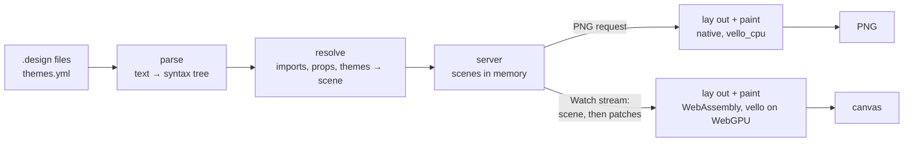

# Design engine

How a `.design` file becomes pixels: the engine parses it, resolves its
imports and props into one tree of nodes, lays the tree out, and paints it —
on the GPU in the browser, compiled to WebAssembly, for the canvas, and on the
CPU in the server for a PNG. A gRPC-Web stream carries each change to the browser as the nodes that
changed. It is a mechanism page under the [viewer](../README.md), for someone
about to change the engine, its stream or the canvas page; what a design can
say is in [Designs](../designs/README.md).



## One crate, two targets

The engine is the `devpage-design` crate in `design/`, a member of devpage's
Cargo workspace. It has no I/O: it is given file contents and asked for
results, so the same code runs in two places.

- **Native**, linked into `devpage`: the server parses and resolves designs,
  and paints PNGs on the CPU.
- **WebAssembly**, as `design/wasm` — a `cdylib` built for
  `wasm32-unknown-unknown`. The canvas page lays out and paints with it, on
  the GPU.

The WebAssembly module and its JavaScript bindings are **vendored**: built
once, committed under `assets/vendor/` like the
[pele bundle](../vendored-pele/README.md), and compiled into the binary as
[built-in assets](../serving-pages/README.md#built-in-assets), so an installed
`devpage` is still one file and building devpage needs neither the
`wasm32-unknown-unknown` target nor a nested build. One command, named on
[Developing devpage](../../engineering/developing-devpage/README.md), rebuilds
them — with `wasm-bindgen` used as a library — and records a fingerprint of
everything they are built from: the engine's and the module's sources, the
proto and the locked dependency versions. A test fails when that fingerprint
no longer matches the sources, naming the command, so the vendored module can
never silently lag the engine. Only someone changing the engine needs the
`wasm32-unknown-unknown` target, which `rust-toolchain.toml` names.

`devpage-design` is published to crates.io when devpage is released, first
and at the same version, so `cargo install devpage` builds the native engine
from the registry and takes the module from the vendored files — see
[Release](../../engineering/sdlc/stages/README.md#release).

## Parsing

The parser turns a file into a syntax tree: imports, then one element with its
attributes and children, each carrying its line and column. It reads the JSX
subset [Elements and attributes](../designs/elements-and-attributes/README.md#attributes) defines — strings in double
or single quotes with no escapes, bare attributes as `true`, braced numbers,
booleans, props and `theme.<name>` colors, array and object literals, names
with `-` in them, text with references in it, `//` comments — and nothing
else. A file that doesn't
parse gives one problem at the first place it went wrong; so does one nested
more than 256 deep, or with a number past ±1,000,000, which keeps the parser's
recursion and every later step finite. Numbers written inside a string — a
gradient's angle and stops, a `viewBox`, a vector's `d` — are held to the same
limit while resolving, so none of them is infinite or not a number either.

No input makes the engine panic: every value is checked before it is used, a
colour's digits as characters rather than bytes, and the resolver stops a tree
nested more than 256 deep through instances. The server also catches a panic
around every call into the engine and reports it as a problem with the design,
so even a bug in the engine can't take down the server or its file watcher.

## Resolving

Resolving turns a design and the designs it imports into a **scene**: one tree
of **nodes**, each a frame, text, rectangle, ellipse, vector or image with
every attribute checked, typed and defaulted. An instance becomes the
imported design's tree with its props substituted, rooted at one node — the
design's root, with the instance's own attributes applied to it. Resolving reports every problem
it finds, not just the first: unknown elements, attributes and props, values
of the wrong type, missing or out-of-folder imports, images and interaction
targets, images that don't decode, designs that use themselves, and the
[themes](#themes)' problems.

An `Image`'s file is decoded whole while resolving — a PNG or JPEG that starts
right but is broken or cut short is a problem at its `src` — and goes with the
scene as an **image file**, known by its content: the SHA-256 of its bytes.
However many `Image`s show a file, under whatever names, the scene holds it
once, decoded once, so painting never decodes. The server keeps a file decoded
until the file changes, so a save of the design doesn't decode its images
again; the browser decodes a file once, when the first scene or patch
carrying it arrives, and keeps it while the scene shows it.

A file larger than 4,096 pixels a side is resampled once, as it is decoded, to
fit 4,096 with its aspect kept — each new pixel the area-weighted average of
the pixels under it, in premultiplied alpha — and both backends draw those
pixels; an `Image` still hugs the file's own size. Why 4,096 is
[the GPU's image atlas](#the-gpus-image-atlas).

Every path a node carries — an image's file, an interaction's target — is
stored as an address in the served folder, worked out from the file it was
written in. The canvas uses an interaction's target as it is, so it never
needs to know which file an instance came from.

A node's **id** is the path of child positions from the root (`0.2.1`), which
is what [patches](#the-watch-stream) address.

### Themes

Every color in a scene holds two values, its light and its dark one; a `#`
color holds the same value twice. A scene also says whether it is
**themed** — whether any `theme.` reference reached it — which is what puts
the switch on an embed's backdrop.

A file's `theme.` references are bound as the file is read, before its props
go anywhere: the resolver reads the `themes.yml` in the file's folder and in
each folder above it, up to the top of the served folder, through `Files`,
like any other file — every one of them, missing ones included, once per
folder per resolve — and keeps those whose `kind` is `themes`. It merges them
top down, name by name in each theme, a lower file's names over a higher
one's. Each reference becomes its two colors there and then, and a gradient
string with references becomes two gradient strings, one per theme — so a
value passed as a prop into a design in another folder carries its writer's
colors, as a path is made relative to its writer's file. The engine reads
`themes.yml` with `serde_yaml` and finds the line of a bad entry by its key,
since YAML values carry no place. A reference to a name that both themes
don't have after merging is a problem at the reference; a malformed
`themes.yml` is one at its own line, reported once per resolve however many
references read it.

## Layout

Auto layout is flexbox restricted to what Figma's auto layout does, so the
engine lays out with `taffy`, a Rust flexbox implementation: `layout="row"`
and `"column"` are a flex direction, `gap`, `padding`, `align` and `justify`
map onto their flex properties, `"hug"` is content size, `"fill"` is
`flex-grow: 1` along the direction and stretch across it, and a frame with
`layout="none"` places its children absolutely at their `x` and `y`.

Flexbox gives such a frame no size of its own when it hugs, so the engine sizes
it as Figma does: as far as its children's furthest right and bottom edges. It
lays out, sets each hugging no-layout frame to its children's extent —
innermost first — and lays out again until nothing changes, which takes one
pass per level of such frames. `"fill"` needs auto layout to take space from,
so on a child of a no-layout frame it is a problem, found while resolving.

Text is measured, shaped and broken into lines with `parley`, over the Inter
faces the engine embeds — regular, medium, semibold and bold — so the line breaks are
the same natively and in WebAssembly. No system font is ever consulted.

## Painting

The painter walks the laid-out scene once, for one theme, and turns it into
the engine's **display list**: an ordered list of drawing commands in canvas pixels —
fills and gradients, strokes, rounded corners, blurred shadows, clip and
opacity layers, layers that add what is in them to what is under them, vector
paths, images and parley's glyph runs. Everything a
drawing depends on is decided there, the theme's value of each color
included: a drawing is made for a theme, and the scene holds both. Two thin backends replay that one list,
each translating a command into its library's call and nothing more:

- **In the browser, on the GPU**: `vello` through `wgpu` on WebGPU, straight
  into the canvas. This is the path for speed — a pan or a zoom repaints the
  whole view on the GPU each frame.
- **In the server, on the CPU**: `vello_cpu`, into an RGBA buffer that is
  encoded as the PNG — a server, a CI runner or a container has no GPU to
  count on. A browser without WebGPU paints the canvas with `vello_cpu` too.

The list covers the design's **drawing**: the root's box, widened by
everything painted outside it — a shadow's blur, a stroke, a child placed
past an edge, a line of text — and cut by any clipping frame, rounded out to
whole pixels. The list opens with a clip to that area and closes it, so a
backend can't show more than the drawing or less. A PNG is the drawing; the
canvas page and an embed fit the drawing. A drawing more than 16,384 pixels a
side is too big to paint, and that is the design's problem everywhere: the
store, `devpage check` and the PNG route all lay a resolved design out once
(`Renderer::drawing`) — a themed one in each theme — and report it, so the
canvas never receives a drawing it can't paint.

Both backends replay the
[same display list](../constraints/a-design-has-one-renderer.md); they differ
only where two rasterizers can — the last bit of anti-aliasing at an edge.
`vello_cpu` has its own API rather than replaying a `vello` scene, which is why
the shared form is the engine's list and not a vello type. Where the two
libraries mean different things by the same call, the GPU backend's
translation evens it out: vello's GPU shader samples a gradient at each
pixel's corner, where vello_cpu — and both, for an image — take its center, so
each gradient goes to the GPU moved half a device pixel.

### Shadows

A shadow is its box's own shape — each corner's radius plus the spread — blurred
by a true Gaussian with a standard deviation σ of half the `blur`, reaching
three σ, past which it is under 0.15%. Vello's blurred rounded rectangle takes
one radius for all four corners, and the two backends share no blur filter,
so the painter computes the blur itself (`design/src/shadow.rs`): it samples
the shape's coverage every half σ — the shape flattened to lines within a
hundredth of a sample, as the rasterizer's own flattening would pull a curve
in — and blurs the samples. A Gaussian that wide has no detail finer than its
samples, so, drawn smoothly, they are the shadow at any zoom. A shadow with no
blur is the shape filled.

A shadow of up to 65,536 samples is one image of them. A larger one — a big
box, or a slight blur, down to a 16,384-pixel box blurred by 2 — is never
sampled more coarsely: it is drawn in pieces, each in a layer that adds it to
what is under it, inside one layer at the shadow color's opacity, so where two
pieces meet edge to edge they add up to the shadow with no seam at any zoom:

- solid where the blur can't reach the edge;
- along a straight edge, where it varies only across the edge, the edge's
  one-dimensional profile stretched along it — one piece for each unbroken
  run, since every join inside a pixel costs each piece there a rounding;
- a corner rounded by less than 16 σ, sampled in two dimensions, the cells of
  sampled corners that meet merged into as few pieces as they make;
- a rounder corner, the blurred edge of a disc as a radial gradient: across a
  disc of radius r, the straight edge's profile less φ(d)·σ/2r, within 0.1 of
  255 of the exact blur;
- an ellipse that isn't a circle, in wedges, each within a hundredth of σ of
  its circle of curvature and drawn as that circle's blurred edge, or sampled
  where the ellipse curves tighter than 16 σ; one too thin to be solid
  anywhere, in tiles that skip where the blur can't reach.

What holds at every allowed size, from a 100-pixel box to a 16,000-pixel one,
and the tests pin: two and a half σ out the shadow is at most 2 of 255 and
fades on from there, with no step where it ends; a straight edge rises from
10% to 90% over 2.563 σ, give or take 0.2 σ, its middle on the box's edge to a
quarter of a pixel; and a shadow in pieces is the same shadow as one image by
the engine's rule — no seam — at 1× and at scales that put each meeting edge
part way across a pixel. In any channel they differ by at most 4 of 255 where
σ spans a device pixel or more. A narrower blur's edge is steeper than a
pixel, and vello_cpu's 8-bit gradients and layers round a disc corner a few
hundredths of a pixel away from the sampled image: up to 6 of 255 where σ is
half a device pixel or more, 11 at a quarter or more, 18 below — a blur of 1
seen at a quarter of its size. Those bounds were measured over 3,000 random
outlines at 0.25×, 0.5×, 0.73×, 1×, 1.37× and 2×; the test holds the hard
cases and a dozen random outlines to them on every run. A 16,000-pixel box's shadow is 32 commands and builds in about
40 µs; an ellipse 16,000 by 8,000 blurred by 2, in about 0.3 ms.

### The GPU's image atlas

vello copies every image a frame paints — image files and a shadow's images
alike — into one atlas texture at most 8,192 pixels a side, and an image that
finds no room there is left out of the frame without a word. So the engine
decides it first. `Renderer::drawing` gives each image a drawing paints a blob
of its own, made in the order the drawing first paints it, and places them as
`vello_encoding`'s own image cache places them in a fresh atlas
(`design/src/atlas.rs`): the same `guillotiere` allocator, in that order, the
atlas starting at 1,024 a side and doubling, everything placed so far repacked
at each size. A test in the module runs vello's own resolver, as the module
ships it, on the scene the canvas renders — 4,000 random sets of images, and a
real drawing with files and shadows — and holds the two to the same fit, the
same first image left out and the same places, so a vello upgrade that packs
differently fails it. A drawing whose images don't all fit is the design's problem, at
the `src` — or the `shadow` — of the first that doesn't, in the store,
`devpage check` and the PNG route alike, so the canvas never draws one with a
hole. An image file takes its room once however many `Image`s show it, and is
at most 4,096 pixels a side, so four of the largest fill the atlas.

A canvas keeps its vello renderer — and with it the atlas — only while the
drawings it shows paint the very same blobs, in the same order. Any other
drawing gets a fresh renderer: another design after a navigation, on a canvas
page or in an embed, or a save that swaps a file or changes a shadow. So the
atlas holds exactly the drawing's images, placed as the engine placed them in
a fresh one. A drawing made after the one its canvas last showed, painting
the same image files and the same shadow pixels in the same order, paints that
drawing's blobs: a save that changes only text or layout keeps the atlas and
uploads no image again. With four 4,096-pixel images on the canvas, such a
save costs the page's main thread under 1 ms instead of 6 to 17.

## In the server

The server keeps every design it has been asked for **resolved in memory** —
its scene or its problems — with every file resolving it asked for, missing
ones included, and the text of every file it read (`src/designs.rs`). A
`themes.yml` a design's references read is one of its files like any other,
and so is one that was looked for and isn't there. When the
[watcher](../live-updates/README.md#the-watcher) reports a changed file —
any file not under `.git` and not `.gitignore`d, unless a site's `watch`
names it — the
store forgets that file's text, and only the designs that asked for it are
parsed and resolved again; their other files come from memory, and no other
design is touched. A save can land while a design is being resolved, after
the file was read: the store numbers each read, and keeps a result only if
every file it was made from is still the read it saw — otherwise it resolves
the design again — so a stale scene is never kept. A design whose scene or problems came out different is
announced to its watch streams. Creating a file a design was missing counts as
a change to it — a `themes.yml` written into a folder between a design and one
above it, say. Painting happens when a PNG is asked for, in the theme it asks
for, from the scene already in memory. `devpage check` and a page's problems bar read designs
straight from disk instead, as they read pages. The routes are on
[Serving pages](../serving-pages/README.md#routes).

## The watch stream

The browser and the server speak gRPC-Web, defined in
`design/proto/design.proto` — the engine crate generates the messages, and with
its `server` feature the service, so the proto ships with the engine — and
served by `tonic-web` on devpage's own address, with no proxy. There is one
call:

```proto
service Designs {
  rpc Watch(WatchRequest) returns (stream Update);
}
```

A page opens **one** watch stream, whatever it shows. `Watch` names every
design the page is showing — the canvas page's design and any overlay open on
it, or each design a page embeds — by its address, with or without the
leading `/`, and streams **updates**, each naming the design it is about, for
as long as the page is open. When the set changes — a navigation, an overlay
opening or closing, embeds arriving or leaving with a page swap — the page
closes the stream and opens one for the new set, which starts again with each
design's whole scene. One stream per page matters: a browser keeps at most six
connections open to one address over HTTP/1.1, which is what devpage speaks
unless it sits behind a proxy that offers more, and the page's
[event stream](../live-updates/README.md#the-channel-and-the-stream) already
holds one. For each design in the set:

- the first update is the whole scene — every color in both themes, and
  whether it is themed — with each image file it shows once;
- after a save, the server resolves the design again, compares the new scene
  with the one it last sent, and sends a **patch**: the nodes whose subtree
  changed, each replaced by its id, and only the image files the scene it
  last sent didn't have — a node shows a file by its id;
- when the design has problems, an update carries them instead, and the
  browser keeps the last scene it drew; once fixed, the next patch is against
  that last scene — an empty one when the fix restored it exactly — and any
  patch tells the browser the design is valid again;
- when the design's own file is deleted, its `no such file` problem is an
  update like any other: the design stays in the set, so when the file is
  written again — a branch switch, an agent rewriting it — the next update is
  a patch against the last scene sent, and it draws again without a reload. A
  stream that drops — devpage stopped — is reopened for the whole set.

A save that changes nothing in a design's scene sends nothing, and the same
problems are not sent twice.

## In the browser

The canvas page loads the WebAssembly module (`assets/design.js` does the
page's part), opens the watch stream with `fetch`, reads the gRPC-Web frames
off the response body and hands each message's bytes to the module, which
decodes it and applies it to the scene that canvas holds — the module keeps
one per canvas. The module lays out and paints on the GPU into a `<canvas>`
sized to the screen's device pixels; one WebGPU device serves every canvas on
the page, and a canvas keeps a vello renderer — its
[image atlas](#the-gpus-image-atlas) — for as long as its drawings paint the
same images. On a slide, the 1920 × 1080 stage is scaled to the window by a
transform the canvas's CSS size doesn't see, so the bitmap follows the
canvas's box on the screen and the module paints at the view's zoom times that
transform — the whole drawing shows, crisp, at any window size — and a click
is taken back through the same transform before it is hit-tested. It lays out once per change of scene or of theme (`Renderer::drawing`) and
paints from that one display list on the GPU or the CPU alike, and paints only when
the scene, the theme or the view does — a zoom, a pan, a resize — at most once per
animation frame.

The design script tells the module which theme each canvas is drawn in: on
the canvas page, the page's; in an embed, the page's until the reader turns
the embed's own switch, and then the embed's own, kept in the page's memory
only; in an overlay, the theme of the canvas it covers. Since the scene holds
both values of every color, a switch is a new display list made in the
browser — nothing is asked of the server. An embed's own switch sets
`data-theme` on its backdrop, which the stylesheet gives the theme's tokens,
so the backdrop and its controls turn with the design.

On the GPU the module first fills the canvas with the page's own background,
read from the backdrop or page under it, so a design's transparent parts show
it; a theme switch changes that background and the design's colors, so every
canvas paints again when the page's `data-theme` changes.

Without WebGPU the module paints with `vello_cpu` once per zoom level, and a
pan only moves that painting on the canvas. Print mode always paints on the
CPU, into a 2D canvas, which Chrome prints reliably.

Clicks are hit-tested by the module against the laid-out scene, and an
interaction runs in the page: a navigation pushes the new address onto the
browser's history and watches that design instead, an overlay adds its design
to the stream's set and paints its scene on a canvas of its own, centered over
the first, which it dims.

A page that embeds designs does the same for each `<canvas>` it holds, all
through the page's one stream, closed while the tab is hidden like the
[event stream](../live-updates/README.md#why-one-stream-per-tab) and closed
when an in-place navigation leaves no design on the page. The page script
loads the design script only on a page that has a design, and such a page
names the design script, the engine's bindings and its wasm in its head, so
the browser fetches all three alongside the page's other modules
([the load set](../rendering-a-page/README.md#the-load-set)). An embedded
design navigates inside its own canvas, with a back stack of its own, so the
page around it stays where it is; and when the page fetches itself again, each
embedded canvas still in it is kept with its drawing, and the stream changes
only if the set of designs did. A canvas inside a widget is kept with the
widget when the widget is unchanged, and made again when React mounts the
widget afresh; the design script then hands the new canvas the old one's
design and back stack, by its `src`, and reopens the stream so it gets its
whole scene. A widget that leaves the page is unmounted, and its designs
leave the stream.

## Failure modes

| What happens | What the reader sees |
| --- | --- |
| A file has problems | The problems over the last valid drawing; the PNG route answers with them instead of a drawing ([Looking at a design as a PNG](../designs/README.md#looking-at-a-design-as-a-png)). |
| A design's images don't fit the GPU together | The problem at the `src` of the first that doesn't fit, over the last valid drawing — never a drawing with a hole; the PNG route answers with it too. |
| A design is deleted | Its canvas shows the problem `no such file` over its last drawing, and draws again when the file is written back. |
| devpage stops | Every canvas keeps its drawing; the page reopens its stream when devpage is back and gets each whole scene again. |
| The module fails to load | Each canvas says so, with the error, in place of its drawing; the PNG route is unaffected. |
| The browser has no WebGPU | The module paints with `vello_cpu` and puts the buffer on the canvas. |
