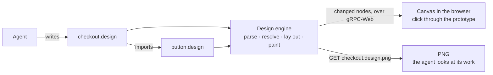

# Designs

A **design** is a UI drawn as code: a `.design` file an agent writes, which
devpage renders on a canvas at high fidelity and lets a reader click through
as a **prototype**. Designs exist so that an agent can show a screen or a flow
before anyone builds it, and so that people can agree on it fast — with the
agent, or with each other on a [deployed](../deploying/README.md) devpage. It is
a concept and task article under the [viewer](../README.md); how a design is
parsed, laid out, drawn and streamed is in the
[design engine](../design-engine/README.md).



Humans never edit a design. They look at it, comment on the page that embeds
it, and the agent changes the file. A design is not documentation of the
current UI and nobody keeps it in sync with the code; it is a prototype, and
the code is the design of what is built. What a design must be is **valid**:
every design it uses exists, every value parses, and devpage reports anything
else as a [problem](#problems).

## A first design

```jsx
// examples/checkout/button.design
<Frame props={{ label: "Button", fill: "#2563eb" }}
       layout="row" padding={[12, 20]} radius={8} fill={fill}>
  <Text size={16} weight={600} color="#ffffff">{label}</Text>
</Frame>
```

```jsx
// examples/checkout/checkout.design
import Button from "./button.design"

<Frame name="Checkout" width={390} height={844} fill="#f8fafc"
       layout="column" gap={16} padding={24}>
  <Text size={28} weight={700}>Your cart</Text>
  <Button label="Pay $42" onClick="navigate ./confirmation.design" />
</Frame>
```

Here is the checkout screen, embedded in this page:


Open either file in devpage — `devpage examples/checkout/checkout.design`, or
link to it from any page — and it is drawn on a canvas. Click **Pay $42** and
the prototype moves to `confirmation.design`.

## One design per file

Every design is one `.design` file, and a design is made of other designs.
There is no separate kind of "component": a button is a design that other
designs use. A file:

- starts with any number of **imports**, one per line —
  `import Button from "./button.design"` — each a name and a path relative to
  the file. The path must lie in the
  [served folder](../constraints/the-served-folder-is-the-boundary.md).
- holds exactly one **root element**, which is a `Frame`. Its `width` and
  `height` are the design's size; a root sized `"hug"` takes its content's
  size.

Using an imported design places an **instance** of it: `<Button label="Pay" />`
draws `button.design` with `label` set to `"Pay"`. An instance can be given
the root element's `x`, `y`, `width`, `height` and `name`, and any of the
design's props — nothing else. A design that uses itself, directly or through
others, is a problem.

`//` starts a comment that runs to the end of the line, outside elements and
between attributes.

## Props

A design declares the values it takes in its root's `props` attribute, each
with a default: `props={{ label: "Button", fill: "#2563eb" }}`. Inside the
design, `{label}` puts a prop's value where it stands — as a whole attribute
value (`fill={fill}`) or inside a text (`<Text>Hi, {name}</Text>`). An instance
that leaves a prop out gets its default. Naming a prop the design doesn't
declare is a problem. There are no expressions: a value is a literal or one
prop.

## Elements

| Element | Draws | Children |
| --- | --- | --- |
| `Frame` | a box: fill, stroke, corners, shadow; lays out its children | any elements |
| `Text` | a run of text in the bundled typeface | text and `{prop}` only |
| `Rect` | a rectangle | none |
| `Ellipse` | an ellipse filling its box | none |
| `Vector` | an SVG path, `d="M…"`, scaled from its `viewBox` into its box | none |
| `Image` | a PNG or JPEG file, `src` relative to the design, covering its box | none |
| an imported name | an instance of that design | none |

The node types and their attributes follow Figma's document model — frames
with auto layout, the same fills, strokes and effects — written as attributes
in JSX syntax rather than as Figma's JSON. They are the set the
[example designs](../../../../examples/checkout/checkout.design) use; another
arrives when a design needs it.

## Attributes

A value is a string `"…"`, or a number, array, object or prop in braces:
`{16}`, `{[12, 20]}`, `{{ y: 4, blur: 12, color: "#0f172a33" }}`, `{label}`.
Every element takes:

| Attribute | Value | Default |
| --- | --- | --- |
| `name` | a label for the node, shown in problems | the element's name |
| `x`, `y` | position in pixels inside a parent with no layout | `0` |
| `width`, `height` | pixels, `"hug"` (fit the content) or `"fill"` (take the free space in the parent's layout direction, or stretch across it) | `"hug"` |
| `opacity` | `0` to `1` | `1` |
| `onClick` | an [interaction](#prototypes) | none |

Boxes — `Frame`, `Rect`, `Ellipse`, `Vector`, `Image`, and the root of an
instance — also take:

| Attribute | Value | Default |
| --- | --- | --- |
| `fill` | a color, or `"linear-gradient(<angle>deg, <color> <stop>%, …)"` | none |
| `stroke` | a color | none |
| `strokeWidth` | pixels, drawn inside the box | `1` |
| `radius` | pixels, or `[topLeft, topRight, bottomRight, bottomLeft]` | `0` |
| `shadow` | `{ x, y, blur, spread, color }`, each optional, drawn outside the box | none |
| `clip` | `{true}` to clip the children to the box | `{false}` |

A color is `#rgb`, `#rrggbb` or `#rrggbbaa`.

`Frame` lays out its children with Figma's auto layout:

| Attribute | Value | Default |
| --- | --- | --- |
| `layout` | `"row"`, `"column"`, or `"none"` — children placed by their `x` and `y` | `"none"` |
| `gap` | pixels between children | `0` |
| `padding` | pixels, `[vertical, horizontal]` or `[top, right, bottom, left]` | `0` |
| `align` | across the layout direction: `"start"`, `"center"`, `"end"` | `"start"` |
| `justify` | along it: `"start"`, `"center"`, `"end"`, `"space-between"` | `"start"` |

`Text` takes:

| Attribute | Value | Default |
| --- | --- | --- |
| `size` | pixels | `14` |
| `weight` | `400`, `500`, `600` or `700` | `400` |
| `color` | a color | `#0f172a` |
| `lineHeight` | a multiple of the size | `1.4` |
| `textAlign` | `"left"`, `"center"`, `"right"` | `"left"` |

A text wraps at its width when it has one and runs on one line when it hugs.
Text is set in Inter, which devpage carries inside it, so a design looks the
same on every machine and in every PNG.

`Vector` takes `d` (SVG path data) and `viewBox` (`"minX minY width
height"`, the path's own bounds when left out). The path is scaled into the
vector's box keeping its proportions, and its `fill` and `stroke` paint the
path rather than the box. `Image` takes `src`, a PNG or JPEG file. Hugging, a
vector takes its view box's size and an image its own size in pixels; given
only one of `width` and `height`, either keeps its proportions.

An attribute an element doesn't take, a value of the wrong type, or an unknown
element is a problem — never ignored — so an agent learns about a typo from
devpage rather than from a reader.

## Prototypes

A prototype is designs linked by **interactions**. `onClick` on any element
takes one:

| Interaction | What a click does |
| --- | --- |
| `"navigate <path>"` | shows the design at `path` in place of this one |
| `"back"` | returns to the design shown before |
| `"overlay <path>"` | shows the design at `path` centered over this one, on a dimmed backdrop |
| `"close"` | closes the overlay this element is in |

A path is relative to the file the `onClick` is written in, like every path in
a design, so an interaction inside an imported design works wherever that
design is used. A path to a file that doesn't exist, or outside the served
folder, is a problem.

The element under the pointer that has an interaction takes the click, and a
pointer over one turns into a hand. A navigation changes the address, so the
browser's back button walks back through the prototype, and every step can be
linked to. Each state of a prototype is a design of its own.

## Viewing a design

A design is a [document](../writing-a-document/README.md#four-kinds): its
address shows it on a canvas, fit to the window, and a reader can zoom with
the pinch gesture or **Ctrl**/**⌘** and the wheel, and pan by dragging or
scrolling. A page
**embeds** one with the image syntax — `` — drawn at
the page's width and clickable like the design's own address. Embedded designs
follow the page's live updates and print in a PDF as they show.

While a design is open, saving any file it is made of redraws it in place —
only the parts that changed are sent to the browser.

## Looking at a design as a PNG

`GET <path>.design.png` answers with the design drawn as a PNG, at its own
size, from the same layout and the same scene as the canvas
([one renderer](../constraints/a-design-has-one-renderer.md)):

```sh
curl -s http://localhost:3030/examples/checkout/checkout.design.png -o checkout.png
```

This is how an agent looks at its work: write the file, fetch the PNG, look,
fix. devpage keeps every design it has read resolved in memory and paints the PNG
itself on the CPU, without a browser, so the answer arrives as fast as a
page. A design
with problems answers `422` with the problems as plain text, one per line.

## Problems

A design's problems are shown on the canvas page and on any page that embeds
it, reported by `devpage check` like a broken link
([Checking links](../checking-links/README.md)), and returned instead of a PNG:

```text
examples/checkout/checkout.design:7:3: Button has no prop "lable"
examples/checkout/button.design:2:40: padding: expected pixels or an array of 2 or 4, found "12px"
examples/checkout/cart.design:1:1: import ./row.design — no such file
```

While a design has problems the canvas keeps showing the last valid drawing,
under the list of problems.

## Constraints

- [A design has one renderer](../constraints/a-design-has-one-renderer.md)
  — the canvas and the PNG are drawn by the same code.
