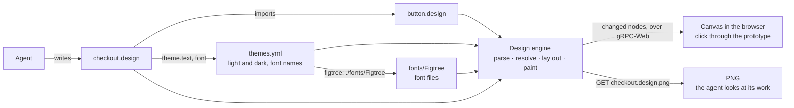

# Designs

A **design** is a UI drawn as code: a `.design` file an agent writes, which
devpage renders on a canvas at high fidelity and lets a reader click through
as a **prototype**. Designs exist so that an agent can show a screen or a flow
before anyone builds it, and so that people can agree on it fast — with the
agent, or with each other on a [deployed](../deploying/README.md) devpage. It sits under the [viewer](../README.md); how a design is
parsed, laid out, drawn and streamed is in the
[design engine](../design-engine/README.md).

Humans never edit a design. They look at it, comment on the page that embeds
it, and the agent changes the file. A design is not documentation of the
current UI and nobody keeps it in sync with the code; it is a prototype, and
the code is the design of what is built. What a design must be is **valid**:
every design it uses exists, every value parses, and devpage reports anything
else as a [problem](viewing-a-design/README.md#problems).

## Topics

- [Writing a design](writing-a-design/README.md) — a first design, one design
  per file, props, themes, fonts and prototypes.
- [Viewing a design](viewing-a-design/README.md) — the canvas, a design
  embedded in a page, its PNG, and its problems.
- [Elements and attributes](elements-and-attributes/README.md) — every
  element, attribute, value and default a design can use.
- [Design engine](../design-engine/README.md) — parsing, resolving, layout and
  painting in one crate for two targets, and the gRPC-Web watch stream.
