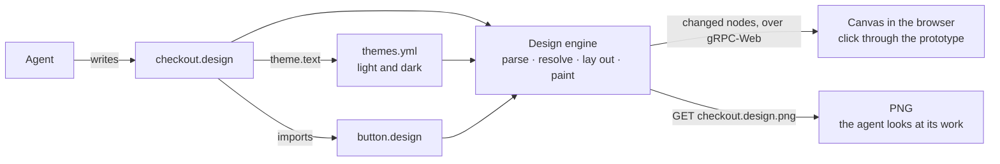

# Designs

A **design** is a UI drawn as code: a `.design` file an agent writes, which
devpage renders on a canvas at high fidelity and lets a reader click through
as a **prototype**. Designs exist so that an agent can show a screen or a flow
before anyone builds it, and so that people can agree on it fast — with the
agent, or with each other on a [deployed](../deploying/README.md) devpage. It is
a concept and task article under the [viewer](../README.md); how a design is
parsed, laid out, drawn and streamed is in the
[design engine](../design-engine/README.md).



Humans never edit a design. They look at it, comment on the page that embeds
it, and the agent changes the file. A design is not documentation of the
current UI and nobody keeps it in sync with the code; it is a prototype, and
the code is the design of what is built. What a design must be is **valid**:
every design it uses exists, every value parses, and devpage reports anything
else as a [problem](#problems).

## A first design

The example's button, `docs/designs/checkout/button.design`, whole:

```jsx
// A button: one line of text on a filled, rounded box.
<Frame props={{ label: "Button", fill: theme.accent }}
       layout="row" padding={[12, 20]} radius={8} fill={fill}
       justify="center" shadow={{ y: 2, blur: 6, color: theme.accentShadow }}>
  <Text size={16} weight={600} color="#ffffff">{label}</Text>
</Frame>
```

A screen using it, cut down from the example's
`docs/designs/checkout/checkout.design` to its bones:

```jsx
import Button from "./button.design"

<Frame name="Checkout" width={390} height={844} fill={theme.background}
       layout="column" gap={16} padding={24}>
  <Text size={28} weight={700} color={theme.text}>Your cart</Text>
  <Button label="Pay $42" onClick="navigate ./confirmation.design" />
</Frame>
```

Here is the whole checkout screen, embedded in this page:


Open either file in devpage — `devpage docs/designs/checkout/checkout.design`, or
link to it from any page — and it is drawn on a canvas. Click **Pay $42** and
the prototype moves to `confirmation.design`.

Every `theme.` name comes from `docs/designs/checkout/themes.yml`, the
[themes](#themes) beside them, so the same files draw a light checkout on a
light page and a dark one on a dark page.

## One design per file

Every design is one `.design` file, and a design is made of other designs.
There is no separate kind of "component": a button is a design that other
designs use. A file:

- starts with any number of **imports**, one per line —
  `import Button from "./button.design"` — each a name and a path relative to
  the file. The path must name a `.design` file that exists in the
  [served folder](../constraints/the-served-folder-is-the-boundary.md),
  whether the design uses the import or not. Each import takes a name of its
  own, and none takes a built-in element's name — `Frame`, `Text`, `Rect`,
  `Ellipse`, `Vector` or `Image`.
- holds exactly one **root element**, which is a `Frame`. Its `width` and
  `height` are the design's size; a root sized `"hug"` takes its content's
  size. A root takes no `x` or `y`: it has no place of its own, and an
  instance goes where the instance's own `x` and `y` say.

Elements, arrays and objects nest at most 256 deep, counting through the
designs a design uses — far deeper than any real design. A number or a string
inside them is not a level of its own.

Using an imported design places an **instance** of it: `<Button label="Pay" />`
draws `button.design` with `label` set to `"Pay"`. An instance takes the
attributes [every element takes](elements-and-attributes/README.md#attributes) — `name`, `x`, `y`, `width`,
`height`, `opacity` and `onClick`, each applied to the used design's root —
and the design's props; nothing else. Its look — fill, stroke, corners — is
the design's own, changed only through its props. A design that uses itself, directly or through
others, is a problem.

`//` starts a comment that runs to the end of the line, outside elements and
between attributes.

## Props

A design declares the values it takes in its root's `props` attribute, each
with a default: `props={{ label: "Button", fill: "#2563eb" }}`. Only the root
declares props; `props` on any other element is a problem. Inside the
design, `{label}` puts a prop's value where it stands — as a whole attribute
value (`fill={fill}`) or inside a text (`<Text>Hi, {name}</Text>`). An instance
that leaves a prop out gets its default. Naming a prop the design doesn't
declare is a problem. There are no expressions: a value is a literal or one
prop.

## Themes

A design's colors can follow the light/dark switch. A file named `themes.yml`
holds the design's own two [themes](../themes/README.md) — light and dark —
each a set of named colors:

```yaml
kind: themes
light:
  background: "#f8fafc"
  text: "#0f172a"
dark:
  background: "#0f172a"
  text: "#f1f5f9"
```

`theme.<name>` is a color wherever a color goes, and stands for that name's
value in the theme the design is drawn in:

```jsx
<Frame fill={theme.background} stroke={theme.border}
       shadow={{ y: 8, blur: 24, color: theme.shadow }}
       props={{ accent: theme.accent }}>
  <Text color={theme.text}>Hi</Text>
  <Frame fill="linear-gradient(90deg, theme.accent 0%, #7c3aed 100%)" />
</Frame>
```

— a fill, a stroke, a text's color, a shadow's color, a gradient's stop
inside its string, a prop's default and an instance's attribute
(`<Button fill={theme.accent} />`). A color written as `#rrggbb` stays the
same in both themes.

- **Which `themes.yml`.** A design uses the nearest `themes.yml` up the
  folder tree from its own file, as far as the
  [served folder](../constraints/the-served-folder-is-the-boundary.md)'s top;
  nothing imports it. A `themes.yml` lower down overrides only the names it
  lists, in each theme, and takes the rest from the ones above it, so one
  file at the top can hold a product's palette and a folder can change a few
  of its colors. A `themes.yml` whose `kind` isn't `themes` is another tool's
  file, and devpage passes over it.
- **What a theme holds.** Colors only — `#rgb`, `#rgba`, `#rrggbb` or
  `#rrggbbaa`, in quotes, since YAML reads an unquoted `#` as a comment. A
  name is letters, digits, `_` and `-`. Every `themes.yml` has both `light`
  and `dark`, and after the files are merged every name a design uses has a
  value in both, so dark never lacks a color light has.
- **Where a name is looked up.** In the themes of the file `theme.` is
  written in, as a relative path is. A `theme.accent` passed as a prop to a
  design in another folder, or a prop default that names one, keeps the color
  of the file that wrote it.
- **`theme` is reserved.** No prop and no import may be called `theme`.

A design never picks its theme; where it is shown does — see
[Viewing a design](#viewing-a-design).

## Elements and attributes

Six elements draw — `Frame`, `Text`, `Rect`, `Ellipse`, `Vector` and `Image` —
and an imported name places an instance. Their node types and attributes
follow Figma's document model, written as JSX attributes rather than Figma's
JSON; every one, with its values and defaults, is on
[Elements and attributes](elements-and-attributes/README.md).

## Prototypes

A prototype is designs linked by **interactions**. `onClick` on any element
takes one:

| Interaction | What a click does |
| --- | --- |
| `"navigate <path>"` | shows the design at `path` in place of this one |
| `"back"` | returns to the design shown before |
| `"overlay <path>"` | shows the design at `path` centered over this one, which it dims |
| `"close"` | closes the overlay this element is in |

A path is relative to the file the `onClick` is written in, like every path in
a design, so an interaction inside an imported design works wherever that
design is used. A path must name a `.design` file that exists in the served
folder; anything else is a problem.

The element under the pointer that has an interaction takes the click, and a
pointer over one turns into a hand. A navigation changes the address, so the
browser's back button walks back through the prototype, and every step can be
linked to. Each state of a prototype is a design of its own.

## Viewing a design

A design is a [document](../writing-a-document/README.md#four-kinds): its
address shows it on a canvas, centred, at its own size — scaled down to fit
the window when it is bigger, never enlarged — and a reader can zoom with the
pinch gesture or **Ctrl**/**⌘** and the wheel, and pan by dragging or
scrolling. The canvas page has the light/dark switch in its corner, the same
switch every page has, and remembers the choice with them; the design is
drawn in the theme the page shows. `?theme=dark` or `?theme=light` on the
address shows that theme for that view without changing the remembered
choice — what an embed's **Open** link carries.

A design's **drawing** is its root's box plus anything painted outside it — a
shadow, a child placed past an edge — as in Figma's export. Every surface shows
the whole drawing, so nothing visible on one is missing from another; a design
whose paint stays inside its root draws at exactly its root's size.

A page **embeds** one with the image syntax — `` —
or, in raw HTML, with an image of it — ``, written
however HTML allows. An embedded design is shown the same way: at its own
size, never enlarged, scaled down only as far as it needs to fit the page's
width and the window's height — on a slide, the room the slide leaves it —
centred on a quiet **backdrop** that sets it apart from the text. It is clickable like the design's own address, and a link in the
backdrop's corner opens it on its own canvas page, in the theme the embed
shows. Embedded designs follow the page's live updates and its light/dark
switch: on a dark page a design is drawn in its dark
[theme](#themes) and its backdrop is dark, and a switch redraws it in the
browser, with nothing asked of the server. A design that uses its themes
also has a switch of its own on the backdrop, beside the link — the page's
sun and moon — which turns only that embed, design and backdrop, to the other
theme. It isn't remembered: the embed keeps the theme the reader turned it
to, even when the page switches, until the page loads again. In a PDF there is no window, so an embedded design prints
at its own size, scaled down only to fit the paper's width — or, on a slide,
the room the slide leaves it, as on screen. A PDF, a slide's PNG and a video
draw an embed in the theme of the page it is on, as the screen does.

While a design is open, saving any file it is made of — a `themes.yml` it
reads among them — redraws it in place —
only the parts that changed are sent to the browser. A design deleted while
open shows its `no such file` problem, and comes back when it is written
again — after a branch switch, say — without a reload.

## Looking at a design as a PNG

`GET <path>.design.png` answers with the design's whole drawing as a PNG,
at 1×, from the same layout and the same scene as the canvas
([one renderer](../constraints/a-design-has-one-renderer.md)):

```sh
curl -s http://localhost:3030/docs/designs/checkout/checkout.design.png -o checkout.png
```

`?theme=dark` paints it in its dark [theme](#themes) —
`checkout.design.png?theme=dark` — and `?theme=light`, or no `theme`, in its
light one.

This is how an agent looks at its work: write the file, fetch the PNG, look,
fix — in both themes when the design uses them. devpage keeps every design it has read resolved in memory and paints the
PNG itself on the CPU, without a browser, so the answer arrives as fast as a
page. A page can link to or show the PNG too —
`` — and `devpage check` treats that link as
the design itself.

| Answer | When |
| --- | --- |
| `200`, `image/png` | the design is valid: its whole drawing at 1× |
| `400`, `theme: expected light or dark, found "<value>"` | `theme` is anything but `light` or `dark` |
| `422`, the problems as `text/plain`, one per line | the design has problems, or its drawing is bigger than 16,384 pixels a side, which is too big to paint |
| `404`, `<address> is not part of the served folder` | `<path>.design` isn't a file in the served folder, as for any other path |

A real file named `checkout.design.png` beside the design wins: it is served
as it is, and a link to it is checked as that file.

## Problems

A design's problems are shown on the canvas page and on any page that embeds
it, reported by `devpage check` like a broken link
([Checking links](../checking-links/README.md)), and returned instead of a PNG:

```text
docs/designs/checkout/checkout.design:7:11: Button has no prop "lable"
docs/designs/checkout/button.design:2:21: padding: expected pixels or an array of 2 or 4, found "12px"
docs/designs/checkout/cart.design:1:1: import ./row.design — no such file
docs/designs/checkout/cart.design:4:30: theme.srface: the themes have no srface; they have accent, background, border, text
```

The [themes](#themes) have problems of their own, each at the reference or
at the line of the `themes.yml` that is wrong:

- `theme.x` in a design with no `themes.yml` above it;
- a name the themes don't have, listing those they do;
- a name only one theme has, once the files are merged;
- a `themes.yml` with `kind: themes` that is malformed — a value that isn't a
  color, `light` or `dark` missing, or either one not a map of names to
  colors;
- `theme` as a prop's or an import's name, and `{theme.x}` in a `Text`'s
  text, where a color can't go.

While a design has problems the canvas keeps showing the last valid drawing,
under the list of problems.

The rule that the canvas and the PNG are drawn by the same code is
[A design has one renderer](../constraints/a-design-has-one-renderer.md).

## Topics

- [Elements and attributes](elements-and-attributes/README.md) — every
  element, attribute, value and default a design can use.
