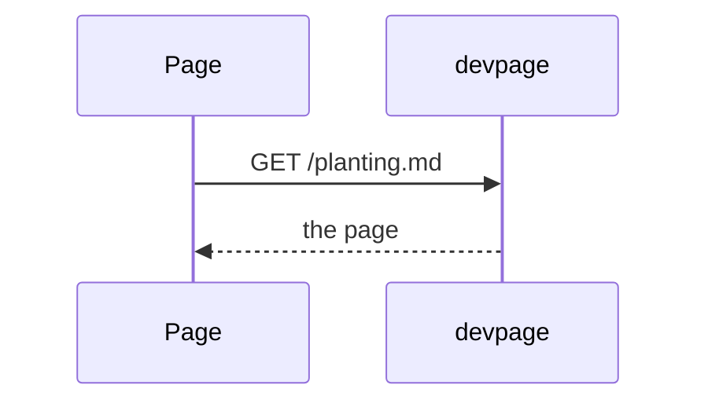
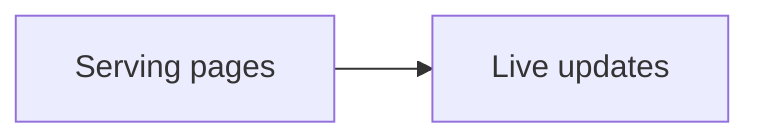

# Diagrams and themes

How to put a diagram in a page with a Mermaid fence, what a reader sees when a
diagram doesn't parse, how the light and dark themes color the page, its
highlighted code and its diagrams from one set of tokens, and how far a page
can change that look. It is a task article under the [viewer](../README.md).

## Writing a diagram

A fenced code block whose language is `mermaid` becomes a diagram:

````markdown

````

The server leaves a `mermaid` fence unhighlighted, as a code block marked
`<pre lang="mermaid">` — the only code block that keeps its language. In the browser, each one is rendered by the `Diagram`
[system widget](../widgets/README.md#system-widgets), which hands it to **pele** — a Mermaid renderer built
into the viewer (version 1.10.0, vendored at `assets/vendor/pele.js`; see
[the vendored pele bundle](../vendored-pele/README.md)) — and
replaces the block with the SVG it returns. Diagrams are drawn when a page
first loads and again every time its content is swapped in, by a live update or
by following a link.

pele detects the diagram type from the first line — `flowchart`/`graph`,
`sequenceDiagram`, `classDiagram`, `erDiagram`, `gantt`, `pie`, `mindmap` and
others. Before committing a diagram, you can check that it parses by running the same renderer in Node, from the
root of the devpage repository (point the last argument at your page):

```sh
node -e 'const fs=require("fs"),vm=require("vm");const c={URL};vm.createContext(c);vm.runInContext(fs.readFileSync("assets/vendor/pele.js","utf8")+";globalThis.pele=pele;",c);const md=fs.readFileSync(process.argv[1],"utf8");for(const[,s]of md.matchAll(/```mermaid\n([\s\S]*?)```/g)){try{const r=c.pele.render(s);const clicks=(s.match(/^\s*click /gm)||[]).length;const links=(r.svg.match(/<a\b/g)||[]).length;console.log("ok",r.type,"clicks",clicks,"links",links)}catch(e){console.log("ERROR",e.message)}}' docs/getting-started.md
```

It prints `ok`, the type and, for [clickable diagrams](#clickable-diagrams),
the number of `click` lines and of links pele drew — the two should match — for
each diagram, or `ERROR` and pele's message. It also reads the `mermaid`
fences of examples nested in a four-backtick `markdown` fence. It hands pele
Node's `URL`, which pele uses to check `https://` targets; without it
those links are silently left out.

## Clickable diagrams

A node becomes a link with a Mermaid `click` line naming its id, the target and
an optional tooltip:

````markdown

````

pele draws the node inside an SVG link, with the tooltip as its `<title>`,
which the browser shows when the pointer rests on the node. The target is
resolved against the page the diagram is on, the same way the
[page script](../live-updates/README.md#the-page-script) treats a link in the
text:

- A link to another Markdown page opens it in place, like a link in the
  text; a `#heading` after it scrolls to that heading.
- A `#heading` link scrolls to that heading on the same page.
- Any other link — an `https://` URL, a file that isn't Markdown — is left to
  the browser, which navigates to it. So is a click with Cmd, Ctrl or Shift
  held.

A clickable node shows a pointer, and while the pointer is over it the node's
border — its rectangle, diamond, circle or other shape — takes the accent
color at 2.5px; the label is never underlined.

Write each `click` line with single spaces: pele rejects extra spaces in it
with a parse error, and the whole diagram is replaced by the
[error block](#when-a-diagram-fails). Links work in flowcharts; pele's sequence
diagrams take no `click` line (it is a parse error there), so their
participants can't be links. The check command [above](#writing-a-diagram)
counts the `click` lines and the links drawn, so a target pele dropped shows
as a mismatch.

The [viewer's landing page](../README.md) diagram is clickable this way: each
part opens its page.

## When a diagram fails

A diagram that pele can't render doesn't break the page. In its place the
reader sees a red block with `Diagram error:`, pele's message — for example
`No diagram type detected for the given text.` or a parse error naming the
line — and then the diagram's source, so the mistake can be found without
opening the file. Fix the source and save; with live updates the diagram
redraws on the open page.

## The themes

The viewer has a light and a dark theme and follows the reader's system
setting (`prefers-color-scheme`); there is no switch on the page. The page's
colors come from seven tokens, defined in `assets/style.css`:

| Token | Used for | Light | Dark |
| --- | --- | --- | --- |
| `--background` | page background | `#ffffff` | `#000000` |
| `--surface` | sidebar, quotes | `#f5f5f7` | `#1d1d1f` |
| `--text` | body text | `#1d1d1f` | `#f5f5f7` |
| `--muted` | secondary text, group headings | `#6e6e73` | `#a1a1a6` |
| `--border` | rules, borders, hover | `#d2d2d7` | `#424245` |
| `--accent` | links, the current sidebar entry | `#0066cc` | `#2997ff` |
| `--code` | code background | `#f5f5f7` | `#1d1d1f` |

Seven more tokens color highlighted code. Their values are Xcode's default
light and dark palettes:

| Token | Light | Dark |
| --- | --- | --- |
| `--syntax-keyword` | `#9b2393` | `#ff7ab2` |
| `--syntax-string` | `#c41a16` | `#ff8170` |
| `--syntax-number` | `#1c00cf` | `#d9c97c` |
| `--syntax-comment` | `#5d6c79` | `#7f8c98` |
| `--syntax-type` | `#0b4f79` | `#dabaff` |
| `--syntax-function` | `#326d74` | `#67b7a4` |
| `--syntax-attribute` | `#815f03` | `#fd8f3f` |

The highlighter marks code with classes named after syntax scopes, prefixed
`hl-` (`hl-keyword`, `hl-string`, `hl-comment`…), and `assets/style.css` maps
groups of those classes to the tokens: comments (in italics), strings, numeric
and language constants, keywords and storage (in semibold), type names,
function names, and tags, attribute names and macros. Code the stylesheet
doesn't map keeps the body text color.
How the server highlights code is in
[Serving pages](../serving-pages/README.md#rendering-a-markdown-file).

Two font tokens, `--font` and `--font-mono`, are shared by both themes. A
theme is a set of values for these tokens. A few colors are fixed rather than
taken from a token: the text of the current sidebar entry (white); the red
(`#d70015`) of diagram errors, comment errors, the problems bar and broken-link
marks; and the black behind a deck's stage.

## Choosing a theme

Every page — a site's, a doc, a deck — has a selector in its top-right corner:
**Auto**, which follows the reader's system setting, **Light** or **Dark**. The
browser remembers the choice for the address it was made on, and it switches
everything drawn from the tokens at once: the page, highlighted code,
diagrams and widgets. On a site with a navbar the selector sits at the right
end of the bar. It is never printed, and a deck hides it in fullscreen. A
document file turns it off with `theme-selector: false`; the page then follows
the system setting, as before the selector existed.

## Changing the look

The themes can't be changed per document. A document file has no theme
field — any field its kind doesn't have stops devpage with an error — and the
stylesheet is compiled into the binary, so there is no theme setting,
no custom stylesheet option and no way to add a third theme without changing
`assets/style.css` and rebuilding devpage.

What a page can do is carry its own CSS. Raw HTML passes through, so a
`<style>` block in a page's Markdown is part of that page:

```markdown
<style>
:root { --accent: #c00000; }
</style>
```

It applies while that page is shown — to the whole frame, the sidebar
included, since a `<style>` element isn't scoped to the article — and to no
other page: opening another page, by a link or a fresh load, replaces the
page content and the `<style>` with it. A token set this way, as above,
recolors everything that uses it, in both themes, because the rule comes after
the built-in stylesheet; wrap it in `@media (prefers-color-scheme: dark)` (or `light`) to
change one theme only. Nothing checks such CSS, and it rides along with the
page's content, so use it for one page's needs rather than as a theme.

## How diagrams follow the theme

pele draws its SVG with its own CSS variables, and the stylesheet sets them on
every diagram from the theme tokens:

| pele variable | Theme token |
| --- | --- |
| `--pele-bg` | `--background` |
| `--pele-fg` | `--text` |
| `--pele-muted`, `--pele-line` | `--muted` |
| `--pele-surface` | `--surface` |
| `--pele-surface-alt`, `--pele-border` | `--border` |
| `--pele-accent` | `--accent` |
| `--pele-font`, `--pele-font-mono` | `--font`, `--font-mono` |

Because the colors are variables rather than values baked into the SVG, a
diagram changes with the page when the system switches between light and dark.
pele variables the stylesheet doesn't set, such as its error and series
colors, keep pele's own defaults.

The stylesheet also styles the links in [clickable diagrams](#clickable-diagrams):
`.diagram a` gets a pointer cursor and no underline, and on hover the shapes
inside the link (`rect`, `polygon`, `circle`, `ellipse`, `path`) take
`--accent` as their stroke, 2.5px wide.
