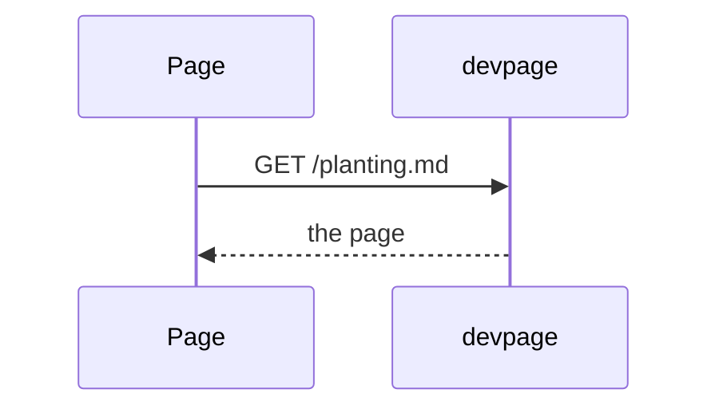
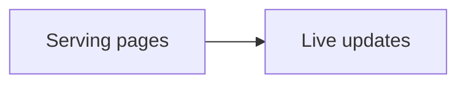

# Diagrams

How to put a diagram in a page with a Mermaid fence, how to make its nodes
links, how `devpage check` finds a diagram that doesn't parse, and what a
reader sees when one doesn't. It is a task article under the
[viewer](../README.md); the colors diagrams take are on
[Themes](../themes/README.md), and how the server draws them is on
[The diagram engine](#the-diagram-engine) below.

## Writing a diagram

A fenced code block whose language is `mermaid` becomes a diagram:

<Example>



</Example>

The server draws it while it renders the page: it hands the fence's text to
**pele** — a Mermaid renderer built into devpage (version 1.10.0, vendored at
`assets/vendor/pele.js`; see [the vendored pele bundle](../vendored-pele/README.md))
— and puts the SVG it returns in the page, in a `<div class="diagram">`, where
the fence was. The browser draws nothing: a page with a diagram loads no
script for it, and a diagram is there in the HTML the moment the page is —
on a page, in a doc or a deck, in its PDF, in a slide's PNG and in a video.

pele detects the diagram type from the first line — `flowchart`/`graph`,
`sequenceDiagram`, `classDiagram`, `erDiagram`, `gantt`, `pie`, `mindmap` and
others. It sizes each label from its own table of character widths, not from
the reader's fonts, so a diagram is the same in every browser.

## Clickable diagrams

A node becomes a link with a Mermaid `click` line naming its id, the target and
an optional tooltip:

````markdown

````

pele draws the node inside an SVG link, with the tooltip as its `<title>`,
which the browser shows when the pointer rests on the node. The target is
resolved against the page the diagram is on, the same way the
[page script](../live-updates/README.md#the-page-script) treats a link in the
text:

- A link to another Markdown page opens it in place, like a link in the
  text; a `#heading` after it scrolls to that heading.
- A `#heading` link scrolls to that heading on the same page.
- Any other link — an `https://` URL, a file that isn't Markdown — is left to
  the browser, which navigates to it. So is a click with Cmd, Ctrl or Shift
  held.

A clickable node shows a pointer, and while the pointer is over it the node's
border — its rectangle, diamond, circle or other shape — takes the accent
color at 2.5px; the label is never underlined. Each target is a link like any
other: [checked](../checking-links/README.md) for a file and a heading that
exist, and marked on the page when it is broken.

<Callout kind="warning" title="Single spaces in click lines">
pele rejects extra spaces in a `click` line with a parse error, and the whole
diagram is replaced by the [error block](#when-a-diagram-fails). Links work in
flowcharts; pele's sequence diagrams take no `click` line (it is a parse error
there), so their participants can't be links.
</Callout>

The [viewer's landing page](../README.md) diagram is clickable this way: each
part opens its page.

## Checking diagrams before committing

A diagram that doesn't parse is a [problem](../checking-links/README.md), like
a broken link: `devpage check` reports it with the line of its fence and
pele's message, and exits with `1`, so a test or a CI job fails on it.

<Terminal>

```
$ devpage check docs
docs/planting.md:14: broken diagram — Parse error on line 2:
  A->>B: soak the seeds; plant them
-----------------------------^
Expecting 'SOLID_OPEN_ARROW', 'DOTTED_OPEN_ARROW', … got 'NEWLINE'
$ echo $?
1
```

</Terminal>

pele's message names the line inside the diagram, counted from the line after
the fence. While devpage serves the page, the same problem is in the
[problems bar](../checking-links/README.md#in-the-preview) at the page's top.
A `;` ends a statement in Mermaid, so one inside a sequence diagram's message
is a common cause; reword the message.

Only real `mermaid` fences are diagrams: one shown as an example inside a
four-backtick `markdown` fence is code, never drawn or checked.

## When a diagram fails

A diagram that pele can't draw doesn't break the page. In its place the
reader sees a red block with `Diagram error:`, pele's message — for example
`No diagram type detected for the given text.` or a parse error naming the
line — and then the diagram's source, so the mistake can be found without
opening the file. Fix the source and save; with live updates the diagram
redraws on the open page.

A diagram that takes pele longer than 2 seconds to draw, or more than 128 MB
of memory, fails the same way, with
`took longer than 2 seconds to draw` or `ran out of memory`, so one diagram
can't hold up or exhaust devpage.

## The diagram engine

devpage runs pele in QuickJS, a JavaScript engine compiled into the binary
(the `rquickjs` crate — [Dependencies](../../engineering/dependencies/README.md#diagrams)).
`src/diagrams.rs` holds it.

- **Where the fences are drawn.** `render::markdown` renders a page's
  Markdown; the highlighter leaves each `mermaid` fence as
  `<pre lang="mermaid">` ([Rendering a page](../rendering-a-page/README.md#highlighted-code)),
  and `diagrams::draw_fences` replaces each with its drawing or its error
  block — all of a page's diagrams handed to the engine at once. Everything
  that renders Markdown goes through it: pages, docs, decks, print mode, and
  `devpage check`, which reads the pages from disk.
- **One thread.** A QuickJS runtime can't move between threads, so one
  thread of its own — the diagram thread — owns it, with pele loaded once,
  and draws each diagram it is sent over a channel; the page being rendered
  waits for the answers. Loading pele takes some tens of milliseconds, so
  serving starts the thread before the first page is asked for; drawing a
  diagram takes about a millisecond.
- **The cache.** Each drawing — or pele's error — is kept by the diagram's
  source, so a page rendered again, by a live update or another reader,
  draws only the diagrams whose text changed. A binary carries one pele, so
  the source is the whole key. The cache holds the last 1,024 diagrams drawn.
  A diagram that hit a limit is not kept: it is tried again the next time.
- **The limits.** Each drawing gets 2 seconds — QuickJS's interrupt handler
  stops it after that — and the runtime 128 MB of memory. A runtime that hit
  a limit is dropped and the next diagram gets a fresh one. A JavaScript
  exception is pele's error for that diagram, and a panic on the thread is
  caught there, so neither takes devpage down.

pele colors its SVG with `--pele-*` CSS variables, which the page's
stylesheet sets from the theme tokens, so a diagram drawn on the server still
follows the light and dark themes in the browser
([How themes reach code and diagrams](../themes/how-themes-reach-code-and-diagrams/README.md#diagrams)).
