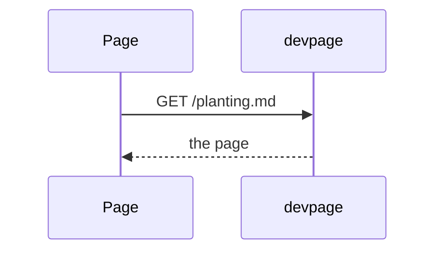
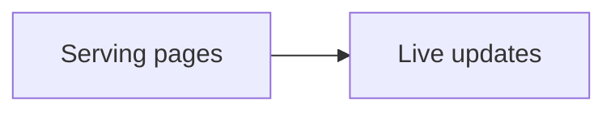

# Diagrams

How to put a diagram in a page with a Mermaid fence, how to make its nodes
links, how to check one before committing, and what a reader sees when one
doesn't parse. It is a task article under the [viewer](../README.md); the
colors diagrams take are on [Themes](../themes/README.md).

## Writing a diagram

A fenced code block whose language is `mermaid` becomes a diagram:

<Example>



</Example>

The server leaves a `mermaid` fence unhighlighted, as a code block marked
`<pre lang="mermaid">` — the only code block that keeps its language. In the
browser, each one is rendered by the `Diagram`
[system widget](../widgets/system-widgets/README.md#diagram), which hands it to
**pele** — a Mermaid renderer built into the viewer (version 1.10.0, vendored at
`assets/vendor/pele.js`; see [the vendored pele bundle](../vendored-pele/README.md))
— and replaces the block with the SVG it returns. Diagrams are drawn when a
page first loads and again every time its content is swapped in, by a live
update or by following a link.

pele detects the diagram type from the first line — `flowchart`/`graph`,
`sequenceDiagram`, `classDiagram`, `erDiagram`, `gantt`, `pie`, `mindmap` and
others.

## Checking a diagram before committing

<Callout kind="tip" title="Run the same renderer in Node">
From the root of the devpage repository, this renders every diagram in a page
(point the last argument at your page) with the pele devpage ships.
</Callout>

```sh
node -e 'const fs=require("fs"),vm=require("vm");const c={URL};vm.createContext(c);vm.runInContext(fs.readFileSync("assets/vendor/pele.js","utf8")+";globalThis.pele=pele;",c);const md=fs.readFileSync(process.argv[1],"utf8");for(const[,s]of md.matchAll(/```mermaid\n([\s\S]*?)```/g)){try{const r=c.pele.render(s);const clicks=(s.match(/^\s*click /gm)||[]).length;const links=(r.svg.match(/<a\b/g)||[]).length;console.log("ok",r.type,"clicks",clicks,"links",links)}catch(e){console.log("ERROR",e.message)}}' docs/getting-started.md
```

For each diagram it prints `ok`, the type and, for
[clickable diagrams](#clickable-diagrams), the number of `click` lines and of
links pele drew — the two should match — or `ERROR` and pele's message:

<Terminal>

```
ok flowchart clicks 6 links 6
```

</Terminal>

It also reads the `mermaid` fences of examples nested in a four-backtick
`markdown` fence. It hands pele Node's `URL`, which pele uses to check
`https://` targets; without it those links are silently left out.

## Clickable diagrams

A node becomes a link with a Mermaid `click` line naming its id, the target and
an optional tooltip:

````markdown

````

pele draws the node inside an SVG link, with the tooltip as its `<title>`,
which the browser shows when the pointer rests on the node. The target is
resolved against the page the diagram is on, the same way the
[page script](../live-updates/README.md#the-page-script) treats a link in the
text:

- A link to another Markdown page opens it in place, like a link in the
  text; a `#heading` after it scrolls to that heading.
- A `#heading` link scrolls to that heading on the same page.
- Any other link — an `https://` URL, a file that isn't Markdown — is left to
  the browser, which navigates to it. So is a click with Cmd, Ctrl or Shift
  held.

A clickable node shows a pointer, and while the pointer is over it the node's
border — its rectangle, diamond, circle or other shape — takes the accent
color at 2.5px; the label is never underlined.

<Callout kind="warning" title="Single spaces in click lines">
pele rejects extra spaces in a `click` line with a parse error, and the whole
diagram is replaced by the [error block](#when-a-diagram-fails). Links work in
flowcharts; pele's sequence diagrams take no `click` line (it is a parse error
there), so their participants can't be links. The
[check command](#checking-a-diagram-before-committing) counts the `click` lines
and the links drawn, so a target pele dropped shows as a mismatch.
</Callout>

The [viewer's landing page](../README.md) diagram is clickable this way: each
part opens its page.

## When a diagram fails

A diagram that pele can't render doesn't break the page. In its place the
reader sees a red block with `Diagram error:`, pele's message — for example
`No diagram type detected for the given text.` or a parse error naming the
line — and then the diagram's source, so the mistake can be found without
opening the file. Fix the source and save; with live updates the diagram
redraws on the open page.
