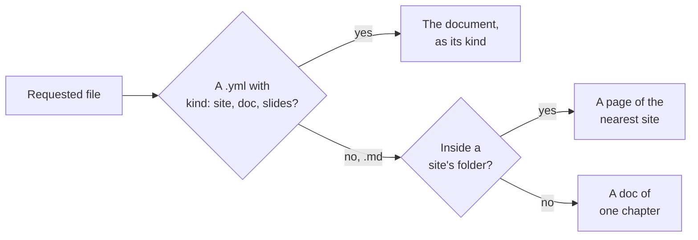

# Which document a file belongs to

How the viewer decides what a requested file is — a document file, a page of a
site, or a Markdown file on its own — and the index of the served folder that
answers it without scanning folders. It is a mechanism page under the
[viewer](../README.md), beside [Serving pages](../serving-pages/README.md),
for someone about to change how files map to documents.

## Document files

A **document file** is a `.yml` or `.yaml` file whose top-level `kind` is
`site`, `doc` or `slides` (`document::kind_of`); a YAML file with any other
`kind`, or none, is an ordinary file.

A document file is loaded with `Document::load` and rendered as its kind: a
site redirects to its root page; a doc renders all its chapters as one page
with its outline; a deck renders its stage with every slide. One that can't be
loaded — a missing chapter, an unknown field — gets `render::invalid`, a page
saying it is not a valid document and why.

## The nearest site

A Markdown file is a page of the nearest site whose document file's folder
holds it, shown in that site's frame with its sidebar. While that site's file
can't be loaded, the page shows `render::invalid` for it instead. A Markdown
file in no site's folder is shown as a doc of one chapter.

With nested sites, the deepest folder wins:

<FileTree>

- docs/
  - devpage.yml — site **A**
  - README.md — a page of A
  - guide/
    - devpage.yml — site **B**, nested in A
    - README.md — a page of B, not A
  - notes.md — a page of A
- scratch.md — in no site: a doc of one chapter

</FileTree>

Of two sites in the same folder, the one whose file name sorts first wins.

## The index

Finding the nearest site never scans folders. The served folder, `Folder` in
`core/src/folder/`, keeps a **document index** of it: every document file and
its kind, and every `.gitignore`. It keeps no document: every document,
a page's site included, is loaded from its file when it is asked for, so a
request always reads what the files say now — even a file the watcher never
hears of, such as one a `.gitignore` excludes. The one document it holds is
the [entry document](../glossary/README.md#entry-document), which keeps its
last valid version while its file is invalid.

<Steps>

1. **Built once, when the folder is opened**
   `Folder::new`, on the entry document, walks the folder with the `ignore`
   crate, honoring each `.gitignore` in it, nested ones included, without
   needing a `.git` folder, and skipping any `.git` and `.devpage` folders; a
   document file in an excluded folder is not indexed.
2. **Kept current by the watcher**
   A changed YAML file or `.gitignore` updates it
   (`Folder::changed`, [Live updates](../live-updates/README.md#the-watcher)).
3. **Asked for a page's owner**
   `Folder::owner` picks, among the indexed sites whose folder holds the
   page, the deepest — and of two in the same folder, the one whose file name
   sorts first — and loads it, or says why it can't. Serving a page, checking
   it and searching it all ask it. `Folder::widgets_owner` answers the same
   for a widgets folder: the entry document when it names that folder, else
   the first indexed document that does.

</Steps>

`devpage` shares one folder between the server and the watcher
(`server::App::local`), with the [search index](../search/README.md) of what the
entry document publishes (`Search::build`) beside it; a published version's
router opens its folder once, with search, the same way (`App::published`).
`devpage pdf`, a version's download and `devpage video` serve through
`server::App::printing`, which opens its own folder, without search, and has
no watcher; `server::App::testing`, which does the same, is what tests start
from.
`devpage check` opens one folder for the whole check.
