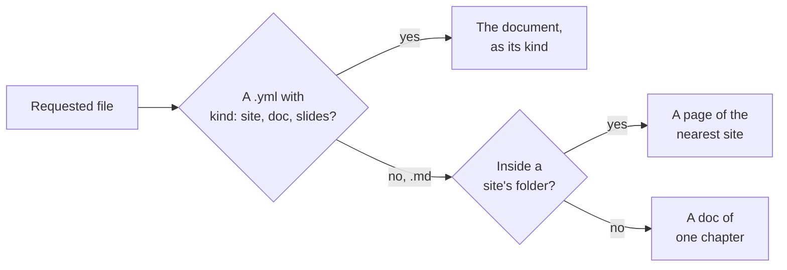

# Which document a file belongs to

How the viewer decides what a requested file is — a document file, a page of a
site, or a Markdown file on its own — and the index of the served folder that
answers it without scanning folders. It is a mechanism page under the
[viewer](../README.md), beside [Serving pages](../serving-pages/README.md),
for someone about to change how files map to documents.

## Document files

A **document file** is a `.yml` or `.yaml` file whose top-level `kind` is
`site`, `doc` or `slides` (`document::kind_of`); a YAML file with any other
`kind`, or none, is an ordinary file.

A document file is loaded with `Document::load` and rendered as its kind: a
site redirects to its root page; a doc renders all its chapters as one page
with its outline; a deck renders its stage with every slide. One that can't be
loaded — a missing chapter, an unknown field — gets `render::invalid`, a page
saying it is not a valid document and why.

## The nearest site

A Markdown file is a page of the nearest site whose document file's folder
holds it, shown in that site's frame with its sidebar. While that site's file
can't be loaded, the page shows `render::invalid` for it instead. A Markdown
file in no site's folder is shown as a doc of one chapter.

With nested sites, the deepest folder wins:

<FileTree>

- docs/
  - devpage.yml — site **A**
  - README.md — a page of A
  - guide/
    - devpage.yml — site **B**, nested in A
    - README.md — a page of B, not A
  - notes.md — a page of A
- scratch.md — in no site: a doc of one chapter

</FileTree>

Of two sites in the same folder, the one whose file name sorts first wins.

## The index

Finding the nearest site never scans folders. `src/index.rs` keeps an
**index** of the served folder: every document file and its kind, and every
`.gitignore`.

<Steps>

1. **Built once at start**
   `Index::build` walks the folder with the `ignore` crate, honoring each
   `.gitignore` in it, nested ones included, without needing a `.git` folder,
   and skipping any `.git` and `.devpage` folders; a document file in an
   excluded folder is not indexed.
2. **Kept current by the watcher**
   A changed YAML file or `.gitignore` updates it
   ([Live updates](../live-updates/README.md#the-watcher)).
3. **Asked for a page's site**
   `Index::site_for` picks, among the indexed sites whose folder holds the
   page, the deepest — and of two in the same folder, the one whose file name
   sorts first.

</Steps>

`devpage` shares one index between the server and the watcher
(`server::router_with_index`), built with the [search index](../search/README.md)
of what the entry document publishes (`Index::with_search`). `devpage pdf`, a slide's PNG and
`devpage video` serve through
`server::printing`, which builds its own index, without search, has no
watcher and logs nothing; `server::router`, which also builds its own index, exists only for
the tests.
