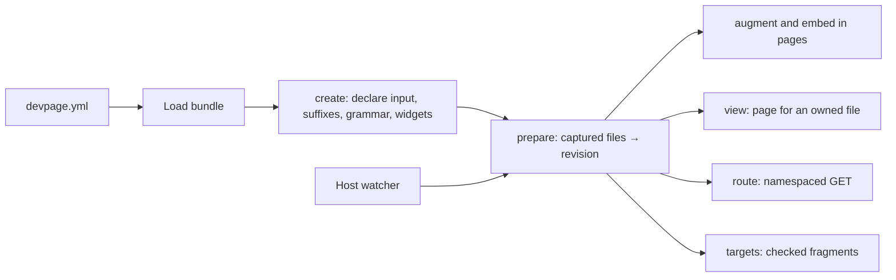

# Extensions

An extension is a separately built Rust library that a document enables in its `devpage.yml`. Devpage loads it into its own process, reads the files it asks for, and asks it to add to pages, draw embeds, show its own file type, answer requests under its own address and highlight its language. Authors keep running the normal `devpage` command; nothing is compiled or installed when a document opens. This box belongs to the [viewer](../README.md).

## Enable a package

A site, doc or deck lists its extensions under `extensions`. Each key is the package's ID; `package` is the path of a built bundle, relative to the YAML file; `config` is passed to the package as written:

```yaml
kind: site
title: Toy
root: README.md
extensions:
  toy:
    package: ./pkg
    config:
      input: model
```

The bundle holds `extension.yml` and the library. Devpage refuses the package when its manifest names another ID, another extension API, another platform, or a library outside the bundle. Any such failure, and any failure of the package's first preparation, makes the document invalid with the reason. An entry with no `package` is a system extension built into devpage: only [`code`](../code-reference/README.md) exists.

## What a package can do



With the toy package above enabled:

- Every page of the site is passed to the package, which may return it with Markdown added; added headings and links are rendered, checked and searched like authored ones.
- A fenced `toy` block is highlighted with the package's grammar.
- `` is replaced by the HTML the package returns for that target.
- Opening `/model/a.toy` shows the package's view of the file inside a devpage workspace page.
- `[link](model/a.toy#main)` is checked against the fragments the package lists for that file.

## From a save to a refreshed page

1. On load, the package's `create` reply names one input file or folder inside the served folder. Devpage watches it even when the site's `watch` list would exclude it.
2. Devpage reads the input's matching files itself and sends their contents in `prepare`. The package replies with a revision name.
3. A saved, added or removed file under the input is read again in the same change burst. If the contents changed, the package prepares again before devpage sends its usual refresh to open pages.
4. A page render carries the revision current when it began in every request it makes.
5. When reading or preparing fails, every later request to that package fails with the reason, shown on the page and reported by `devpage check`, until a preparation succeeds.

## Trust and limits

A package is trusted native code in the devpage process. Its panics are caught and reported as errors; a crash or memory fault ends devpage. The package gets file contents only from devpage's capture, but nothing stops native code reading files itself.

`devpage check` and `devpage pdf` use the same extensions as serving; a Markdown page printed on its own uses its site's. Publishing a document that enables a package fails with "Publishing native extensions is not supported; serve this project locally". Changing a package's library needs a devpage restart. Devpage never tells a package to dispose of an instance; a library is closed once no binding holds it.

## Topics

### Tasks

- [Test an extension](local-test/README.md) — The repository's tests, and building a package and running it with devpage.

### Reference

- [Package and protocol reference](reference/README.md) — Bundle, native boundary, every request and reply, capture rules and addresses.

### Constraints

- [Extensions use the host watch](constraints/host-watch.md) — Inputs join devpage's watch, and preparation precedes refresh.
- [A render uses one extension revision](constraints/one-revision.md) — A render names its revision, and a failed preparation is never served as current.
- [The native boundary is versioned](constraints/native-boundary.md) — Only the C table and owned JSON buffers cross between devpage and a package.
