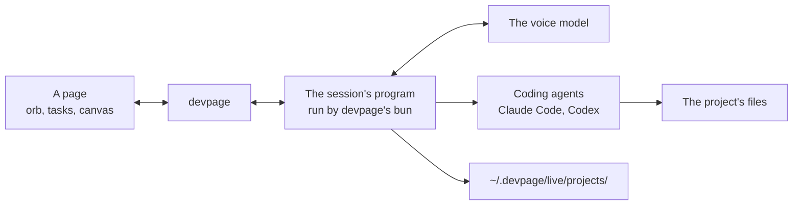
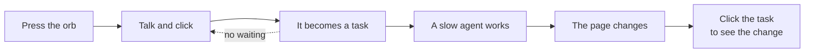

# The live session

A voice session over the pages devpage serves: you talk, an assistant answers
aloud, and coding agents on your machine do the work it hands them, while the
page shows what is said about and what changed. It is the
[system extension](../glossary/README.md#system-extension) `live`: a program
devpage installs beside itself and runs, and four
[system widgets](../on-the-page/widgets/system-widgets/README.md#the-live-sessions-widgets)
devpage places on every page. It sits under the [viewer](../README.md).



## What changes

| Typing to an agent | The live session |
|---|---|
| You type the request | You say it |
| You describe where the thing is | You click it |
| You wait for it to finish | You give the next request |
| You scroll a chat to see what happened | You see every task and what it changed |

## A session



### 1. You talk and click

You press the orb and talk. A click says which part you mean. Pointing is
faster and more exact than describing.


### 2. It becomes work you can see

What you said becomes a task in the side panel. The marked part says what the
request is about. A comment is written only when you ask for one. You are
already giving the next request. Speech is fast, so you need to see what was
understood and what is running.


### 3. You check what changed

The page changes in front of you. Clicking a done task takes you to what it
changed.


Every screen of one request is on [Design](design/README.md).

## What it does

One line each.

| # | What |
|---|---|
| 1 | An orb in the corner of every page starts and stops the session. |
| 2 | The orb shows your voice, the assistant's voice, and whether work is running. |
| 3 | Stopping the session stops the voice. Running work finishes. |
| 4 | The context is the page you are on. |
| 5 | While the session is on, clicking a part or selecting text marks it as what you are talking about. No typing. |
| 6 | A marked part is the context of a request, never a comment by itself. A devpage [comment](../share/comments/README.md) is saved on it only when you ask for one ("comment this", "leave a note here"), short and in your words. |
| 7 | Every request for work becomes a task. |
| 8 | A button in the navbar opens a side panel on the right with every agent, its tasks and their state. |
| 9 | Clicking a done task goes to the part of the page it changed. |
| 10 | You can give a request at any time, also while earlier ones are running. |
| 11 | The assistant can go to a page or a part, point at a part, and select a part. |
| 12 | While the voice is on, the screen stays on, though you touch neither keyboard nor mouse. |

## Why

| What | Why |
|---|---|
| You switch it on and off | The microphone is open only when you decide. |
| It never makes you wait | You keep your own pace, not the agent's. |
| The assistant can open a page, point and select | It can show you what it means. |
| It lives in devpage | The pages, live page updates and comments are already there. |

## Decided

| Question | Answer |
|---|---|
| Does the side panel open by itself on a new task? | No. The navbar button shows how many are running. |
| A task changed several places: where does a click go? | To the first one. |
| Does the assistant move your page on its own? | Only when asked. |
| How do you see what it heard? | The last line heard or said is at the top of the side panel. |

## Turn it on

1. Install the program, once for each version of devpage. The install script
   does it; after `cargo install`, or when devpage says so, run:

   ```sh
   devpage setup
   ```

2. Give devpage a key for the session's models, in its environment:

   ```sh
   export DEVPAGE_OPENAI_API_KEY=…
   ```

   The models can run on an Azure OpenAI resource instead: see
   [On Azure](#on-azure).

3. Serve any document, as always: `devpage`. An orb is in the bottom right
   corner of every page; pressing it starts the session, and pressing it
   again stops it.

The agents are the coding agents installed on the machine — Claude Code and
Codex — each with the login it already has. devpage holds no key of theirs.

## When it is on

The session is on when all three hold:

- devpage serves on a loopback address, the condition for starting any
  [extension's program](../extensions/README.md#a-program-beside-devpage). A
  deployed devpage, and `devpage server`, never have it.
- The environment names where the models run: `DEVPAGE_OPENAI_API_KEY` is
  set, or [for Azure](#on-azure) both `DEVPAGE_AZURE_OPENAI_ENDPOINT` and
  `DEVPAGE_AZURE_OPENAI_API_KEY` are. An empty one counts as not set.
- The program is installed: the one `devpage setup` unpacked, or the folder
  [`live.program`](#settings) names.

With the key set and no program, devpage says so once as it starts — `No live
session: its program is not installed: run `devpage setup`` — and serves
without the session. Without the key it says nothing: the session is off.
`devpage check`, `pdf`, `png` and `video` never have it.

When it is on, every document in the served folder has the extension `live`
without naming it, a Markdown file served alone included; a design's own page
does not. There is one session for the served folder: one program, at one
address, whichever document's page asks. A document changes that for itself
under `extensions`:

```yaml
extensions:
  live:
    config:
      enabled: false
```

- `config` holds the session's [settings](#settings) for this project.
- `enabled: false` in it turns the session off for the document: its pages
  show none of the session's widgets and load none of their modules.
- An entry with a `package` replaces the built-in session with that package,
  as any [extension](../extensions/README.md#enable-a-package): devpage then
  places no widgets for it.

Where the session is off, an `extensions.live` entry with no `package`
changes nothing.

## What a page shows

devpage places the session's widgets itself, after the ones the document
names in its own [places](../on-the-page/widgets/places/README.md):

- **The orb**, floating in the bottom right corner. It starts and stops the
  session, and shows your voice, the assistant's, and whether work is running.
  What keeps the session from starting is said beside it.
- **The tasks button**, in the navbar's place, with the number of running
  tasks. It opens and closes the panel.
- **The task panel**: the agents, each with its tasks, and above them the last
  thing heard or said. A task leads to what it changed.
- **The canvas**: a scratch pad over the whole page, for an idea that is not in
  the project yet. A scratch pad is a Markdown file the session keeps, drawn
  by devpage as an [extension's page](../extensions/reference/README.md#pages),
  so widgets and diagrams work in it as on any page.

The session marks the text it is talking about, moves the page where its
script says, and hears which part you click or select.

## The program

The session itself is a TypeScript program, [`live/`](../../../../live/service.ts) in
devpage's repository: it holds the voice session, decides what work an agent
gets, runs the agents and keeps the tasks. devpage does not contain that
logic. It carries the program's source in its executable, and
[`devpage setup`](../configuration-reference/README.md#devpage-setup) puts it
on the machine:

<FileTree>

- ~/.devpage/live/
  - program/ — the program, unpacked, with its packages installed
  - bun/ — the bun that runs it, at the version devpage pins, and its package cache
  - projects/ — what each project's session keeps

</FileTree>

devpage runs the program as it runs any
[extension's](../extensions/reference/README.md#process): started by the
first page that asks, given each request and WebSocket under its address,
stopped when devpage exits. Its `run` names `bun`, and a program whose `run`
names `bun` is run with devpage's own bun once that is installed, never the
machine's.

The installed program is exactly the one the executable carries. `devpage
setup` stamps it; a devpage that finds another's stamp, after an update, says
`No live session: the program in <folder> is another devpage's: run `devpage
setup`` and serves without the session.

The key reaches the program through devpage's environment and never a page.
`DEVPAGE_LIVE_MODEL` names the voice model; it is `gpt-live-1` when not set.

### On Azure

The voice model and Fast's model run on an Azure OpenAI resource when devpage's
environment names one, with the variables
[the video narrator](../share/making-a-video/README.md#the-narrator) reads:

```sh
export DEVPAGE_AZURE_OPENAI_ENDPOINT=https://<resource>.openai.azure.com/
export DEVPAGE_AZURE_OPENAI_API_KEY=…
```

- The endpoint being set selects Azure, also beside an OpenAI key. With the
  endpoint and no Azure key there is no session.
- On Azure a model is named by its deployment: `DEVPAGE_LIVE_MODEL` and the
  `fast` setting name deployments. Without them the session asks for
  deployments named `gpt-live-1` and `gpt-6-luna`, and for one named
  `gpt-6.1-sol` when the resource refuses Fast's.
- The agents are not affected: Claude Code and Codex keep their own logins.

## Settings

`~/.devpage/config.yml`, the file that holds the
[server contexts](../share/server/reference/README.md#cli), may hold a `live`
mapping: the session's settings for every project.

```yaml
live:
  program: ~/code/devpage/live
```

devpage reads one key, `program`: a folder that takes the installed program's
place, to work on the program itself. It is an absolute path, or one from `~`;
its `extension.yml` must name the extension `live`. It is run as it is, with
no stamp looked for, still by devpage's own bun. Every other key is the
program's own, and devpage keeps it when it writes the file. A document's
`extensions.live.config` holds the same settings for one project; a setting
given there replaces the one for every project.

The program reads three settings:

```yaml
live:
  harnesses:
    claude-code: [fable, haiku]
    codex: []
  fast: gpt-6-luna
  record: true
```

- `harnesses` names the coding agents the session may use, each with the
  models of it that may be used; an empty list is the agent's own default
  model. The first is the default. Without the setting it is Claude Code on
  its default model.
- `fast` names the model that decides what is said and which agent gets a
  piece of work.
- `record: true` saves your voice: see [Recording](#recording). Without it
  no sound is kept.

With more than one harness or model, `~/.devpage/routing.md` says in plain
words which kind of work goes where. A `routing.md` at the top of a project
replaces it whole for that project.

## Where a session is kept

Nothing of a session is written into the project. Each project's session has
a folder of its own, `~/.devpage/live/projects/<the project's path>/`, the
path written with a `-` for every character that is not a letter or a digit:
its log, its tasks, its agents and its scratch pads. The log holds words:
what was said and done. No sound is kept unless you turn
[recording](#recording) on.

Only the program reads and writes that folder; devpage does not.

### Recording

Recording is off until the `record` setting is `true`, for every project in
`~/.devpage/config.yml` or for one in its `extensions.live.config`. With it
on, each voice session writes two files into the `voice/` folder of the
project's session folder, named by the time the session started:

- **A WAV file:** your microphone's sound as it was sent to the voice model,
  mono, 16-bit, 24 kHz. The assistant's voice is not in it.
- **A JSON file** of the same name: the session's id, how long the recording
  is, how much of it is you speaking, and each thing you said with where it
  is in the WAV. The times are the voice model's: close, not exact.

Both are written as the session goes, so a session cut short keeps what it
had. Nothing sends them anywhere, and nothing deletes them.

## Topics

- [The agents](agents/README.md) — Voice, Fast and the slow agents, and how one
  request runs. The pages on each part are under it.
- [Design](design/README.md) — the orb, every screen of one request as a
  click-through prototype, the side panel, an agent's session and the canvas.
- [The scratch pad](scratch-pad/README.md) — the canvas the assistant shows
  over the screen to develop an idea, and how it is built.
- [Agent icons](agent-icons/README.md) — the orb that stands for one agent,
  and how the session's own orb is the same kind.
- [Evals and tests](evals/README.md) — how the session is checked after a
  change: the three kinds of check, the sets of eval cases by behaviour, and
  what to run when.
