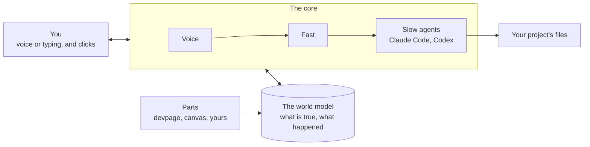

# The live session

You talk to one assistant while you read your project's pages in the browser,
and you click the part you mean. Coding agents on your machine do the work it
gives them, and the page shows what was asked and what changed. You never
start an agent, name one or wait for one: you work on the project. It is part
of the [viewer](../README.md), and it is on for any project you serve once
you [turn it on](use/turn-it-on/README.md).

The pattern has a name: an **Extendable World Model Meta Harness**. A harness
runs one coding agent. This one runs several of them for you, around a shared
record of the project and the conversation that anything can add to.

## What changes for you

- **You say the request,** where before you typed it.
- **You click the thing,** where before you described where it is.
- **You give the next request,** where before you waited for the first to
  finish.
- **You see every task and what it changed,** where before you scrolled a
  chat.

## Topics

### Start here

- [How it works](how-it-works/README.md) — the few ideas behind the session,
  and one request followed from your words to the changed page.

### Use it

- [Use it](use/README.md) — turn the session on, say which coding agent gets
  which kind of work, and the settings.

### Understand it

- [The core](core/README.md) — Voice, Fast and the slow agents, how work is
  given to an agent, and how each agent's prompt is put together.
- [The world model](world-model/README.md) — what the agents share: the log,
  what Fast's scripts can call, and the parts that come with the session.

### Add to it

- [Extend it](extend/README.md) — give the agents something new to see and
  act on, by writing a world model part.

### Change it

- [Inside](inside/README.md) — the program's files, the screens, and how the
  session is checked after a change.
