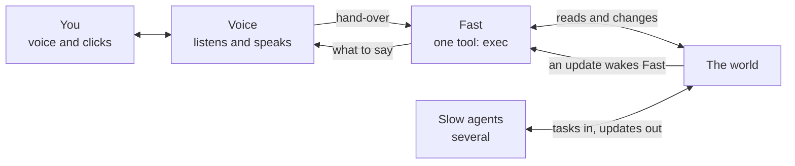

# The agents

**Voice is the interface. Fast is the hub. Slow agents do the work.** They are
the three kinds of agent of [the live session](../README.md), and to you they
are one assistant.

| | Its model | What it is |
|---|---|---|
| **Voice** | GPT-Live | The interface |
| **Fast** | `gpt-6-luna` | The hub |
| **Slow agents** | Claude Code, Codex | The work |

You say what you want done or what you want answered, and you point at what
you mean. You never name a task or an agent.

The code, the files and the log are on the
[technical design](../technical-design/README.md) page.

## How it works

- **Voice** hears you, speaks, and hands over what you said. It decides
  nothing and knows nothing.
- **Fast** routes: your words to a slow agent, and a slow agent's updates back
  to you. It also moves the page. It never does the work, and it never retypes
  your words: in a script your message is a variable.
- **Slow agents** answer questions and change files. They publish updates on
  their tasks. They never talk to you directly.

## One request, start to end

1. You speak. Voice hands over.
2. The program wakes Fast with what you said, as a message with an id.
3. Fast writes one script. It picks an agent and composes the prompt around
   your message.
4. Voice says one short line, written by Fast.
5. The slow agent works and publishes updates on the task.
6. Each update wakes Fast. Fast decides what you hear.

You can give the next request at step 4. Nothing waits for step 6.

## The rules

Every agent is told the first two in the same words (`live/brief.ts`); the
rest are in each agent's own brief.

- **One partner, for thinking and for doing.** Answers come first. No fluff,
  no repeating what you said, no question back when you want an opinion.
- **Thinking or doing.** When you explore ("I think", "maybe", asking for an
  opinion): talk, change nothing. When you state something as settled or name
  a specific change: do it, without asking you to confirm. In between: act
  only when it is cheap and easy to undo.
- **One assistant.** Whatever is spoken is in the first person, as the one
  who thinks, answers and does the work. Nothing spoken names an agent, a
  model, a task by its number, a tool or a hand-over, unless you ask how the
  session itself works.
- **Length.** What a slow agent publishes is written to be heard: one to four
  plain sentences, the answer or the result first. What Fast writes itself is
  one or two.
- **Questions to you.** Only when an agent cannot go on, and then exactly
  one.
- **Voice by itself says nothing.** It says only the lines it is given,
  completely and unchanged, and never talks over you.
- **A judgment is never Fast's.** A fact Fast can see, it says. What you
  should think of something goes to a slow agent, and Fast gives no opinion of
  its own.
- **Marked part and comments.** The marked part is context for the request. A
  comment is saved only when you ask for one, on the part marked when you
  spoke, short and in your words.

## Topics

- [The world](../world/README.md) — the three parts Fast sees, and what its
  scripts can use.
- [Voice to Fast](../voice-to-fast/README.md) — what the voice model sends at
  a hand-over, and how messages get ids.
- [Fast, the hub](../fast/README.md) — what wakes Fast, how it routes in both
  directions, how it picks a slow agent, and how it is replaced before its
  context fills.
- [Slow agents](../slow-agents/README.md) — what an agent is, how it gets
  work, what it publishes.
- [The harness](../harness/README.md) — what an agent's session is made of,
  the same for every coding agent, and what a coding agent must do to be used.
- [Routing](../routing/README.md) — which harness and model an agent runs on:
  the settings, your rules, and what you say.
- [Technical design](../technical-design/README.md) — the program's files, one
  request through them, a restart, the log and the cost.
