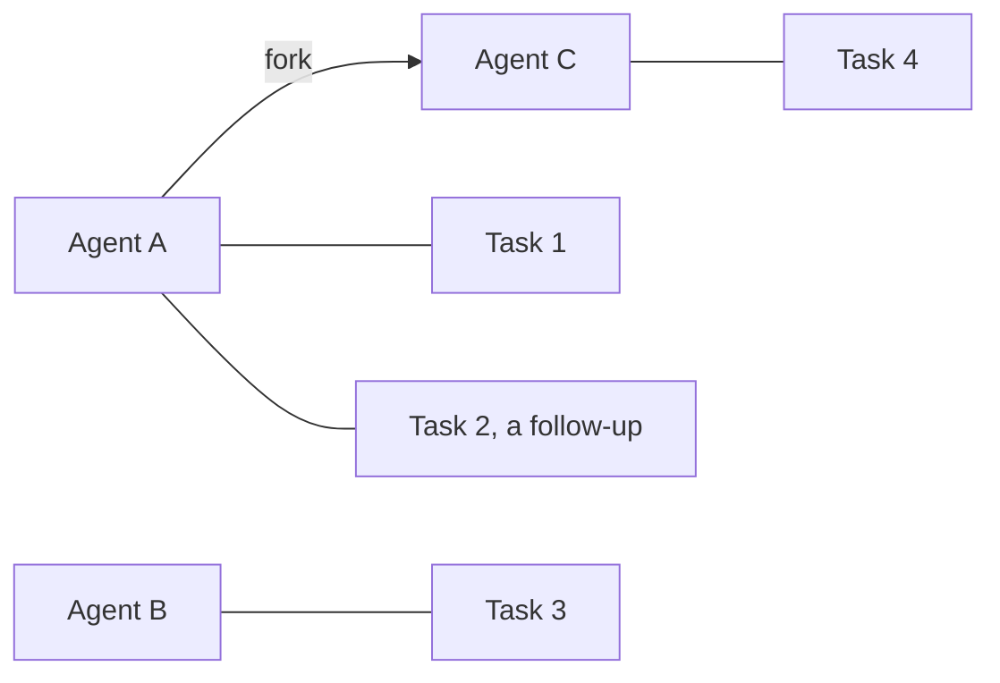

# Slow agents

A slow agent is one conversation with a coding agent on your machine: Claude
Code or Codex, on the login it already has, behind [the harness](../harness/README.md).
It does the work: it answers questions and changes files. The code is
`live/agents.ts`; the page belongs to [the agents](../README.md).

## An agent and its tasks

- **A task** is one piece of work given to an agent, with its updates.
- **An agent** is a conversation with its own context. It can hold several
  tasks, when they are related.
- **A new agent** starts empty and reads what its task needs. A fork starts
  with what the agent it is forked from knows.

## What an agent gets

One prompt per piece of work. Fast composes it around your words; the program
adds the page you were on and the part you had marked. It reaches the agent
as a message that begins `Task <number>`.

Every `spawn`, `send` and `fork` makes a new task, a follow-up too. So the
side panel has one row per thing you asked.

A message typed in [an agent's chat](../../design/README.md#an-agents-session)
does not go through Fast: it is already addressed to one agent. It is a task
of that agent all the same, because an agent reports on a task: so it shows in
the side panel, and you hear its answer.

## What an agent publishes

With its `update` tool, on the task it was given:

- **A title**, in its first update: three to six words. Until then the panel
  shows your first words.
- **Its own name**, in its first update: two to four words for what it works
  on, wider than one task. It sends a new one when a later task has changed
  what it works on. The [side panel](../../design/README.md#the-side-panel) shows
  it.
- **Progress**, when there is something worth knowing.
- **A question**, when it cannot go on without you: exactly one, and its turn
  ends. Your answer arrives as a new task.
- **Finished**, once per task: the answer, or what it changed and where. Its
  changes are the places to look at: for each, the page and a few words copied
  from the new text. A click on the done task goes to the first.
- **Failed**, once per task: what went wrong.
- **A comment**, only when you ask for one, with its `write_comment` tool: on
  the part that was marked when you spoke.

Updates go to the world, on the task. Fast decides what you hear of them. The
agent never talks to you.

An update is written to be spoken: one to four plain sentences in the first
person, no Markdown, the answer or the result first, then what it did not
verify, then what you have to decide. Fast passes it on as it is.

A turn that ends without `finished` or `failed` still ends its task: the
agent's last words become that update.

An agent has a third tool, `read_log`: it reads [the session's log](../technical-design/README.md#the-log)
when you ask who said what, or what exactly was done.

## The life of an agent

1. **Created:** new, or forked from another agent, for a task.
2. **Working:** one task at a time. A follow-up waits its turn.
3. **Idle,** or waiting for your answer to its question: kept while its tasks
   are in Fast's window.
4. **Closed:** when Fast has forgotten its tasks, at a
   [swap](../fast/README.md#swapping-fast-before-its-context-fills). Its work
   is on disk, in the files and the comments.

An agent whose conversation the coding agent has lost starts empty once, and
goes on.

## What an agent may change

- **The project's folder and its [scratch pads](../../scratch-pad/README.md#who-writes-a-pad)**
  are the default scope for reads and writes. The
  [fullFilesystemAccess setting](../../README.md#settings) can expand it.
- **It asks nobody** before it uses a tool. Several agents work in the project
  at the same time, so each is told to change only what its task needs.
- **The session restarted while a task ran:** the task is marked failed, with
  "The session restarted before it reported." The agent's conversation is
  kept, so it can be given more work.
