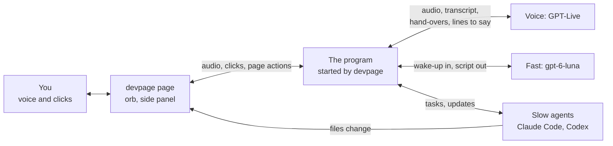

# Technical design

How the [live session](../../README.md) is built: the program is in `live/`, the
orb, the side panel and the canvas are system widgets in
`core/assets/widgets/`, and [devpage starts the program](../../README.md#the-program).
What the parts are for is on [the agents page](../README.md) and the
pages beside it.

## The parts

Each part is one file in `live/`:

- **`service.ts`** connects everything: the open pages, the voice session,
  Fast, the agents. It carries out what Fast's scripts ask for, and keeps the
  key, so it never reaches the browser.
- **`voice.ts`** is the GPT-Live session in client mode. It turns transcript
  fragments into messages and pairs each hand-over with its words: see
  [Voice to Fast](../voice-to-fast/README.md).
- **`world.ts`** is the world as one numbered log, kept in `world.sqlite`: see
  [the world](../world/README.md).
- **`fast.ts`** is Fast's loop: the wake-ups, the model call, the context
  swap. See [Fast, the hub](../fast/README.md).
- **`sandbox.ts`** runs a script in QuickJS and returns the calls it made.
- **`agents.ts`** runs the slow agents on a harness, without knowing which:
  see [slow agents](../slow-agents/README.md).
- **`harness.ts`** is what a harness must do, and **`claude.ts`** and
  **`codex.ts`** are Claude Code and Codex as one each: see
  [the harness](../harness/README.md).
- **`routes.ts`** is which harness and model an agent may run on: the
  settings, the rules in `routing.md`, and what Fast is told of them. See
  [routing](../routing/README.md).
- **`brief.ts`** is what all three are told in the same words. Each one's own
  brief is in its file.
- **`tasks.ts`** is the list of tasks, kept in `world.sqlite`. The side panel
  shows them under their agents: the program sends every open page the tasks
  and the agents, each agent with its number, its name and whether it works,
  is idle or has a question.
- **`home.ts`** is where a project's session is kept, and the settings.
- **`log.ts`** is [the log](#the-log).
- **`pages.ts`** is the list of pages Fast can open.
- **`cost.ts`** has the prices and prints [the cost](#the-cost).
- **`eval.ts`** is [the eval of Fast](#the-eval-of-fast), with its cases in
  `evals/`.

## One request

1. Voice hands your words over (`session.delegation.created`). The program
   sends an empty silent note at once, which cancels the API's own "one
   moment".
2. The program makes one message of the words, with the page you are on and
   the part you marked, and adds it to the world.
3. Fast is woken with the world's new entries and the page, and answers with
   one script.
4. The script runs in the sandbox. Its calls are carried out in order: `say`
   goes to Voice as a line (`session.commentary.append`), `spawn`, `send` and
   `fork` make a task and give it to an agent, the `page` calls go to your
   tab.
5. The agent publishes updates with its `update` tool. Each goes into the
   world and wakes Fast, which decides what you hear.

A call that cannot be carried out becomes a `problem` entry in the world,
which wakes Fast.

## What you hear

- Only what a script gave to `say`, and "I'm back." after a restart, which
  the program says itself.
- A line is sent with the id of the hand-over it answers. News of a task is
  sent with the id of the hand-over that started the task, in the same voice
  session, and otherwise with none.
- Fast runs only while the voice is on. What the agents published while it
  was off, it gets when the voice starts.

## The marked part

The program keeps the marked part with its author: `user` for your click or
selection, `assistant` for a script's `page.select`. The page draws each in
its author's voice colour from the orb: yours in red (`#e64c3c`), the
assistant's and the part it points at in ice blue (`#2f8fe6` on a light page,
`#5cbdff` on a dark one). A message keeps the text that was marked when it
was said. A task given from that message is about that part, and the mark is
cleared.

## The model behind Fast

`gpt-6-luna`, at reasoning effort `medium`, on the priority service tier,
called through the Responses API with nothing stored at the provider.

- When the API refuses the model, the session goes on with `gpt-6.1-sol`. The
  log gets a `fast` entry of kind `model_fallback`.
- The [`fast` setting](../../README.md#settings) names another model.

## A restart

You do nothing after a restart: the page brings the session back.

- **The program tells the pages first.** Before it ends, by a script's
  `restart()` or by a signal from outside, it sends every open page
  `restarting`.
- **The page connects again by itself.** When the connection closes it tries
  again every 400 ms for 20 seconds, then with waits doubling up to 8
  seconds. Its first try is the request that makes devpage start the program
  again. Each time it connects it sends the page you are on.
- **The voice starts again by itself.** When the voice was on, the page keeps
  the microphone and the sound open across the gap, so the browser asks for no
  permission and no click. The orb shows the gap as starting. Once the
  program answers, the page asks for the voice with `resumed`, and Voice says
  "I'm back." After 60 seconds without the program the page gives up and the
  voice is off.
- **A voice you stopped stays off.** The page starts it again only when you
  had turned it on and not stopped it.
- **New widget code needs no reload.** When a newer `live.ts` is loaded
  beside the one running, it takes over the connection, the microphone and
  the sound from the old one through `globalThis.__liveSession`, so the voice
  goes on while the code changes. The program's code is loaded by the
  restart.
- **A reloaded page starts the voice again too.** A page that goes away with
  the voice on leaves the time in `sessionStorage`; a page loaded in the same
  tab within 15 seconds starts the voice.
- **The screen stays on while the voice is on.** From the moment you turn the
  voice on until it is off, also across a restart or a reload, `live.ts`
  holds a screen wake lock (`navigator.wakeLock.request("screen")`), kept in
  `globalThis.__liveSession` with the rest. The browser lets it go whenever
  the tab is hidden, so the page asks again when the tab is shown. Where the
  browser has none or refuses (no secure context, low battery), nothing is
  shown and the session goes on.

What each case comes to:

| Case | What happens |
|---|---|
| The program ends after telling the pages | The voice is on again, with no click. |
| The program is killed without a word | The same. |
| `live.ts` changes while the voice is on | The connection and the audio go on; no new connection is opened. |
| The page is reloaded, with no click after it | The microphone opens and the sound runs, where the browser allows sound without a click. |
| You stopped the voice, then the program ends | The voice stays off. |

- When a browser does not let a reloaded page play sound without a click, its
  sound stays suspended and the microphone is not heard either, since both
  run on the same audio clock. The orb then shows "Click anywhere to hear
  me", and the first click or key starts both.
- `restart()` first checks that the code bundles
  (`bun build service.ts --target=bun`) and does not restart when it does
  not. With tasks still running it restarts only with `restart(true)`, after
  you said "restart now". The process ends six seconds later.
- A restart ends the voice session and the running tasks. The world, the
  tasks and the agents' sessions are in files, so Fast starts with the recent
  messages and tasks, and an agent can be given more work.

## What it rests on

**GPT-Live,** by OpenAI's delegation guide for the Live API:

- In client mode the hand-over is an event with an id and a time, and no
  words. The words are in the transcript fragments.
- Text can be pushed in at any time: one kind is spoken aloud, in up to 500
  tokens, the other is silent context. Either one cancels a pending automatic
  acknowledgement.
- You can keep talking while work runs.
- No event closes a hand-over: several lines can be sent for one.
- Voice costs $0.05 per minute. Fast's tokens are billed separately, at its
  model's price.

**Claude Code,** by the Claude Agent SDK:

- A session is picked up again by its id, also after a restart, and can be
  picked up as a fork: a new session that starts with the old one's context.
- The program's own tools can be defined in code.
- It runs on the login Claude Code already has on the machine. The program
  holds no token for it, and none for Codex.

## What devpage gives it

| What | Used for |
|---|---|
| An extension that is a program devpage starts and keeps running | The program: the voice session and the agents' sessions live for hours. |
| Requests and live connections passed through to that program | Audio goes up and comes back; clicks and page actions go both ways. |
| Places for widgets outside the page's text | The orb, the navbar button and the side panel stay when you go to another page. |
| A page module for widgets | Reading the address, the text and your selection; marking a part; going to a page. |
| Pages an extension answers | A scratch pad, drawn as a page of the project. |
| Comments tied to a part of a page | A note you ask to leave on a part. |

## Where things are kept

- **The key:** `DEVPAGE_OPENAI_API_KEY`, or
  [Azure's](../../README.md#on-azure), in devpage's environment. Claude
  Code and Codex use their own logins.
- **The settings:** `live` in `~/.devpage/config.yml`, and a project's own:
  see [Settings](../../README.md#settings).

In [the session's folder](../../README.md#where-a-session-is-kept),
`~/.devpage/live/projects/<the project's path>/`:

- **The database** (`world.sqlite`) holds world entries, tasks, agents and their harness conversation ids, and the session log.
- **The scratch pads** live in `pads/`.

On first startup with the SQLite-backed service, devpage imports the legacy
session files in one transaction and keeps the originals with a `.migrated`
suffix. A restart resumes an interrupted archive without importing twice.

Nothing of it is in the project.

## The log

The program writes what every part said and did to the session database, one row per event. It holds
words only: no audio and no key.

`log.ts` prints the last 80 entries so that they can be read. It is run in
the project's folder, with the path to the program: `bun <program>/log.ts`.
A number sets how many, a word keeps only the entries with that word, and
`-v` adds the detail.

Every entry has the time (`ts`), the voice session's id (`session`), who it
is from (`who`), its kind (`kind`) and usually words (`text`). Entries of
Fast carry the wake-up's number (`run`), entries of the agents carry `agent`
and `task`.

- **`user`:** each transcript fragment of yours with its times (`fragment`),
  and each message made of them (`utterance`), with its hand-over.
- **`voice`:** the same for what Voice spoke, and each hand-over (`handover`)
  with its `offset_ms` and the words that had arrived by then.
- **`fast`:** per wake-up: what woke it and the exact text it was shown
  (`wake`), the script and the calls it made (`script`), a script that threw
  with its error (`script_failed`), each call carried out (`did`) or not
  (`did_not`), and the end (`run_ended`). Each model call (`model`) with its
  time and its tokens, cached ones apart. The context swap (`swap_started`,
  `swap_summary`, `swap_ready`, `swap_done`).
- **`say`:** each line given to Voice (`line`), with the hand-over id it was
  sent with and whether the connection took it.
- **`agent`:** an agent created and what it was forked from, each task given,
  each turn's start and end with its time, turns and cost, the agent's own
  text and each tool it used, and the base agent being built.
- **`world`:** every entry of the world, as the line Fast reads.
- **`service`:** a voice session starting, failing or ending, a hand-over's
  words being cut (`handover_cut`) or missing (`handover_without_words`), the
  API's acknowledgements, the routes, and every event the code does not
  handle, whole.

Fragments, model calls, acknowledgements and an agent's text and tools have
`level: "debug"`: the printer shows them only with `-v`.

An agent reads the log with its `read_log` tool when you ask who said what.

## The cost

`bun <program>/cost.ts`, run in the project's folder, prints what each of the
last 7 days cost, from the log. A number sets how many days.

- **Voice** is billed by the minute the session is on: the API reports the
  seconds (`voice_usage`).
- **Fast** is billed by the token: each model call's entry has its tokens,
  its tier and its cost (`cost_usd`). The prices are in `live/cost.ts`; the
  priority tier costs twice the standard one.
- **The agents** run on the machine's own logins and add nothing to that
  bill. Their line shows what the same turns would cost at API prices.

## The eval of Fast

`bun eval.ts`, in `live/`, checks that Fast does the right thing, before its
model, its brief or its settings change.

- **A case is one moment of a session:** everything Fast had been shown until
  then, the wake-up, and what a right script does there. The cases are in
  `live/evals/cases.ts`.
- **The session is a written sample,** `live/evals/sessions/sample.json`: a
  session written for the eval, on Kelpie, a made-up command-line backup
  tool with a docs site.
  `bun <program>/eval.ts freeze <session id>`, run in a project's folder,
  makes such a file from the log and the world of a session of your own.
- **A sample case** is a wake-up of that session, as it is written.
- **A written case** goes on after one of its wake-ups with something you
  could say next, or an update an agent could publish.
- **The model is called through the program's own code:** the same brief,
  the same request, the same sandbox, the same second try when a script
  throws.
- **The calls are checked in code:** which calls the script makes, to which
  agent, to which page, and that it makes no others. A case that expects
  nothing fails on any call.
- **The words are checked by a judge model,** Claude on the machine's login:
  a spoken line and a prompt for an agent are held to the case's points and
  to two rules that always apply. A line states only what Fast was shown, and
  a prompt asks for what you asked and no more.
- **Each case runs three times**, since the model does not answer the same
  way twice. `--runs 5` sets another number, and `show <case>` prints what
  Fast is shown in a case.
- **The cases are in sets, by behavior.** Which sets there are and how to run
  one, several, or only what failed last time is on
  [Evals and tests](../../evals/README.md).
- **A setup is a model, an effort and a tier:**
  `bun eval.ts gpt-6.1-sol gpt-6-luna:medium` compares two. With none it runs
  the one the program uses.
- **It prints** how many cases passed every time, sometimes and never, each
  failure with its script, the time to the script, and the cost. Every try is
  saved in `~/.devpage/live/evals/`.

When Fast does the wrong thing in a session, that moment becomes a case.
