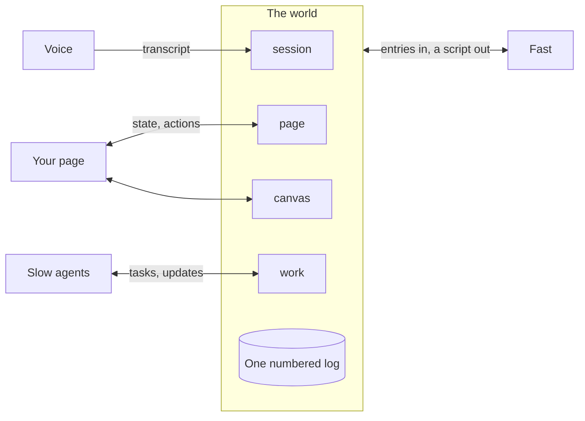

# The world

The world is what the agents of [the live session](../README.md) share: what
was said, the page you are on, the scratch pad on the canvas, and the work.
It is made of named parts, and one numbered log of everything that happened.
Fast sees the log's entries and acts through the parts' functions.

## The four parts

The live session brings four parts. Each has its own page, with its state,
its entry kinds, its functions and its widgets.

<Cards columns={2}>

- (mic) [Session](session/README.md) — The voice and the transcript. Fast reads what was said and gives Voice the line to speak.
- (file-text) [Page](page/README.md) — The address, the text and the marked part. Fast reads it and moves it.
- (frame) [Canvas](canvas/README.md) — The scratch pad open over the page.
- (list-checks) [Work](work/README.md) — The tasks, their updates and the agents that hold them.

</Cards>

## A part is the same thing everywhere

A part registers what it has of four things: state, entry kinds, functions
and widgets. The four parts above are registered that way, and so is a part
an extension adds. So each of their pages is also an example of
[the extendable world](extending/README.md).

## Topics

### The parts

- [Session](session/README.md) — the voice status and the transcript, and
  the functions `say` and `restart`.
- [Page](page/README.md) — where you are and what is marked, and the
  functions that move the page.
- [Canvas](canvas/README.md) — the open scratch pad, and the functions that
  show and close it.
- [Work](work/README.md) — tasks, updates and agents: the functions that give
  work, and the slow agents' tools.

### How it is used

- [One numbered log](log/README.md) — the entries, their kinds, the line
  Fast reads of each, and what Fast holds of them.
- [Fast's scripts](scripts/README.md) — how Fast calls the parts' functions:
  ids as variables, examples, and how a script runs.

### Adding to it

- [The extendable world](extending/README.md) — what a world part is, and how
  the session and an extension register one the same way.
