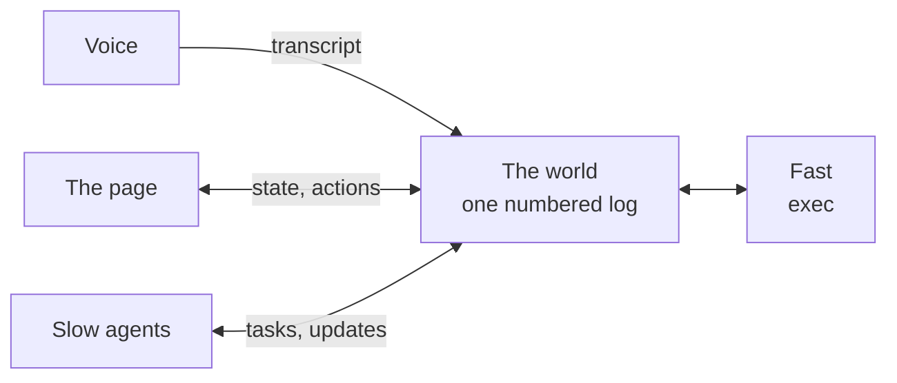

# The world

What Fast sees and acts on. It has three parts. The session's program owns
all of it (`live/world.ts`); it belongs to [the agents](../README.md).



## The three parts

1. **The transcript.** What you said and what Voice said, as messages with
   ids. Fast reads it and cannot change it.
2. **The page.** The address, the text, the marked part, the side panel. Fast
   reads it and moves it: go to, scroll, point, select, open or close the
   panel. While [the canvas](../../scratch-pad/README.md) is open, the scratch
   pad on it is the page.
3. **The work.** The tasks, their updates, and the agents that hold them. Fast
   reads it and gives work to an agent.

## One numbered log

Every change to the world is one entry with a number and a time. There are
five kinds:

| Kind | What it is | The line Fast reads |
|---|---|---|
| `message` | Something you or Voice said, with its id, the page it was said on and the part marked then | `m41  user  "Why is this step here?"  page /docs/waiting-list/README.md  marked "An offer stays open"` |
| `page` | What happened on the page, by you or by Fast, as one sentence | `page  The user marked "An offer stays open".` |
| `task` | A piece of work given to an agent, and how: a new agent, a fork, or the same agent | `t7  given to a2 (a new agent)  "…"` |
| `update` | What an agent published on a task: `progress`, `question`, `finished` or `failed` | `u12  t7 a2  finished  "The page now says seven days."` |
| `problem` | Something a script asked for that could not be done | `problem  page.point could not be done: …` |

- "What was marked when this was said" has an exact answer: the mark at the
  message's time, not at the time Fast runs.
- "Everything since entry 412" has an exact answer. That is what a wake-up
  carries, and what a [swap](../fast/README.md#swapping-fast-before-its-context-fills)
  adds.
- Routing can be tuned later, because every decision is in the log with what
  Fast saw.

The log is one file, only ever added to; the program holds its newest 2,000
entries, and the ids of messages and updates go on across a restart.

## What Fast holds

Fast holds a window of the world: the recent messages, the page as it is now,
the recent tasks and their agents. Everything in it has an id: `m41` is a
message, `u12` an update, `a2` an agent.

What falls out of the window is forgotten. Fast cannot query older history,
because a lookup would add lag. When it cannot place what you said, it starts
a new agent.

## What a script can use

Fast has one tool, `exec`. It runs JavaScript in a QuickJS sandbox. The ids
Fast sees in its context are the script's variables.

```js
m41                // a message; in a string it is the words
m41.page           // the page address when it was said
m41.marked         // the marked text when it was said; empty when nothing was marked
u12                // an update; in a string it is its text

spawn(prompt)      // a new agent, forked from the base agent
spawn(prompt, route) // the same, on a named route
a2.send(prompt)    // more work for that agent
a2.fork(prompt)    // a new agent that starts with a2's context

say(text)          // Voice says it

page.go(address)
page.scroll(where) // "up", "down", "top", "bottom"
page.panel(open)
page.point(quote)  // the smallest block of the page that contains the quote
page.select(quote)

canvas.pad(title)  // the address of the scratch pad for an idea
canvas.show(address) // opens the canvas on that pad, over the page
canvas.close()

restart()          // restarts the session's program; restart(true) also with tasks running
```

Fast composes each prompt as a string. Your words go in as a value, so Fast
writes only what is around them. The page you were on and the part you had
marked are added to every prompt by the program, so a script never writes
them. What a route is, is on [Routing](../routing/README.md).

### Examples

You ask a question about a part you marked.

```js
spawn(`The user asked: "${m41}"`);
say("I'm checking that.");
```

You add something to work that is running.

```js
a2.send(`The user adds: "${m44}"`);
```

An agent finished.

```js
say(u12);
```

Five updates arrived at once.

```js
say(`The three wording fixes and the new diagram are in. One question: ${u35}`);
```

You ask to see the part you marked earlier.

```js
page.point(m38.marked);
```

### How a script runs

- **No `await` and no return value.** The calls are collected and carried out
  when the script ends. `exec` answers "ok" or the error.
- **A script that throws does nothing.** No half-done scripts.
- **An unknown id is an error.** Fast gets it back and tries once more.
- **After a hand-over, a script that gives work must use a message of that
  hand-over.** Otherwise it is refused, and the error names the right ids.
  This catches `m14` typed for `m41`.
- **A quote must be on the page exactly once.** No match, or more than one,
  is an error, found while the script can still fail. After a `page.go`, a
  `canvas.show` or a `canvas.close` in the same script the text is not known
  yet, and the quote is looked for when the call is carried out.
- **`page.go` takes only an address from the list of pages** Fast was shown,
  and `canvas.show` only a pad made in this script or one from the list of
  pads.
- **Only `say` is spoken.** Fast's plain text never reaches Voice.
- **A new sandbox for each script,** with 32 MB of memory, stopped after
  300 ms.

The cost of collecting the calls: when a `spawn` fails, Fast learns it at the
next wake-up, as a `problem`, after "I'm checking that" was said.

## Topics

- [The extendable world](extending/README.md) — the design that lets the core
  and any extension add to the world through the same contracts.
