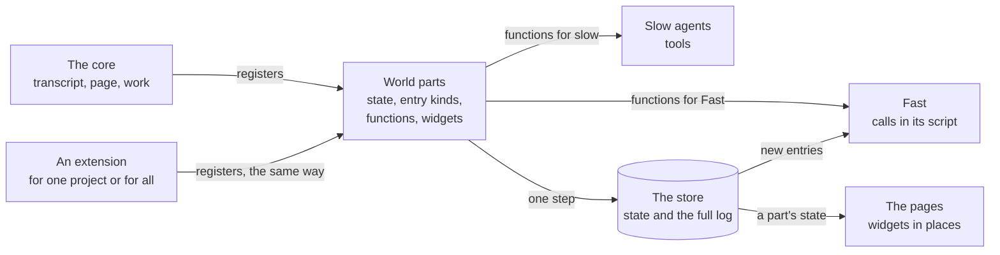
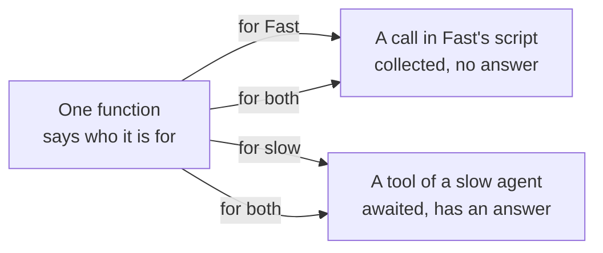
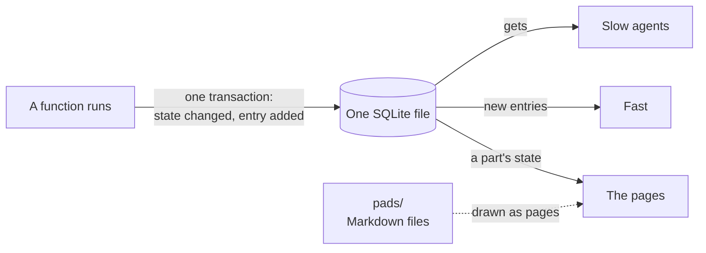

# The extendable world

The design that lets the core of the live session and any extension add to
[the world](../README.md) through the same contracts: what a world part
registers, who may call its functions, where its state and its entries are
kept, how its widgets get on the page, and where an extension is enabled. It
is a design, not what runs: [what exists today](#what-exists-today) is the
starting point, and [what changes](#what-changes) lists the difference. It
sits under [the world](../README.md), for someone about to build it.



## What exists today

- **Entries.** One log, only added to, in `world.sqlite`. Five fixed kinds:
  `message`, `page`, `task`, `update`, `problem`
  ([One numbered log](../README.md#one-numbered-log)). The program holds the
  newest 2,000.
- **State.** Tasks and agents occupy separate rows in the session database, each
  written whole on every change. The pages show the state and never read
  entries; Fast reads entries and never the state. The code that handles an
  update writes both, separately.
- **Fast's calls.** `say`, `spawn`, `send`, `fork`, `page.*`, `canvas.*` and
  `restart`, written by hand twice: in the script sandbox
  (`live/sandbox.ts`), where each is checked while the script can still fail,
  and in `carry` (`live/service.ts`), where each is carried out. A call
  returns nothing to the script.
- **The slow agents' tools.** `update`, `write_comment` and `read_log`, one
  list in `live/agents.ts`: a name, an input, what it runs. Each
  [harness](../../harness/README.md) hands the list to its agent, today over
  MCP.
- **What wakes Fast.** A hand-over, an `update` and a `problem`
  ([What wakes Fast](../../fast/README.md#what-wakes-fast)). The rule is
  written into the program.
- **The pages.** One WebSocket from each page to the program. On every change
  the program sends the whole state. The session's four widgets are compiled
  into devpage and placed by name in `core/src/document.rs`.
- **Nothing outside the program can add to the world.** An
  [extension](../../../../extensions/README.md) can add to pages and run a
  program of its own; the session's program is told only its own settings.

## A world part

A world part is a named piece of the world: the transcript, the page, the
work, or an extension's. It registers what it has of four things; none is
required.

1. **State: how things are now.** Data that changes. Widgets show it.
2. **Entry kinds: what happened.** A kind says its fields, the line Fast
   reads, an image when it has one, and whether it wakes Fast. An entry is
   never changed or dropped.
3. **Functions: what can be done.** A `get` reads state, a `set` changes it,
   an `action` does something. A function says its name, its input, what it
   runs and [who may call it](#who-may-call-a-function).
4. **Widgets: how it shows.** The widgets it brings and the
   [place](../../../../on-the-page/widgets/places/README.md) of each.

Three rules hold for every part:

- **The core registers its parts the same way an extension does.** Nothing
  reaches the world any other way.
- **A `set` or an `action` changes state and adds its entries in one step.**
  State and entries cannot drift.
- **A function never tells Fast or Voice itself.** It adds an entry; the
  entry's kind decides whether Fast wakes; Fast decides what is said.

## Who may call a function

Every function is written once and says who it is for. The program offers it
in the right form.



A sketch of the wording, not an interface that is settled:

```js
action("say",      { for: "fast" })
set("update",      { for: "slow" })
get("read_log",    { for: "slow" })
action("mac.run",  { for: "both" })
```

- A `set` or an `action` can be for Fast, for slow agents, or for both.
- A `get` is for slow agents only. Fast's script gets no answer from a call;
  what Fast knows is the entries it was shown. Data meant for Fast is an
  entry kind.
- A function for Fast keeps what a script is today: its calls are collected
  and carried out when the script ends, and a script that throws does nothing.
- MCP is how a slow agent's functions are carried today. It is not part of
  the contract: an extension registers a function and writes no MCP.

What the code asks of a function:

- **A function for Fast has two halves.** One runs inside the sandbox and
  one outside, and nothing but text crosses between them. A registered
  function gets a generated sandbox half, which checks its input and records
  the call. The core's own checks stay the core's sandbox code: a quote on
  the page exactly once, an address from the list of pages, a message of the
  hand-over used. An extension's function has no check of its own inside the
  script.
- **A function runs with its caller.** Fast's run, with its hand-over and the
  messages its script used, or the agent that called. `say` needs the
  hand-over it answers; `spawn` needs the message and the part marked with it.
- **A function for Fast brings its line of Fast's brief.** The brief is
  put together when a context is built.
- **An extension's module is a function the program calls** with the
  registering calls in hand, the input's schema builder among them. It cannot
  import the program's packages from its own folder.
- **A base agent is built again when the list of functions changes.** Its
  record keeps a fingerprint of the list.

## The store

One SQLite file for each project's session, in
[the session's folder](../../../README.md#where-a-session-is-kept).



- It takes the place of `tasks.json`, `agents.json`, `world.jsonl` and the
  daily files of [the log](../../technical-design/README.md#the-log).
- It keeps both the state as it is now and the full log of every event. No
  entry is dropped.
- How many tables it has is not part of the contract. The contract is one
  store and one way to write.
- [Scratch pads](../../../scratch-pad/README.md) stay Markdown files: devpage
  draws them as pages and the agents edit them as files.
- What is only in memory today moves into state: the part marked with each
  message, the hand-over each task came from, what is marked now, the open
  pad. A restart loses them today.
- Fast's list of agents and the side panel's are worked out twice today, from
  entries and from the files. Both read the work part's state.
- [The eval of Fast](../../technical-design/README.md#the-eval-of-fast) and
  [the cost](../../technical-design/README.md#the-cost) read the store, where
  they read the files today.

### Moving a session into the store

Sessions kept in today's files are moved, not left behind. The move runs when
the program starts and finds no completed import, including when a registry
already uses the database. It keeps every entry's number and every
id of a message, an update, a task and an agent, with each agent's
conversation in its harness. The old files are kept, renamed.

## Widgets and state on the page

- **A package says where its widgets go.** Its `extension.yml` declares its
  widgets, their modules and their
  [places](../../../../on-the-page/widgets/places/README.md). Today only a
  package with a native library can bring widgets, and only a document can
  place one.
- **The panel is a stack of sections.** Each widget placed in `panel` is one
  section. The agents and their tasks are the live session's section.
- **The session's own widgets are placed the same way,** through its
  manifest, not by name inside devpage.
- **A widget reads a part with one call, `useWorld(part)`.** It returns that
  part's state and draws the widget again when it changes. The
  [`devpage` module](../../../../on-the-page/widgets/page-module/README.md)
  exports it, because a package's widget can import only its own modules.
- **No new connection.** `useWorld` reads from the WebSocket each page already
  holds to the program. Only its `state` message changes; what was heard, an
  agent's session, page actions and the microphone's audio stay as they are.
- **The program sends one part at a time.** A page that connects gets every
  part's state. After that, a change to a part sends that part's state, whole.
  Not a diff: a widget that reads the whole part cannot be wrong after a
  missed message.
- **The core's state becomes four parts:** `work` for tasks and agents,
  `canvas` for the open pad, `page` for where you are and what is marked,
  `session` for the voice and its problem.
- **Widgets only.** Pages from a world extension are out of scope.

```js
const work = useWorld("work")

// on the socket, when a part changes
{ type: "state", part: "work", state: { tasks: [...], agents: [...] } }
```

## Where an extension is enabled

- **A world part ships in an ordinary
  [extension package](../../../../extensions/reference/README.md#bundle).**
  Its manifest names a JavaScript module, which the session's program loads;
  the module registers the part.
- **For one project:** `extensions` in the project's `devpage.yml`, as every
  package is enabled today.
- **For every project:** the same `extensions` mapping in
  `~/.devpage/config.yml`, beside the session's
  [settings](../../../README.md#settings).
- **A project wins.** An entry with the same id replaces the global one, and
  `enabled: false` turns it off for that project.
- **Global packages are bound only while devpage serves on this machine,** as
  the session is. `devpage publish` refuses a document with a bound package,
  so they are never bound for `publish`, `check` or `pdf`.
- **Same trust as a package's program.** A world module runs as the person who
  ran `devpage`. A deployed devpage loads none.

## The first extensions

**The computer.** A part named for what it is, `mac`, enabled for every
project and not bundled with devpage.

- Its functions are for both Fast and slow agents: open an address, open a
  program, take a screenshot, and run a script as the general one. They
  control the computer and get information from it. AppleScript is how some
  are carried out.
- It has one free-form entry kind: what ran, with what it gave back, text or
  a screenshot. A slow agent gets the result at once, as the tool's answer.
  Fast gets it from the entry, one wake-up later, so the entry of a call Fast
  made wakes Fast.
- An entry can carry an image, and a wake-up sends it to Fast with the
  entry's line. Today a wake-up is one text.
- It has no state and no widget.
- A slow agent on Claude Code can already run AppleScript through its shell;
  Codex is sandboxed. What the part adds is the same ability for Fast, and
  the entry in the log.

**Tests**, as the example of a part with state: each test with its last
result, a function for slow agents that runs them, an entry for each result
that wakes nobody and one for the end of a run that wakes Fast, and a section
in the panel that updates test by test.

## What changes

1. Entry kinds are registered. The five built-in kinds each bring their line
   and say whether they wake Fast.
2. Fast's calls are registered functions, made from the same kind of list the
   slow agents' tools already are.
3. Every function says who it is for.
4. State and entries are written in one step, in one store.
5. The pages get a part's state, and widgets read it with `useWorld`.
6. A package's manifest declares widgets, places and a world module.
7. Extensions can be enabled for every project.

What does not change: what wakes Fast, a script being all or nothing, Voice
speaking only what `say` gives it, and the slow agents' three tools.

## Not verified

Read from the code, not run: that the built-in SQLite of the bun devpage pins
does what the store needs, and that Fast's model takes an image in a wake-up.
The prototype settles both, with one function called both ways and a widget
from a package with no library reading a part.
