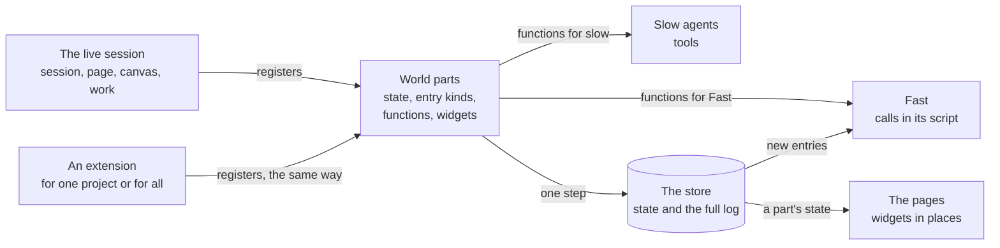

# The extendable world

[The world](../README.md) is made of named parts, and everything in it is
registered by one. The live session registers its four, and an installed
extension registers another the same way. This page says what a part is; the
pages under it say how its functions, its store and its widgets work.

## A world part

A world part is a named piece of the world: the session, the page, the
canvas, the work, or an extension's. It registers what it has of four things;
none is required.

1. **State: how things are now.** Data that changes. Widgets show it.
2. **Entry kinds: what happened.** A kind says its fields, the line Fast
   reads, an image when it has one, and whether it wakes Fast. An entry is
   never changed or dropped.
3. **Functions: what can be done.** A `get` reads state, a `set` changes it,
   an `action` does something. A function says its name, its input, what it
   runs and [who may call it](functions/README.md).
4. **Widgets: how it shows.** The widgets it brings and the
   [place](../../../../on-the-page/widgets/places/README.md) of each.

Three rules hold for every part:

- **The live session registers its parts the same way an extension does.**
  Nothing reaches the world any other way.
- **A `set` or an `action` changes state and adds its entries in one step.**
  State and entries cannot drift.
- **A function never tells Fast or Voice itself.** It adds an entry; the
  entry's kind decides whether Fast wakes; Fast decides what is said.

## The examples

The four bundled parts are the examples. Each page lists the part's state,
entry kinds, functions and widgets under the same four headings.

- [Session](../session/README.md) — two entry kinds, one of which wakes Fast,
  and two functions for Fast.
- [Page](../page/README.md) — functions for Fast that each add an entry, and
  no widget.
- [Canvas](../canvas/README.md) — state and a widget, with no entry kind of
  its own.
- [Work](../work/README.md) — functions for Fast and for slow agents, a
  `set`, an `action` and a `get`, and a section of the panel.

## Topics

- [Who may call a function](functions/README.md) — a function for Fast, for
  slow agents, for both or for a widget, and what the code asks of it.
- [The store](store/README.md) — one SQLite file for a session's state and
  its full log, and how an older session is moved into it.
- [Widgets and state on the page](on-the-page/README.md) — where a part's
  widgets go, and how a widget reads a part with `useWorld`.
- [Where an extension is enabled](enabling/README.md) — a part shipped in an
  extension package, for one project or for every project.
