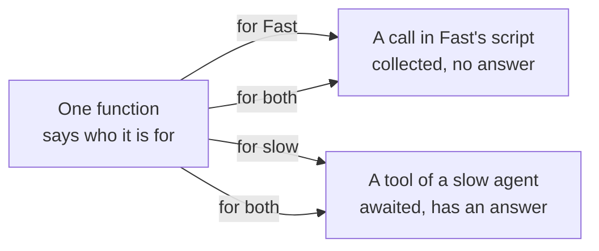

# Who may call a function

Every function of a [world part](../README.md#a-world-part) is written once
and says who it is for: Fast, slow agents, both, or a widget on the page. The
program offers it in the right form. This page says what each form is and
what the code asks of a function.



A module registers functions by their local names. These are the bundled
parts' own, from [session](../../session/README.md#functions) and
[work](../../work/README.md#functions):

```js
action("say",      { for: "fast" })
set("update",      { for: "slow" })
get("read_log",    { for: "slow" })
```

- A `set` or an `action` can be for Fast, slow agents, both, or a widget on the page.
- A `get` is for slow agents only. Fast's script gets no answer from a call;
  what Fast knows is the entries it was shown. Data meant for Fast is an
  entry kind.
- A function for Fast keeps what [a script](../../scripts/README.md#how-a-script-runs)
  is: its calls are collected and carried out when the script ends, and a
  script that throws does nothing.
- A function for both gives a slow agent its result at once, as the tool's
  answer. Fast gets it from the entry, one wake-up later, so the entry of a
  call Fast made wakes Fast.
- MCP is how a slow agent's functions are carried today. It is not part of
  the contract: an extension registers a function and writes no MCP.

## What the code asks of a function

- **A function for Fast has two halves.** One runs inside the sandbox and
  one outside, and nothing but text crosses between them. A registered
  function gets a generated sandbox half, which checks its input and records
  the call. The bundled parts' own checks stay their sandbox code: a quote on
  the page exactly once, an address from the list of pages, a message of the
  hand-over used. An extension's function has no check of its own inside the
  script.
- **A function runs with its caller.** Fast's run, with its hand-over and the
  messages its script used, or the agent that called. `say` needs the
  hand-over it answers; `spawn` needs the message and the part marked with it.
- **A function for Fast brings its line of Fast's brief.** The brief is
  put together when a context is built.
- **An extension's module is a function the program calls** with the
  registering calls in hand, the input's schema builder among them. It cannot
  import the program's packages from its own folder.
- **Each harness offers the functions declared for its caller.** The service
  dispatches a script's collected calls to the registered functions with
  Fast's caller context.

## An action that starts work

An action that starts external work can use `running.follow(async publish => …)`.
The producer starts after the action commits. Each awaited
`publish(write => …)` can read and set that part's state and add its entries
in a separate transaction. The original caller determines the wake rule
for those entries.
